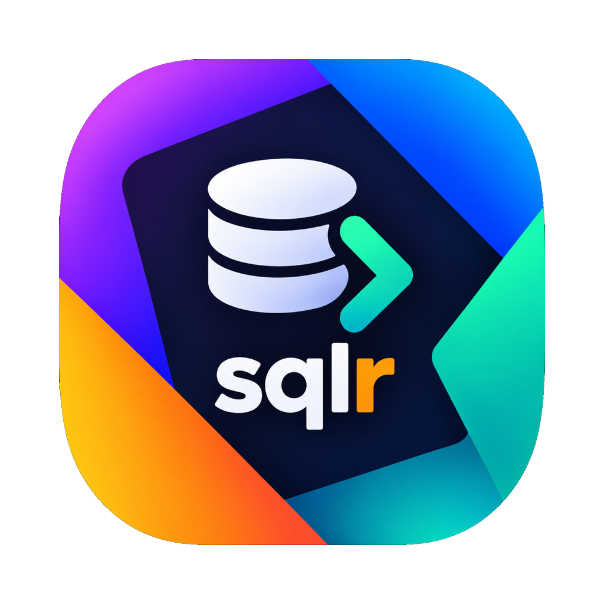
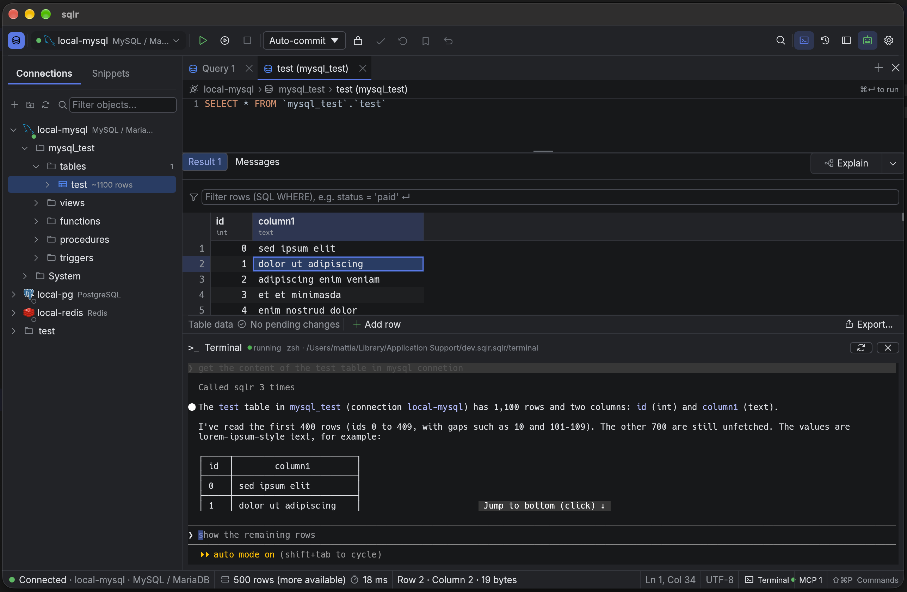

<p align="center"></p>

# sqlr

A universal database client: native Rust, egui, no webview. One app for relational, document and key-value databases and any other database you add through a driver you write in Rust. MIT licensed.




## Install

```sh
curl -fsSL https://raw.githubusercontent.com/mceck/sqlr/main/scripts/get-sqlr.sh | sh
```

Or get it from the [download page](https://mceck.github.io/sqlr/download.html)


## What it does

Link to [documentation](https://mceck.github.io/sqlr/usage/README.html).

- **Edit data in the grid**: double-click a cell, add/duplicate/delete rows, changes tinted until **Preview** (the generated SQL), **Apply** or **Discard**; concurrent changes are detected and named.
- **AI integration**: can be used and configured with your favourite AI agent through MCP.
- **SQL editor built for big scripts**: only visible lines are laid out; a 10 MB file scrolls and takes typing in well under a frame. Statement coloring, autocomplete, find/replace, multi-caret editing, SQL formatting (⌥⌘L), a command palette (⌘⇧P) over commands, snippets and history.
- **Profiles and commit modes** per connection: Development / Test / Production, each with its color, commit mode (**Auto**, **Manual**, **Smart**), read-only flag and confirmation rules for writes and destructive statements.
- **Object editors**: tables, views, indexes, sequences, functions, triggers, schemas and databases open in tabs with sub-tabs; edits stay pending until **Apply**, with a **Preview DDL** first. Create, rename (F2), drop, truncate, generate SQL, copy DDL.
- **Export and import**: CSV, TSV, JSON, JSON Lines, SQL `INSERT`, Markdown with column mapping, batching in one transaction, and bad rows reported by line.
- **Dump and restore** through the native tools (`pg_dump`, `mysqldump`, `sqlite3`, …): streaming logs, exact command line visible, passwords never on the command line, native tools run over the SSH tunnel.
- **Transfer data** between any two connections or between a connection and a file (CSV, TSV, JSON, JSON Lines, XLSX, Parquet): mapped columns, type mapping across dialects, upserts, FK switches, bounded batches. Wizards can be saved as **tasks** with a run history.
- **Schema tools**: compare two schemas with a side-by-side DDL diff and a migration script that orders itself; ER diagrams with saved layout; **Explain / Explain Analyze** as a cost tree with estimated-vs-actual badges.
- **Admin**: users and roles with a per-object privilege grid, sessions with a lock-waiting tree and cancel/terminate, server properties with search.
- **NoSQL, first-class**:
  - **MongoDB** a Mongo shell subset parsed by sqlr itself (no JavaScript engine), results as table, tree or JSON, in-place document editing, index management.
  - **Elasticsearch** Kibana-console style requests, ES|QL and SQL, document editing, index management.
  - **Redis** `SCAN`-only key browser, typed value views, TTL editing, console.

## Supported databases

| Database | Driver | Notes |
|---|---|---|
| PostgreSQL (and compatible servers) | `tokio-postgres` | TLS (`disable` … `verify-full`, rustls), SSH tunnel |
| MySQL 8 / MariaDB 11 | `mysql_async` | TLS (rustls), SSH tunnel |
| SQL Server 2016+ | `tiberius` (rustls) | native TDS, SQL and Windows-less authentication, SSH tunnel |
| Oracle 12c+ | `oracle-rs` (pure Rust) | no Oracle Instant Client or OCI, TLS, SSH tunnel |
| SQLite 3 | `rusqlite` (bundled) | files, read-only open |
| DuckDB | sidecar with the bundled `duckdb` engine (downloaded in the Driver Manager) | files and in-memory databases, read-only open, no Java or system library, [docs/drivers/duckdb.md](docs/drivers/duckdb.md) |
| Snowflake | SQL API via `reqwest` (rustls) | HTTPS, OAuth/PAT/JWT tokens, [connection notes](docs/drivers/snowflake.md) |
| MongoDB | `mongodb` (rustls) | [Mongo shell subset](docs/tech/mongo-shell-subset.md), TLS, SSH tunnel |
| Elasticsearch 7.17 / 8.x | `reqwest` (rustls) | Kibana-console requests, ES\|QL and SQL, SSH tunnel |
| Redis (standalone) | `redis` (rustls) | key browser, console, TLS, SSH tunnel |
| Db2, ClickHouse, H2, any JDBC | JDBC bridge sidecar (downloaded in the Driver Manager, Java 17+) | [docs/drivers/jdbc.md](docs/drivers/jdbc.md) |

A connection can be pasted as a URL (`postgresql://user@host:5432/db`, `sqlite:/path`, …); a password inside a URL is refused.

## Extending: write your own driver

Drivers run as separate processes against a fixed protocol a crash takes down only its connections, never the app.

1. Generate a skeleton from `templates/sqlr-driver-template`.
2. Implement the driver with [`sqlr-driver-sdk`](crates/sqlr-driver-sdk) and launch it with `run(MyDriver)`.
3. Check it with the conformance suite in `crates/sqlr-driver-tests`.
4. Package it with `scripts/package-driver.sh` and install it through **Settings → Drivers… → Install from file…**. The Driver Manager keeps every version, so rollback and removal need no restart. Drivers published with a sqlr release (HANA, DuckDB, the JDBC bridge) download from the release instead.

Start with [docs/tech/writing-a-driver.md](docs/tech/writing-a-driver.md) and [docs/tech/driver-protocol.md](docs/tech/driver-protocol.md).

## Architecture

| Crate | Role |
|---|---|
| `sqlr-core` | domain types, columnar chunks, driver traits |
| `sqlr-driver-*` | one driver per database (PostgreSQL, MySQL, SQL Server, Oracle, SQLite, Mongo, Elasticsearch, Redis, JDBC) |
| `sqlr-engine` | tokio runtime off the UI thread: sessions, catalog cache, results, history, sidecar drivers |
| `sqlr-sidecar` | sidecar protocol, `SidecarDriver` client, `serve` loop |
| `sqlr-registry` | driver-file installs, versions and a local-file review step (no UI) |
| `sqlr-driver-sdk` | write a driver as a sidecar: re-exports the API, `run` |
| `sqlr-store` | connections TOML, encrypted credential vault, settings |
| `sqlr-ui` | egui widgets (grid, tree, forms) |
| `sqlr-mcp` | loopback MCP server, tools and agent policy |
| `sqlr-terminal` | PTY session, vt100 parser and terminal widget |
| `sqlr-app` | binary: wires everything |
| `sqlr-testkit` | `FakeDriver` for tests (dev-dependency) |

Hard rules that keep it fast and safe: the UI thread never does I/O or blocks (database, keychain and vault work runs on background workers), connections use rustls only (no OpenSSL), passwords never reach plaintext files, logs or `Debug` output, and identifiers in generated SQL always go through `Dialect::quote_ident`.

## Build and run

```sh
cargo build --release -p sqlr-app
cargo run --release -p sqlr-app
```

`sqlr --help` lists `--config-dir` and `--data-dir`, so a second profile is just another pair of directories. The welcome screen's **Open demo database** builds a small SQLite database with sample tables, for trying the app without a server.

### macOS app bundle

```sh
scripts/package-macos.sh
open dist/sqlr.app
make install-fast # build in release mode without optimizations and install to /Applications
```

The script builds the release binary and wraps it in `dist/sqlr.app` with `docs/media/icon.png` as the app icon, then ad-hoc signs the bundle. Double-clicking it launches sqlr as a normal app, with its own Dock icon and no terminal window; drag it to `/Applications` to install. `--bin target/release/sqlr` bundles an existing binary instead of rebuilding. Distributing the app to other Macs needs a Developer ID signature and notarization (`--sign "Developer ID Application: …"`).

## Tests

```sh
make test           # every Docker service + nextest (services stop at the end)
make test KEEP_TEST_SERVICES=1  # reuse services across full test runs while iterating
make test-fast      # no database services: UI and unit tests only
make coverage       # the whole suite under llvm-cov; Docker services start and stop
make coverage-fast  # no Docker: UI and unit tests only
```

`make test` starts every service from `docker-compose.test.yml` — PostgreSQL, MySQL,
MariaDB, MongoDB, Redis, Elasticsearch, SQL Server and Oracle — and runs the full matrix.
Nothing starts a server per test: Postgres/MySQL tests get a fresh database on the fixed
server, and the few tests that touch server-global state serialize through a cross-process
lock. The first run also starts Oracle and three Elasticsearch nodes; later runs reuse the
volumes, and `make test-services-reset` recreates them from empty. On Docker Desktop for
macOS set `DOCKER_HOST=unix://$HOME/.docker/run/docker.sock`.

`make test-services` starts the containers without running tests. TLS certificates for the
test services are generated into `.test-services/certs` (ignored by git).

For repeated full runs, use `make test KEEP_TEST_SERVICES=1`. It starts any missing
services and keeps them running afterwards, including when a test fails, avoiding
database startup and teardown on every iteration. Stop them when finished with
`scripts/test-services.sh down`. Plain `make test` still tears down the services.

`make coverage` excludes SAP HANA, writes `target/coverage/` (`summary.txt`,
`per-crate.txt`, `lcov.info`, `html/`) and fails when a crate is below 80% lines.
`make coverage-open` opens the HTML report. `scripts/coverage.sh --fast --check` runs the
same in a Docker-free environment.

To run the suite directly, start the services once and then use nextest:

```sh
scripts/test-services.sh up
cargo nextest run --workspace --profile containers
```

App, engine, UI, PostgreSQL, MySQL/MariaDB and SQLite integration tests share an
executable per crate to reduce linking and disk use; app smoke tests and engine
peak-memory tests keep their own executables.
Register new test modules in `tests/integration.rs`. To select a module, use e.g.
`cargo nextest run -p sqlr-ui -E 'test(/^editor::/)'` or
`cargo test -p sqlr-ui --test integration editor::`.

The workspace build also builds the sidecar fixtures. Before package-only runs that
use them, run `cargo build --workspace --examples --bins` with the same profile and
target. Sidecar tests use those binaries directly instead of invoking Cargo per test.
After upgrading from the previous test layout, `cargo clean` once removes obsolete
test executables and incremental caches. Regular test runs reuse the build outputs.

Editor performance budgets: `cargo run --release -p sqlr-ui --example editor_measure`.

## Where things live

| What | Where |
|---|---|
| Connections (no secrets) | `connections.toml` in the config directory |
| Global settings | `settings.toml` in the config directory |
| Profile / connection overrides | `overrides.toml` in the config directory |
| Keymap | `keymap.toml` in the config directory |
| Profiles | `profiles.toml` in the config directory |
| Installed drivers | `drivers/<id>/<version>/` in the data directory |
| Secrets (passwords, SSH secrets, MCP token) | encrypted `secrets.vault` in the config directory; its encryption key lives in the OS keychain, service `sqlr` |
| History, snippets | `sqlr.db` in the data directory |
| Logs (newest fourteen daily files) | `logs/sqlr.log.<date>` in the data directory |
| Local incidents (twenty files or thirty days) | `diagnostics/<incident-id>.json` in the data directory |

MacOS: both under `~/Library/Application Support/dev.sqlr.sqlr/`. Linux: `~/.config/sqlr/` and `~/.local/share/sqlr/`. Help → Diagnostics shows local reports and a session-only log level (default `info`); `RUST_LOG` takes precedence. See [Troubleshooting](docs/usage/troubleshooting.md) for reports, bundles and SQL privacy.

## License

MIT, see [LICENSE.md](LICENSE.md).

CI runs formatting, clippy, dependency constraints and full tests on Linux and macOS; startup time, release size, million-row grid scrolling and editor budgets are enforced on both platforms. See [docs/tech/performance-budgets.md](docs/tech/performance-budgets.md).
