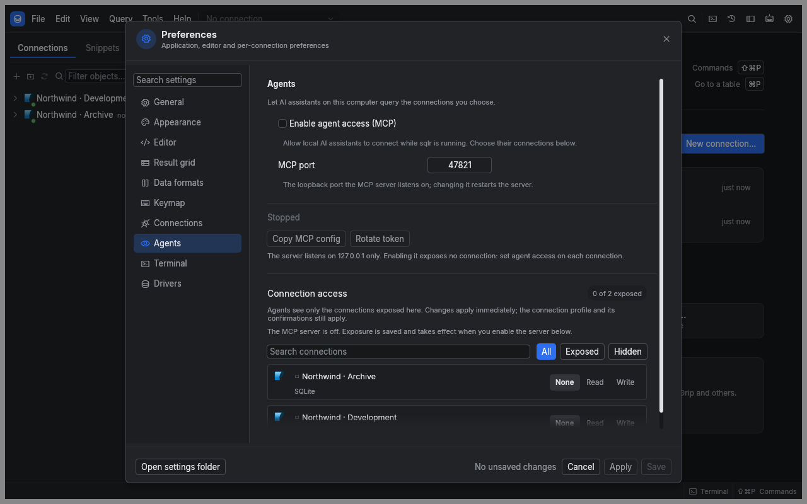

[Manual](README.md) › Integrations

# Use an agent or the integrated terminal

Connect a local agent to work with sqlr's database tools and open editor tabs, and give it the sqlr skills so it knows how. You can also use the integrated terminal as a shell, with agent access turned on or off.

## Decide which connections an agent may use

MCP is off by default. Turning it on does not expose your connections: each connection has a separate **Agent access** level.

| Level | Agent access |
|---|---|
| **None** | The connection is hidden and cannot be queried |
| **Read** | Browse objects and run reads in a read-only agent session |
| **Write** | Run reads and writes, subject to the profile's read-only setting and confirmations |

1. Open **Settings…** and select **Agents**.
2. Find the connection under **Connection access**, using **Search connections** or the **All**, **Exposed** and **Hidden** filters.
3. Select **Read** or **Write**. The change applies and saves immediately.

You can also change **Agent access** in the explorer context menu or directly in the connection dialog. New, imported, duplicated and agent-created connections start at **None**. An agent cannot change this permission. Setting it back to **None** closes that connection's agent sessions.

## Connect your agent

1. In **Agents**, enable **Enable agent access (MCP)**.
2. Wait for the running status. The default endpoint is `http://127.0.0.1:47821/mcp`.
3. Under **Agents on this computer**, find your agent and choose **Install**. The first time, sqlr asks you to confirm that it writes its token into that agent's configuration file.
4. Restart the agent so it loads sqlr, and keep sqlr open while you use it.

sqlr lists Claude Code, Codex CLI, Gemini CLI, Cursor, VS Code and OpenCode, each with its configuration file and state. **Install** adds only sqlr's entry and keeps the rest of the file, comments included; a copy of the original is saved beside it as `<file>.sqlr-backup` before the first change. **Remove** takes sqlr's entry out again. An agent shown as **Outdated** has an entry that no longer matches the running server: choose **Update**, then restart the agent. An agent shown as **Manual setup** has a file sqlr cannot read: choose **Copy config** and add the entry by hand.

For any other MCP client, use **Other agent… → Copy MCP config** and paste the configuration into the client's MCP settings. It includes a bearer token. Keep it private. **Copy endpoint** copies only the address. The token-free `mcp.json` discovery file in the data directory also publishes the endpoint while the server runs.

**MCP port** accepts ports 1024 through 65535. Changing it restarts the server and disconnects clients. **Rotate token** replaces the credential and disconnects all MCP sessions. sqlr rewrites the entry of every agent it installed in both cases, so restarting the agent is enough; a client set up with **Copy MCP config** needs the configuration copied again. Disabling MCP or quitting sqlr ends agent work and removes the discovery file, and keeps the installed entries for next time.

## Give your agent the sqlr skills

The sqlr skills teach an agent how to work with sqlr: which tools to use for a task, in what order, and which rules to follow.

| Skill | Use it to |
|---|---|
| `sqlr-configure` | Change settings, profiles, shortcuts and connection folders |
| `sqlr-create-connection` | Add a connection, store its credentials and test it |
| `sqlr-edit-user-query` | Fix, run or explain the query open in your editor tab |
| `sqlr-query-database` | Explore a schema and query a database on the agent's own session |
| `sqlr-connect-agent` | Diagnose missing sqlr tools or a failing connection to sqlr |

The integrated terminal's workspace already holds them. To add them to an agent you use elsewhere, run `npx skills add mceck/sqlr` for all of them, or `npx skills add mceck/sqlr --skill sqlr-query-database` for one.

## Understand what tools can do

| Area | Available to an agent | Kept under your control |
|---|---|---|
| Database | Browse, describe, search and query exposed connections | Exposure level and profile protections |
| Editor | Read and edit query text with a revision check; run a statement, selection or script; open a tab with a proposed query; show objects and plans | Closing and saving editor tabs |
| Library | Read and manage snippets and saved configuration | Approval for snippet and configuration deletion |
| Configuration | Read permitted settings; update permitted connection settings and secrets | MCP settings, application updates and terminal shell command |
| Operations | Inspect progress and cancel work | Integrated terminal input, output and lifecycle |
| Credentials | Write a credential when needed | Reading stored secrets |
| Drivers | Inspect declared driver fields | Installing and removing drivers |

An agent session has its own database transaction, separate from your editor and other clients. Ending an MCP session rolls back its open transactions. An agent cannot loosen a safety flag or move a connection to a less protective profile.

When a tool reports `secret_required`, provide the missing connection credentials through sqlr or your approved configuration workflow, then retry.

## Review an approval

When a profile requires confirmation, an agent's request opens an approval showing the client, connection, profile, risk and exact statement. Read the statement before allowing it.

**Deny** is initially focused. Escape denies, and an unanswered approval expires after 60 seconds. Deleting configuration or a snippet also requires approval. An agent receives `denied` or `timeout` when the request is refused or expires.

The server supports eight MCP sessions. Idle sessions close after 30 minutes. Result pages default to 200 rows, accept up to 1,000 rows and stay within 256 KiB. A result expires after five minutes without access; rerun it after expiry.

## Open a terminal

1. Choose **View → Terminal**, use the toolbar toggle, or press Ctrl+Backtick.
2. Use your shell. It starts when the terminal first opens and keeps running while the panel is hidden.
3. Use the header actions to **Clear** the display, **Restart** the shell or **Kill** its process group.

Quitting sqlr also stops the terminal process group. A shell that has exited shows its exit code.

| Action | macOS | Windows and Linux |
|---|---|---|
| Copy selected text | ⌘C | Ctrl+Shift+C |
| Paste | ⌘V | Ctrl+Shift+V |
| Interrupt command | Ctrl+C | Ctrl+C |

In **Settings… → Terminal**, an empty **Shell command** uses your login shell. An empty **Working directory** uses sqlr's configuration `terminal` folder, containing an `AGENTS.md` and the sqlr skills. sqlr keeps the skills and the marked section of `AGENTS.md` current; add your own instructions outside the markers. **Font size** applies immediately; restart the shell for the remaining terminal changes.

Terminal output and the configured shell command are excluded from logging. MCP cannot read or control this terminal. sqlr does not start an agent automatically or put the MCP token in the shell environment. An agent you launch there reaches sqlr through its installation from **Settings → Agents**, and uses the same connection access rules as any other MCP client.

## Fix a connection problem

| Message or symptom | What to do |
|---|---|
| **Port busy** | Choose another **MCP port**, or stop the program using it |
| **Keychain error** | Unlock the OS keychain, then disable and enable MCP again |
| Agent has no sqlr tools | Choose **Install** for that agent in **Settings → Agents**, then restart the agent |
| `401 Unauthorized` | Restart the agent; if it shows **Outdated**, choose **Update** first. For a client set up by hand, copy the current MCP configuration |
| `403 Forbidden` | Use the local loopback endpoint with a local client; remote hosts and unrelated browser origins are rejected |
| Connection absent or `not_exposed` | Set that connection's **Agent access** to **Read** or **Write** |
| Expired result or approval | Rerun the query or request and review the new approval |

## Related

- [Connections](connections.md): save credentials and configure database access.
- [Profiles and transactions](profiles-and-transactions.md): understand write protections.
- [Troubleshooting](troubleshooting.md): review local logs and reports.

---

← [Settings and shortcuts](settings-and-shortcuts.md) · [Glossary](glossary.md) →
