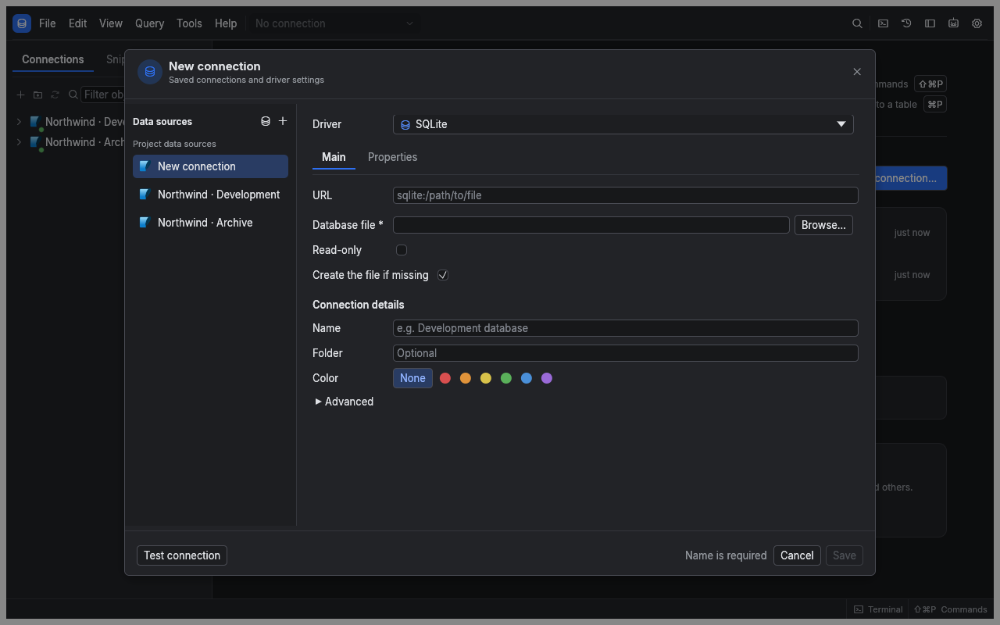

[Manual](README.md) › Connections

# Connect to a database

A saved connection records where your database is and how to reach it. Opening it creates live sessions for browsing and running queries. Your database account determines which objects and operations you can use.

## Choose a database

| Available with the app | Install a sidecar driver first |
| --- | --- |
| PostgreSQL, MySQL/MariaDB, SQLite, SQL Server, Oracle, Snowflake | DuckDB, SAP HANA |
| MongoDB, Elasticsearch, Redis | JDBC databases through the JDBC bridge, requiring Java 17+ |

The database picker also includes compatible services with preset ports and options. An entry marked as planned does not provide a working connection. See [Drivers](drivers.md) for installation and database-specific requirements.

## Save and test a connection

1. Choose **New connection** from the explorer or command palette.
2. Select the database in **Data sources**.
3. Give the connection a **Name** you will recognise later.
4. Complete the driver's fields. A server normally needs host, port, database and user; SQLite needs a file path.
5. Enter passwords or tokens in the masked secret fields.
6. Expand **Advanced** and choose a **Profile**. Use [Profiles and transactions](profiles-and-transactions.md) to decide which write protections you need.
7. Enable **Save password securely on this device** if you want sqlr to retain credentials.
8. Choose **Test connection** to check access, server version and round-trip time.
9. Choose **Save**. Open the saved connection from the explorer when you want to work.

Testing uses a temporary session. Saving keeps the definition; it does not prove that every database operation is permitted.

## Fill the form from a URL

Paste a connection URL into **URL**, for example `postgresql://analyst@db.example.test:5432/shop`. sqlr fills recognised fields. Enter secrets separately: a URL containing a password or token is refused with **Remove the password from the URL; enter it in the Password field**.

SQLite and DuckDB URLs can identify local files. DuckDB also accepts `:memory:` for a database that disappears when its session ends.

## Configure SSH and TLS

Use the **SSH** group to enable a tunnel. Supply the SSH host, user and authentication method: password, key file or SSH agent. A private key may need a passphrase. One optional jump host is supported, using the same authentication method for both hops.

New SSH host keys are not trusted by default. Check the host identity before enabling **Trust new host keys**. Tunnel settings also apply to supported native dump and restore tools.

Use the driver's TLS or SSL fields to enable encryption and certificate verification. Most network drivers begin without TLS unless configured otherwise. PostgreSQL supports SSL modes through `verify-full`, with root and optional client certificates. TLS 1.0 and 1.1 are unsupported. Snowflake always uses verified HTTPS.

## Manage saved connections

Right-click a connection for connection, editing, duplication, refresh and removal actions. Group connections in folders and drag them into order. Duplication gives the copy a new name and resets agent exposure to **None**.

Each editor gets a separate session by default. Transactions and read-only choices belong to that session. Turning off per-editor sessions in **Connections** preferences affects newly opened tabs; existing editor sessions remain until their tabs close. Disconnecting a connection closes all its sessions, with a transaction decision when needed.

Snowflake requests use independent auto-commit SQL API calls. Persistent transactions, cross-request `USE` changes and editable result cells are unavailable; set database, schema, warehouse and role in the form.

## Keep credentials portable

Definitions live in `connections.toml`; secrets live in the encrypted `secrets.vault`, whose key is protected by the OS keychain. An unlock is reused until you quit. If saving credentials is off, sqlr asks when connecting and retains entered secrets in memory for that app run.

Copying the vault to another computer or config path does not transfer its key. Use an explicit [connection export](migrating-connections.md) when moving credentials. A keychain or vault error is reported without replacing saved credentials.

## Related

- [Migration](migrating-connections.md): import definitions from another client.
- [Troubleshooting](troubleshooting.md): investigate failed connections.

---

← [First query](getting-started.md) · [Move saved connections](migrating-connections.md) →
