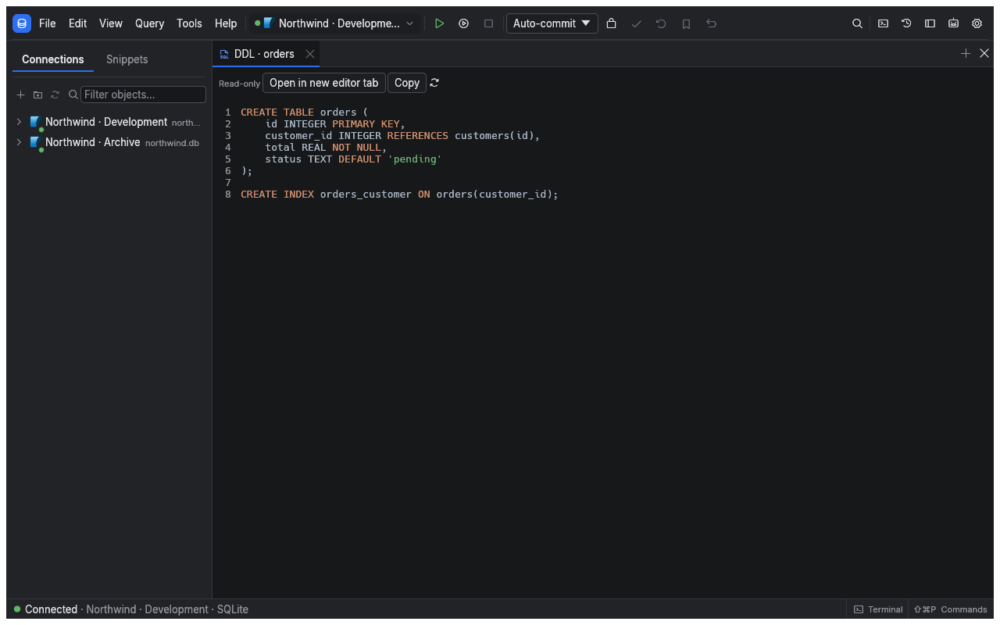

[Manual](README.md) › Everyday work

# Explore and change database objects

Use the explorer to find objects, browse their data and open their definitions. Object editors let you collect structural changes and review their DDL before applying them. Available actions depend on the driver and your database permissions.

## Find an object

1. Expand a connection with its arrow.
2. Expand its databases or schemas, then the object group you need.
3. Use the explorer's filter field to narrow the tree.
4. Right-click an object to see its available actions.

Children load as you expand the tree. Previously loaded catalog information is cached, so names can appear before a server refresh finishes. Use **Refresh** after changes made by another client. Successful DDL run through sqlr invalidates its catalog cache.

The explorer hides folders that are empty, such as a schema with no views or functions, so the tree lists only what exists. The **Tables** folder is always shown. To keep empty folders visible, turn on the empty-folders option in **General** preferences.

Relational connections group tables, views and other supported objects under databases or schemas. MongoDB shows databases and collections; Elasticsearch shows indices; Redis shows numbered databases. Use [Document and key-value databases](nosql.md) for their specialised views.

For a quicker route, press ⌘P, type part of an object name and select a match. The object palette searches known catalog entries across connections.

## Choose the right action

| Action | Result |
| --- | --- |
| **Open data** | Browse a table or view's rows |
| **Edit** | Open the object's editor |
| **Open DDL** | Open its definition in a read-only editor tab |
| **Copy DDL** | Put the definition on the clipboard |
| **Generate SQL** | Create a statement template for the selected object |
| **Import/Export** | Open available data movement tools |
| **Rename**, **Drop**, **Truncate** | Change the object or remove data, subject to permissions and confirmations |

An unavailable action can mean the driver does not support it, the object has the wrong kind, or the session is read-only. Templates are starting points: review them before running.

## Edit a table or another object

1. Open the object's **Edit** action.
2. Select the relevant sub-tab, such as **Columns**, **Indexes**, **Constraints** or **Foreign keys**.
3. Make your changes. They remain in the schema change list.
4. Choose **Preview DDL** to inspect the generated statements.
5. Choose **Apply** to execute them, or **Revert** to remove the pending changes.

A table editor can also provide **Triggers**, **Permissions**, **DDL**, **Data** and **Properties**. Views, routines, sequences and other supported objects have their own pages. The driver determines which pages and fields can be changed.

Where the database supports transactional DDL, sqlr applies a batch as one transaction. Other databases execute the statements sequentially: a failure can leave earlier changes applied, and the outcome identifies progress. Review the result before retrying.

## Create, rename or remove objects

Use the explorer's **New ...** actions for the selected database or schema, or find the corresponding command in ⌘Shift+P. Only object kinds supported by the driver are offered.

Select an object and press F2 to rename it where supported. Before **Drop** or **Truncate**, check the active connection and profile. These actions follow [write and destructive-statement protections](profiles-and-transactions.md); database grants still apply.

If a database drop fails because it is in use, sqlr opens a **Database in use** dialog. It keeps the server error visible and lists the sessions connected to that database, with their id, user, client and state. Choose **Terminate session** (after confirming) to close one, **Refresh** to reload the list, and **Retry drop** to run the drop again. Terminating a session interrupts its work and rolls back its open transactions; a session belonging to sqlr asks for a second confirmation. Read-only profiles block both actions.

The **Data** page edits rows, while structure pages edit the schema. A row changeset and a schema change list are separate: review and apply each in its own view.

## Related

- [Results and editing](results-and-editing.md): change table contents.
- [Schema tools](schema-tools.md): compare definitions and view relationships.

---

← [Move saved connections](migrating-connections.md) · [Write and run SQL](sql-editor.md) →
