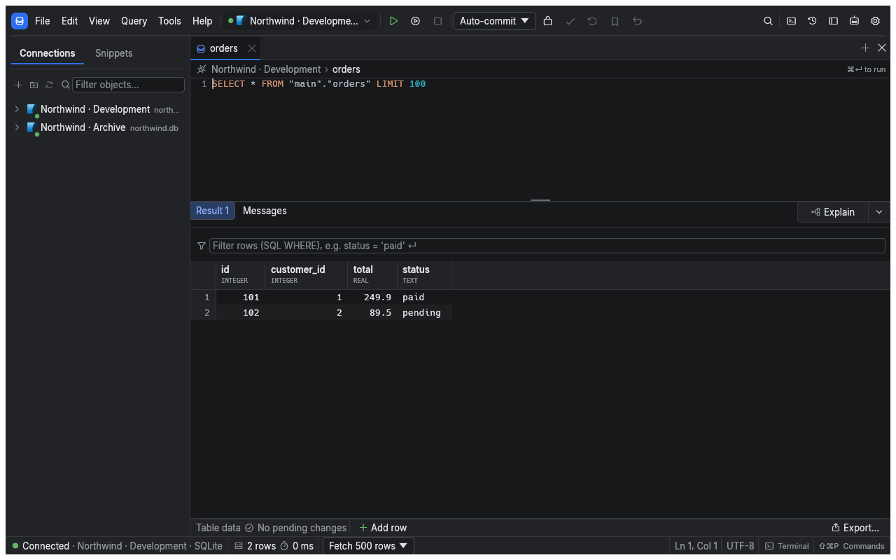

[Manual](README.md) › First steps

# Run your first query

Start with the included demo database to learn the workspace without configuring a server. sqlr runs locally on macOS, Windows and Linux; you sign in to your databases, rather than to a sqlr account.

## Install and open sqlr

Download the build for your operating system and architecture from the [download page](../download.html). On macOS, open the DMG and copy sqlr to Applications. On Windows, extract the ZIP and run the executable. On Linux, use the AppImage or extract the archive and run `sqlr`.

The repository also provides an installer for macOS and Linux:

```sh
curl -fsSL https://raw.githubusercontent.com/mceck/sqlr/main/scripts/get-sqlr.sh | sh
```

The installer checks the release checksums. Linux installs under `~/.local` by default; macOS uses `/Applications`, falling back to `~/Applications` when needed. Set `SQLR_VERSION` to choose a release or `SQLR_PREFIX` to change the Linux installation prefix.

## Open the demo

1. Start sqlr and choose **Open demo database** on the welcome screen.
2. Wait for the **Demo** connection and its editor tab to appear.
3. Run the prefilled query with ⌘Enter:

```sql
SELECT * FROM order_summary LIMIT 100;
```

The result appears below the editor. The demo contains customers, employees, products, orders and order items, all generated sample data. It is a persistent SQLite file in your data directory, so edits survive restarting the app.



Screenshots in this manual use an isolated sample connection; your demo's connection name and rows may differ.

## Find your way around

| Area | Use it to |
| --- | --- |
| Explorer, left | Expand connections, schemas and objects, or right-click for actions |
| Editor and object tabs | Write queries, inspect definitions and browse data |
| Results and **Messages** | Read returned rows, errors, notices and timing |
| Value panel | Read a selected value in full |
| Toolbar | Choose the active connection, run or stop work, and manage transactions |
| Status bar | Check row counts, timing, transaction state and cursor position |

Panels can be rearranged by dragging their dock tabs. sqlr remembers the arrangement.

1. Expand **Demo** in the explorer, then its schema and tables.
2. Open a table to inspect its columns or data.
3. Open the command palette with ⌘Shift+P and search for a command.
4. Open the object palette with ⌘P and type part of a table or view name.

Shortcuts in this manual use the sqlr preset on macOS. Use Ctrl instead of ⌘ on Windows and Linux; see [Settings and shortcuts](settings-and-shortcuts.md) for the full keymap.

## Connect your own database

Use **New connection**, select your database and fill in the connection form. Choose **Test connection** before **Save**. Follow [Connect to a database](connections.md) for credentials, TLS and SSH.

## Related

- [SQL editor](sql-editor.md): choose between running one statement and a script.
- [Results and editing](results-and-editing.md): browse rows and make pending edits.

---

← [Manual](README.md) · [Connect to a database](connections.md) →
