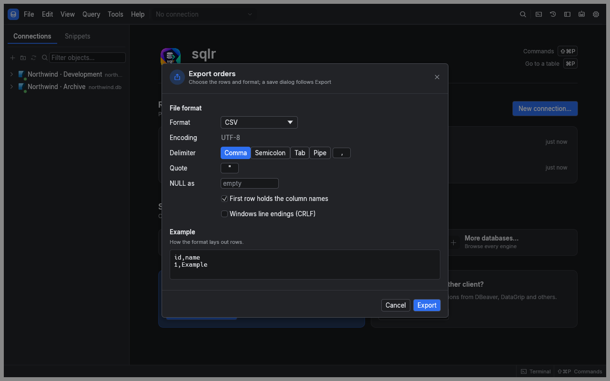
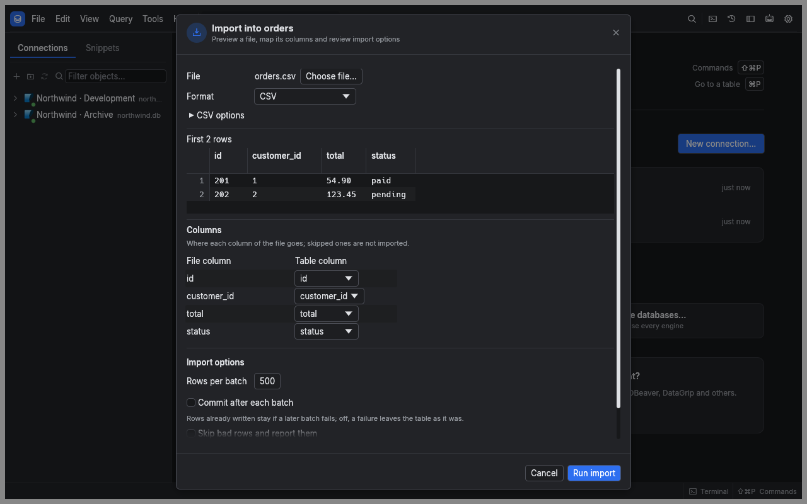
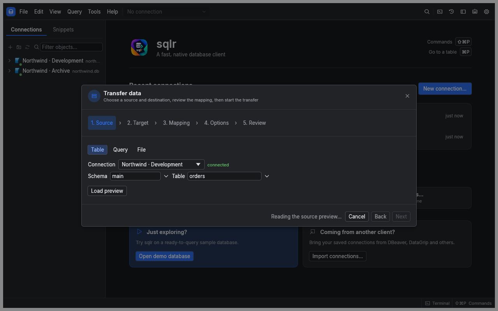
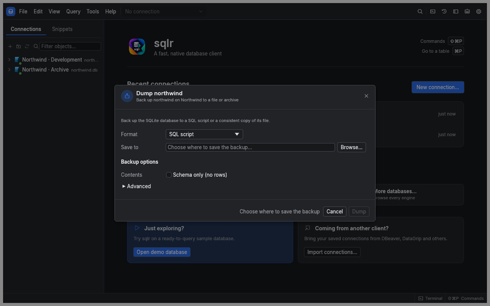

[Manual](README.md) › Data tools

# Import, export and back up data

Use an export for a file of rows, a data transfer for a mapped copy, or a dump for a database backup. You need permission to read the source and, for imports and restores, to write the destination.

## Choose a tool

| Your goal | Use |
|---|---|
| Paste selected values into a spreadsheet | Copy from the result grid |
| Save query rows as CSV or JSON | Export result |
| Load a file into a table | Import from the table's explorer menu |
| Copy a table to another connection | **Transfer data…** in the command palette |
| Preserve database structure and data for recovery | Dump and restore |

Copying into another grid creates a changeset: review the column mapping in **Paste as new rows…**, then use **Apply** to write the rows. See [Results and data editing](results-and-editing.md).

## Export query results

1. Run the query and open its result.
2. Open the export action from the result strip or command palette.
3. Choose the file format and destination.
4. Review the sample and format options.
5. Start the export and watch its progress.

You can export CSV, TSV, a JSON array, JSON Lines, SQL `INSERT` statements or a Markdown table. Delimited formats let you choose the header, delimiter, quote character, NULL text and line endings. SQL export also needs the destination table name.

For a partially loaded result, choose between its loaded rows and rerunning the whole statement. The whole-statement option requires a read statement. Rerunning reads the database again, so the export can reflect changes made since the result appeared.

Exports use raw values unless **Use for export** is enabled under **Data formats** in Preferences. A successful export replaces its temporary output with the finished file; cancelling or failing removes the partial output.

## Import a file into a table

1. Right-click the destination table in the explorer and open its import action.
2. Choose a CSV, TSV, JSON array or JSON Lines file.
3. Check the sample rows and detected columns.
4. Map each file column to its destination column. Leave automatic IDs unmapped when the database should generate them.
5. Review the batch and error options, then start the import.

An unmapped destination column uses its default or nullability rules. Conversion errors identify the affected row and column. JSON Lines expects one object per line; a JSON array expects one array containing objects.

## Copy between connections

Open the command palette with ⌘⇧P and choose **Transfer data…**. The wizard keeps your choices when you move back between steps.

1. In **Source**, choose a table, read-only query or file. Check the preview before continuing. File sources include CSV, TSV, JSON, JSON Lines, Excel `.xlsx` sheets and Parquet.
2. In **Target**, choose an existing table, a new table or a file. For a new table, enter its name and review the generated column types.
3. In **Mapping**, choose the destination for each source column, or skip it. You can trim text, change case, turn blank text into NULL, supply a constant or request a type conversion. This step appears for table targets.
4. In **Options**, choose the batch size and write behavior.
5. In **Review**, check both endpoints, column mappings, warnings and any new-table DDL. Choose **Run transfer**.

Table and query sources cannot be copied into a table on the same saved connection through this wizard. Use `INSERT … SELECT` in an editor for that case. A table target needs a transaction-capable, writable session with no open transaction.

New-table type conversion can lose information. For example, a timestamp with a time zone may become a UTC timestamp without its zone, and an unfamiliar type may become text. Review every warning and the editable DDL before running.

### Control writes and rejected rows

| Option | Effect |
|---|---|
| **Rows per batch** | Sets the requested batch size; the engine writes at most 10,000 rows per batch |
| **Commit after each batch (a cancel keeps the committed batches)** | Keeps completed batches if you stop later; otherwise one commit covers the transfer |
| **Delete the target's rows first** | Removes existing data before loading; requires confirmation |
| **Update rows that exist, by key** | Updates matching rows instead of inserting duplicates; choose the identifying key columns |
| **Switch foreign keys off during the load** | Temporarily relaxes foreign-key checks; requires confirmation |
| **Skip bad rows and report them** | Records rejected rows instead of failing on the first one |

When skipping bad rows, choose a **Rejected rows file**. It contains the row position, reason and source values. The dialog shows the first 100 rejections, and the transfer stops at 1,000 rejected rows. Keep this file private if the source contains sensitive values.

Use **Stop transfer** to cancel. Read the final counts of rows read, written and rejected before retrying, especially if you enabled per-batch commits.

## Dump a database

Start from a database node in the explorer, or SQLite's `main` schema, and choose the dump action.

| Database | Backup formats | Native tools |
|---|---|---|
| PostgreSQL | SQL, custom archive, tar, directory | `pg_dump` |
| MySQL and MariaDB | SQL | `mysqldump` |
| SQLite | SQL or database file | `sqlite3` for SQL; online backup for a database file |

1. Choose the output path and format.
2. Select schema-only or data-only output if needed.
3. Review the database-specific options and displayed command. PostgreSQL directory output supports parallel jobs; MySQL offers routines, events, triggers and a consistent snapshot.
4. Choose **Dump** and follow the log.

sqlr finds native tools on `PATH` and in common installation directories. If discovery fails, install the database's client tools or set **Executable** in the dialog. Passwords are passed through the tool's environment or a private temporary file, and SSH connections use the existing tunnel.

## Restore a backup

1. Open the restore action on the destination database.
2. Select the backup and its format.
3. Review the destination and options, including whether existing objects will be removed.
4. Choose **Restore** and answer any confirmation.
5. Read the outcome and refresh the explorer after completion.

PostgreSQL SQL scripts use `psql`; archive formats use `pg_restore`. MySQL SQL uses `mysql`. SQLite accepts a SQL script or a database-file backup.

> **Warning:** Restoring a SQLite database file replaces the destination's contents. Cancelling a restore stops the tool but may leave changes it already wrote. Check the destination before retrying.

These dialogs configure a single run. They do not currently offer a Tasks panel or a **Save as task** action.

## Related

- [Results and data editing](results-and-editing.md): copy rows and apply pasted changesets.
- [Profiles and transactions](profiles-and-transactions.md): understand write protection and commit modes.
- [Schema tools](schema-tools.md): compare structures or generate sample data.

---

← [Profiles and transactions](profiles-and-transactions.md) · [Schema tools](schema-tools.md) →
