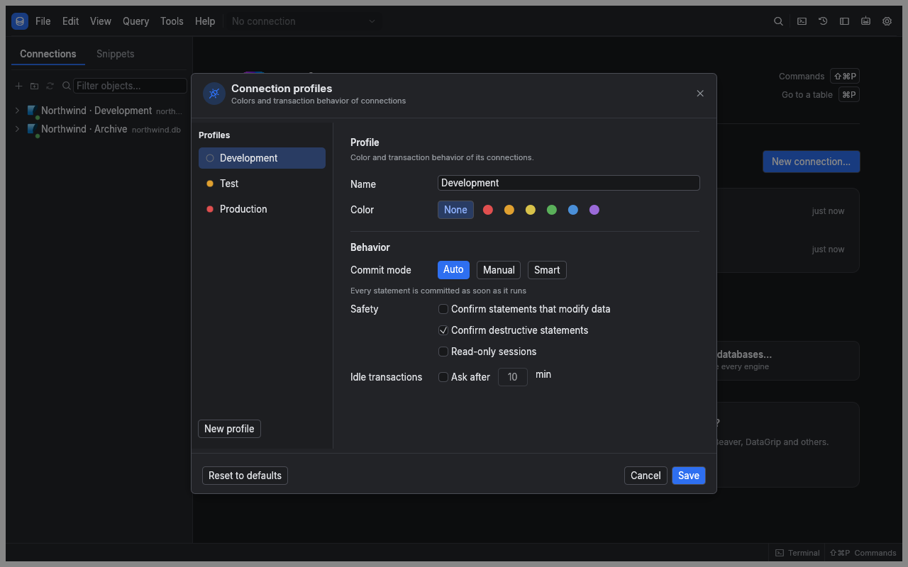
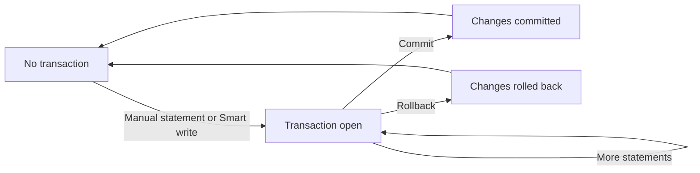

[Manual](README.md) › Everyday work

# Control writes and transactions

A connection profile sets the default commit mode, confirmation rules and colour for a connection. A transaction groups statements until you commit or roll back. Check both the active connection and its transaction state before applying changes.

## Choose a connection profile

Choose **Profile** in the connection form. Open **Connection profiles** to edit profiles, create your own or reset built-in values.

| Built-in profile | Commit mode | Confirm writes | Confirm destructive statements | Idle transaction prompt |
| --- | --- | --- | --- | --- |
| Development | Auto | Off | On | Off |
| Test | Smart | Off | On | Off |
| Production | Manual | On | On | After 10 minutes |

Test uses amber and Production red to help you recognise the environment. None of the built-in profiles is read-only by default. Enable read-only when you need browsing without writes.

Destructive statements include `DROP`, `TRUNCATE`, column drops and `DELETE` or `UPDATE` without `WHERE`. Review confirmations carefully; a confirmation does not make a statement reversible.

## Choose how statements commit

| Mode | Behaviour |
| --- | --- |
| **Auto** | Each statement commits independently, unless you explicitly open a transaction |
| **Manual** | The first ordinary statement starts a transaction; later statements join it until your decision |
| **Smart** | Reads behave like Auto; a write or schema change starts a transaction that remains open |

Change the current session's mode from the toolbar without editing the saved profile. Switching to Auto while a transaction is open first asks you to commit or roll back.

By default each editor has its own session. A transaction in one editor does not include statements from another editor or the explorer. With shared sessions enabled, tabs on that session share the transaction.

MongoDB, Elasticsearch, Redis and the Snowflake SQL API driver run in Auto because their sqlr drivers do not expose transaction controls. Profiles still supply colour, confirmations and read-only protections.

## Finish a transaction

1. Check the status bar for the transaction's statement count and start time.
2. Review your results and changes.
3. Choose **Commit** to keep the database changes, or **Rollback** to undo uncommitted work.

Closing an editor with its own open transaction, disconnecting, reconnecting or quitting asks you to choose **Commit**, **Roll back** or **Cancel**. If the network connection is lost, the transaction is lost too; reconnecting does not restore it.

MySQL and MariaDB DDL can implicitly commit an open transaction, even if the DDL fails. Read the transaction warning before assuming that Rollback can still undo earlier work.

## Recover from an error or use savepoints

A statement error can leave the transaction open. PostgreSQL marks it failed: roll back the transaction, or roll back to an earlier savepoint where available, before continuing. A commit of that failed PostgreSQL transaction is reported as a rollback.

In an open, healthy Manual or Smart transaction, choose **Savepoint** to mark your progress. **Rollback to ▾** lets you discard later work while keeping earlier work. SQL transaction commands are also recognised and tracked.

When the idle transaction prompt appears, choose **Commit**, **Roll back** or **Keep open**. Keeping it open silences that prompt until the next activity; the transaction still holds any database resources or locks it acquired.

## Enforce read-only and confirmations

Read-only can come from the profile, a setting or the current session's switch. The client rejects modifying or unrecognised statements, and requests server enforcement where supported. Read-only results cannot be edited.

Settings resolve from global values through profile overrides to connection overrides. Safety flags combine to retain protection: if any level enables read-only or a confirmation rule, a lower level cannot turn it off. Agents with **Read** access always use read-only sessions.

## Related

- [Results and editing](results-and-editing.md): understand Apply inside a transaction.
- [Settings and shortcuts](settings-and-shortcuts.md): configure setting levels.

---

← [Results and editing](results-and-editing.md) · [Move data](moving-data.md) →
