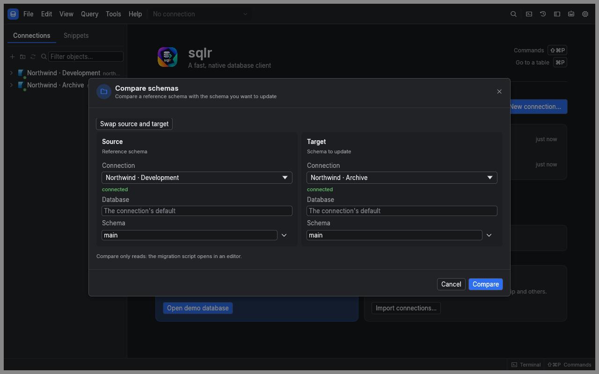
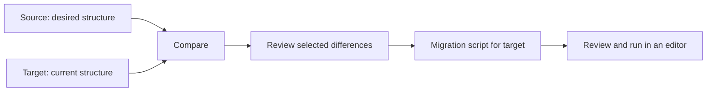
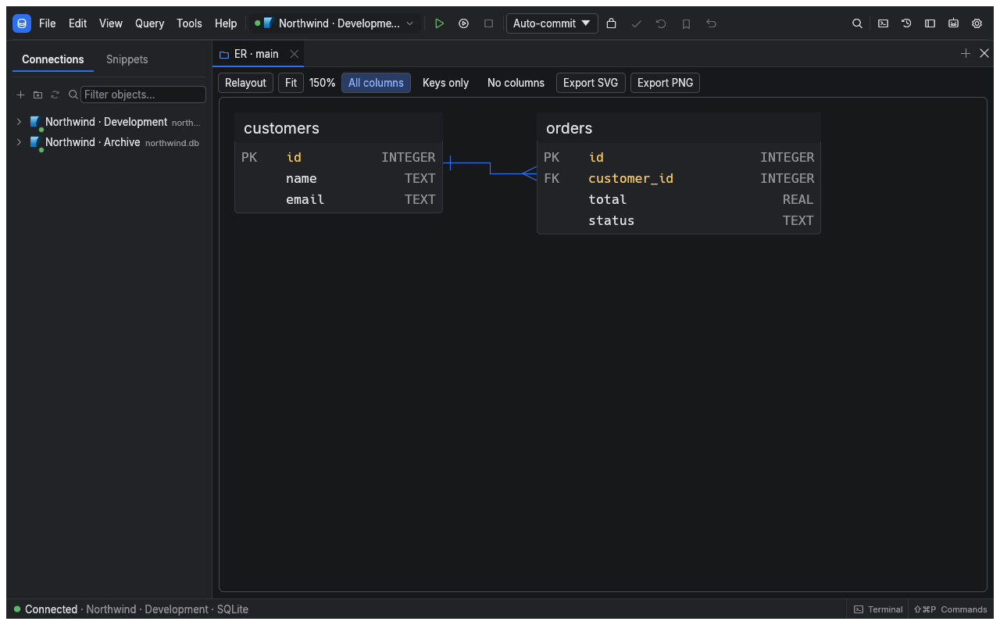
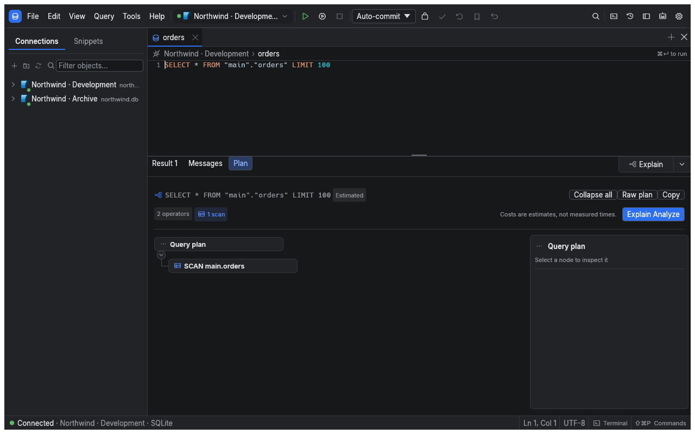
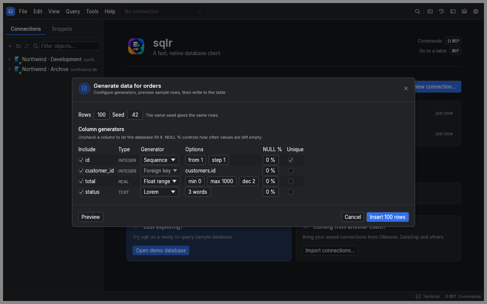

[Manual](README.md) › Data tools

# Compare schemas and understand query plans

Use schema tools to review structural differences, draw relationships, investigate query performance or fill a test table. Available actions depend on the connection's driver.

## Compare a target with a reference schema

The **Source** is the reference you want to reproduce. The **Target** is the schema you intend to update. Both connections must use the same driver.

1. Open **Compare schemas…** from the command palette, or **Compare with…** from a schema or database in the explorer.
2. Set **Source** to the reference connection, database and schema.
3. Set **Target** to the connection, database and schema to update. Use **Swap source and target** if the sides are reversed.
4. Choose **Compare**. This reads metadata without changing either database.
5. Select a difference to inspect its definitions: target on the left, source on the right.
6. Uncheck objects you want to exclude, then choose **Open migration script**.
7. Review and adjust the script in its new editor tab before running it on the target.

The comparison lists added, removed and changed objects. Generated statements are ordered by dependencies, including creating tables before their foreign keys. The script changes the target to match the source, and may contain operations that remove data. Opening it does not execute it.

## Draw an ER diagram

Open the ER diagram action from a schema in the explorer. Each table shows its columns and types; primary and foreign keys are marked, and relationships connect the relevant columns.

- Drag a table to reposition it. sqlr remembers the arrangement for that connection, database, schema and set of tables.
- Choose **Fit** to bring the diagram into view.
- Choose **All columns**, **Keys only** or **No columns** to control detail.
- Choose **Relayout** to replace your positions with an automatic layout.
- Use **Export SVG** to save a vector image. The visible **Export PNG** button does not currently save a file.

The diagram shows declared foreign keys. Relationships implied only by naming conventions do not appear.

## Explain a statement

1. Connect an SQL editor tab and place the caret in one statement.
2. Choose **Explain** above the results, from the Query menu, or with ⌥⌘E.
3. Open the **Plan** pane and read its summary.
4. Select an operator card or a segment of the hot-path bar to inspect its properties.

An estimated plan shows the database's expected work. **Explain Analyze**, also available with ⌥⇧⌘E, executes the statement to obtain actual measurements when the driver supports it. SQLite provides an estimated plan only. MySQL Analyze accepts read statements only.

> **Warning:** Analyze executes the statement. For supported writes, sqlr asks first and rolls back the database transaction afterward; external effects from triggers or functions may still occur. Analyze is refused while a transaction is already open.

The plan runs in the editor tab's session, so its temporary tables and session settings apply. Use Stop to cancel a running plan.

### Read the plan

| Area | What to look for |
|---|---|
| Summary | Execution and planning time, cost, estimated and actual rows when available |
| Warnings | Large estimate errors, large scans, repeated operators or disk spills |
| Hot-path bar | Operators carrying most of the time, or cost for an estimated plan |
| Operator cards | Scan, join, sort and other steps; the heaviest have a **HOT** marker |
| Inspector | Selected operator's filters, indexes, loops, buffers and extra properties |
| Raw plan | The database's original output, which you can copy |

**Collapse all** reduces a large tree. Editing the statement marks the existing plan as changed; use **Recompute** to replace it with a current one. A plan is a snapshot, so changing data or indexes also warrants a new computation.

## Generate sample rows

Use a writable test database for generated data.

1. Right-click a table and choose **Generate data…** from its import/export actions.
2. Set **Rows** and **Seed**. The default is 100 rows with seed 42.
3. Review the proposed **Column generators**. Uncheck a column to let its database default fill it.
4. Choose generators and parameters for the included columns, including their NULL percentage.
5. Choose **Preview** to inspect 20 sample rows.
6. Choose **Insert N rows**, where N is your row count, then confirm with **Insert rows**.

Generators include sequences, number and date ranges, UUIDs, names, addresses, pattern-based text, constants and choices from a list. A foreign-key generator picks actual values from the referenced table when writing; the preview uses stand-in values.

The same specification and seed reproduce the same generated values. If a uniqueness requirement cannot be satisfied, enlarge the generator's range or reduce the row count. The run reports written and rejected rows and offers **Stop** while running.

## Related

- [SQL editor](sql-editor.md): select statements and run a reviewed migration.
- [Import, export and backup](moving-data.md): copy data after preparing the schema.
- [Explorer and objects](explorer-and-objects.md): inspect and edit individual definitions.

---

← [Import, export and backup](moving-data.md) · [Administration](administration.md) →
