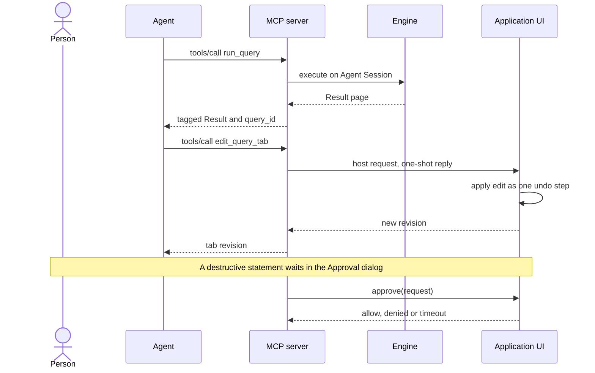

# Agents and terminal

sqlr exposes a local MCP server while it runs, so AI agents can inspect the connections the person has exposed, run statements, page results, fix open editor tabs, save snippets and manage configuration. The same workspace holds an integrated terminal where the person runs an agent, Claude Code or any other shell tool. This spec describes the server, its security and exposure model, the tool surface, approvals, and the terminal. Agents act with the person's rights, so every capability is gated by explicit consent, the existing profile safeguards, or both.

## Concepts

- An **Agent** is an AI client connected to the MCP server. Agents are external clients: sqlr has no built-in chat and no built-in MCP client.
- The **MCP server** is the loopback HTTP endpoint the app hosts for the length of one App session. It has no daemon and outlives nothing.
- **Agent access** is the level a Connection grants to Agents: `None`, `Read` or `Write`. `None` is the default and means the Connection is invisible to Agents.
- An **MCP session** is one Agent's connection to the server. Its Sessions, Results and open transactions end with it.
- An **Agent Session** is an engine Session opened for one MCP session on one Connection. It is separate from the explorer's Session and from every Editor session, so an Agent never shares a transaction with the person or with another Agent.
- An **Approval** is the in-app dialog where the person allows or denies a statement or a configuration delete that an Agent requested.
- A **Safety flag** is a setting or profile field that can be tightened but not relaxed through the Agent surface.
- The **Integrated terminal** is the PTY-backed shell docked at the bottom of the workspace. It is available to the person only.

## Behaviour

### Enabling and server lifecycle

The MCP server is off by default. Settings → Agents turns it on, and a toolbar toggle next to the workspace toggles does the same. Enabling the server exposes no Connection: exposure is a separate per-Connection decision.

The server binds `127.0.0.1` on a configurable port, default `47821`, in the range 1024 to 65535. It speaks MCP Streamable HTTP at `/mcp`. There is no wildcard binding, no IPv6 wildcard and no Unix socket option, and no TLS: the listener is loopback-only and authenticated.

Starting the server:

1. Read the persistent bearer token from the Credential vault, generating and storing one when absent.
2. Create the data directory when needed and bind the listener.
3. Build the session manager and router.
4. Write the discovery file.
5. Report `Running`.

A failure at any step leaves the rest of the app running and reports a precise status:

- `Port busy` when the address is already in use, with no discovery file left behind;
- `Keychain error` when the vault or its key cannot be read;
- `Error` for an unavailable data directory or any other startup failure.

The same failure is retried when the port changes or the server is disabled and enabled again; the app does not retry the same failed port on every frame.

Stopping the server stops accepting requests, cancels in-flight tool calls, denies pending Approvals, drops every MCP session together with its Agent Sessions and Results, removes the discovery file, and reports `Stopped`. Disabling the server at runtime does the same, and quitting the app stops the server before the process exits.

Changing the port restarts the listener and drops active MCP sessions. Rotating the token replaces its vault value, updates the in-memory verifier, drops every MCP session and Agent Session, and keeps the listener bound. Both actions are explicit Settings actions that state their effect before they run.

The server accepts at most eight MCP sessions at once. A ninth connection receives a structured error. A session is idle when it has no in-flight tool call and no recent Result activity for 30 minutes; an idle sweep runs every 60 seconds, closes idle sessions, and closes Results older than their TTL.

### Endpoint security

Every HTTP request carries `Authorization: Bearer <token>`, including the initialize request. The token comparison is constant-time. A missing or wrong token receives `401 Unauthorized` with `WWW-Authenticate: Bearer`.

`Host` is accepted only as `127.0.0.1:<port>` or `localhost:<port>`. An `Origin` header is accepted only as `http://127.0.0.1:<port>` or `http://localhost:<port>`; a request without `Origin` is accepted for ordinary non-browser clients. Every other value, including `null`, receives `403 Forbidden`. No CORS preflight is served.

Only MCP tools are exposed. The server implements no resources, prompts, sampling, elicitation or server-initiated requests.

Tokens carry 256 bits of OS randomness, encoded as unpadded base64url (43 characters). The token lives in the shared Credential vault, under a namespace separate from connection credentials. Its only stored form is the encrypted vault value; TOML files, the discovery file, logs, Incidents, tool results and `Debug` output carry everything else. Rotating the token is the containment action for a leaked token.

The initialize response tells the Agent to call `get_guide` first and states that Connection access is explicit consent.

### Discovery file

A running server publishes `mcp.json` in the data directory with the URL, process id, protocol version, application version and start time. The file carries endpoint metadata only, and the token stays in the Credential vault.

The file is written atomically through a private temporary file and a rename. On Unix it is mode `0600`; on Windows it inherits a user-scoped access list. A stale file is overwritten on the next successful start and removed on stop or disable. The server does not start when the data directory is unavailable.

### Agent access

Each Connection stores an Agent access level:

- `None`: Agent-facing lists include only exposed Connections, and every data tool that names this one returns `not_exposed`.
- `Read`: Agents browse and query with reads only. The Agent Session is read-only on the server, and the family classifier rejects modifying statements before execution.
- `Write`: Agents browse and run modifying statements, while the Connection profile still decides commit mode, read-only mode, write confirmation and destructive confirmation.

The person sets the level in three places that share one store path: the Advanced section of the connection dialog, the Explorer context menu, and the connection list in Settings → Agents. Changes apply immediately and are saved even while the server is off. `None` is the default for a new Connection, an Agent-created Connection and a duplicated Connection, and imports keep it at `None`. The Agent write path rejects a payload that contains it.

Agent access is stored with the Connection and serialized with a default so existing `connections.toml` files load unchanged.

An exposure change applies to new Agent Sessions. Setting a Connection back to `None` also closes its open Agent Sessions at once.

### Agent sessions and connection lifecycle

The engine keeps a third kind of Session beside the explorer's Session and Editor Sessions: an Agent Session per MCP session and Connection. Two MCP clients on one Connection have separate transactions, and an Editor tab has a third.

Connections open lazily on the first catalog read or query. The app connects the explorer's Session when needed, so the Explorer shows the Connection, and opens the Agent Session for the work. The tool surface offers no connect or disconnect operation, so a Connection the person is using stays up.

Catalog tools (`browse`, `describe_object`, `search_objects`) read through the explorer's catalog state and use it for the catalog query. `run_query` runs on the Agent Session. A Connection the person already had open stays open after the Agent is gone.

When credentials are missing, for example because the Connection does not save secrets and no in-memory secret exists, the tool returns `secret_required` naming the Connection and the secret field keys, never their values. The Agent may write the secrets through the configuration tools.

On MCP session end, idle timeout, token rotation, server stop or application quit, the app cancels in-flight queries, closes the session's Results, closes every Agent Session for that MCP session and rolls back its open transactions. A metadata Session opened only for that Agent is closed too; a Connection the person had open remains open.

Agent Sessions follow the Connection profile exactly: commit mode, savepoints, read-only flag and idle transaction timeout. A `Read` exposure forces a read-only Session regardless of profile.

Paged Results read inside an open transaction, as the editor's do. Agent queries appear in the Operations panel with their Connection, kind, target, elapsed time and a Cancel action. Completed queries are recorded in History like any other. There is no separate Agent marker in History.

### Configuration access

Connection values are write-only. For each exposed Connection, `config_list` returns only its id, name, driver, folder, profile and Agent access, plus a map that says, for each secret field declared by the driver, whether a value is stored. Hosts, ports, users, TLS and SSH options, driver properties and secret values stay inside the app.

Profiles, settings, keymap and saved task definitions are readable, because they are policy and definitions rather than credentials. A driver's manifest is readable so an Agent can learn the field keys, types, defaults and secret flags needed to create a Connection.

The following are human-only:

- installing, removing or rolling back drivers;
- `agents.enabled` and `agents.port`, and the token lifecycle;
- application updates;
- `terminal.shell`, which stays outside the Agent surface;
- the update-check and diagnostics privacy settings, which Agents may read but not write.

Safety flags are tighten-only for Agents:

- a profile's `read_only`, `confirm_writes` and `confirm_destructive` flags that are on stay on;
- a profile's `idle_tx_timeout_min` can only decrease;
- a profile's `commit_mode` can only become stricter, from `auto` to `smart` to `manual`;
- a `tighten_only` setting that is currently on can be neither turned off nor reset;
- a Connection can move only to a profile at least as strict on read-only, write confirmation, destructive confirmation, idle transaction timeout and commit mode;
- driver fields that weaken transport security can only be tightened. Field keys containing `tls_verify`, `verify_cert`, `verify_server`, `check_hostname`, `host_key`, `insecure`, `strict_host` or `validate` are treated this way when their current value is a safe one; removing one of these values is rejected.

A rejected relaxation returns `invalid` with a message naming the flag.

Configuration writes are partial: only the provided fields change, and omitted fields stay. `remove_values` and `remove_secrets` name keys to delete. A Connection's driver is immutable after creation, and `agent_access` is rejected rather than ignored. Writes are serialized by the app, the last write wins per field, and `save_secrets` keeps its existing meaning: secrets for a Connection with it off stay in memory for the session and are written neither to the vault nor to `connections.toml`.

Configuration changes apply to the running app rather than to files behind it. Connection and folder changes go through the store worker; profile, setting, keymap and task changes go through the in-memory stores and their save paths. A write is acknowledged only after the store confirms it, so the UI is current before the tool returns. A store failure returns an error without applying a half-written change.

Driver manifests are readable in full: id, name, family, dialect, default port, capabilities, and fields with key, label, type, default, required, secret, group and tighten-only flag.

### The tool surface

The server exposes 19 tools with flat names. The tool catalogue and the guide are generated from one registry, so they stay in step. Data and configuration tools return structured JSON; the guide returns text.

| Tool | Request | Response and semantics |
| --- | --- | --- |
| `get_guide` | optional `topic`: `overview`, `security`, `tools`, `recipes`, `terminal` | Markdown guide for the topic, the overview by default. Covers the app model, exposure, write-only connections, approvals, the tool catalogue with arguments, recipes, limits and the fact that the terminal is not reachable through MCP. |
| `config_list` | `target`: `connections`, `folders`, `profiles`, `settings`, `keymap`, `tasks`, `drivers`; optional `driver_id` | Configuration metadata. Connections are exposed Connections only, with names, drivers, folders, profile, exposure and secret presence and no values. Settings carry definition, default, allowed levels, safety, and stored values by global, profile and Connection level; `terminal.shell` has no value. Drivers are manifests. No secret is ever returned. |
| `config_write` | `target`: `connection`, `folder`, `profile`, `setting`, `keymap`; target payload | Create or patch. Connections create or update, patch values, remove values, write and remove secrets and set `save_secrets`; `agent_access`, a changed `driver` and protected keys are rejected. Folders create, rename or move. Profiles create or update with tighten-only safety. Settings set or reset at global, profile or Connection level, validated against the setting definition and its allowed levels. Keymap sets or resets one action. Saved tasks are readable and deletable but not written through MCP. |
| `config_delete` | `target`: `connection`, `folder`, `profile`, `task`; `id` | Deletes after an Approval. A Connection is disconnected and its secrets removed. A folder is removed and its Connections and subfolders move to the parent. A profile in use is rejected before the dialog. A task definition is removed and never run. |
| `browse` | `connection_id`, optional `path` segments | Returns child Nodes with name, kind, path, has-children flag and detail, plus whether the catalog answer came from the cache. Works for every family. |
| `describe_object` | `connection_id`, `name`, optional `database`, `schema` | Relational table details: columns with type, nullability, default and generated flag, primary key and unique keys. Non-relational Connections return `unsupported`; `browse` stays the generic path. Index and foreign-key lists are present but empty in this version. |
| `search_objects` | `query`, optional `connection_id`, optional `limit` | Case-insensitive search of relation names across the default databases of exposed relational Connections, with at most 200 matches, 50 by default. Reports cache state and skips unreachable Connections. |
| `run_query` | `connection_id`, `query`, optional `database`, `max_rows`, `timeout_s` | Runs one statement or native command, family-aware, and returns a tagged Result with a page, `truncated`, `query_id` and status. |
| `get_query_result` | `query_id`, optional `offset`, `limit` | Pages an existing Result, fetching more from the server when the page passes the loaded rows. Expired or unknown ids return `not_found`. |
| `cancel_query` | `query_id` | Requests cancellation through the engine. Repeated calls are safe. |
| `close_result` | `query_id` | Releases the Result and its memory. Repeated calls are safe and report whether the id was still present. |
| `list_query_tabs` | none | Open SQL Editor tabs only: id, title, Connection, database, dirty flag, revision and busy flag. Object editors, DDL viewer, administration, document and Redis tabs are excluded. |
| `get_query_tab` | `tab_id` | Text, revision, dirty and busy flags, Connection, database, caret and selection as character offsets. |
| `edit_query_tab` | `tab_id`, `expected_revision`, `edit` | Replaces the whole text or applies a list of range edits. A revision mismatch returns `conflict` with the current revision and changes nothing. |
| `run_query_tab` | `tab_id`, `target`: `script`, `selection` or `{statement: index}`; optional `max_rows` | Runs the tab's current buffer in the tab's Session and database, through the same UI execution flow, and puts Results in the tab's grid. |
| `list_snippets` | none | Snippet metadata: id, name, folder, Connection scope, updated time. |
| `get_snippet` | `id` | The full Snippet, including its SQL. |
| `write_snippet` | optional `id`, `name`, `folder`, optional `conn_id`, `sql` | Creates or updates a Snippet and returns its id. Without an id, an existing Snippet with the same name is replaced. |
| `delete_snippet` | `id` | Deletes after an Approval that shows the name and folder. |

Tool results that succeed return structured content. A tool failure sets the error flag and returns both readable text and a structured error.

#### Query contract

`run_query` runs exactly one unit: one SQL statement, one document shell statement, one Elasticsearch console request or one Redis command line.

For SQL, the Dialect splits the input and exactly one non-empty statement is accepted. More than one returns `invalid` with the count and a hint to use an Editor tab for scripts. The statement is classified, a `Read` exposure or a read-only profile rejects modification with `read_only` before approval, and the profile confirmations decide whether an Approval is needed.

MongoDB and Elasticsearch use the engine's document execution path. Redis rejects `MULTI`, `EXEC`, `DISCARD`, `MONITOR`, `SUBSCRIBE`, `PSUBSCRIBE` and commands whose first word starts with `BL` with `unsupported`, rather than hanging.

Limits:

- the call waits 30 seconds by default; `timeout_s` accepts 1 to 120 seconds;
- a page holds at most `max_rows` rows or documents, 200 by default and 1000 at most, and at most 256 KiB of encoded data;
- reaching either limit sets `truncated` and leaves the `query_id` pageable;
- a SQL or document query still running at the deadline returns `status: "running"` with the rows fetched so far and a `query_id`;
- a Redis reply is available immediately and has no pages; a timed-out Redis command returns `running` without an id, and the guide tells the Agent not to resubmit it;
- Results stay available for five minutes after the last access, a background sweep closes expired ones, and `close_result` or the end of the MCP session closes them immediately.

The result envelope is a tagged union:

```json
{
  "kind": "tabular | document | reply",
  "status": "ready | running | cancelled | failed",
  "query_id": "opaque string",
  "elapsed_ms": 0,
  "truncated": false,
  "error": {"code": "string", "message": "string"},
  "tabular": {
    "columns": [{"name": "string", "type_name": "string", "kind": "string", "hint": "string"}],
    "rows": [[null, true, 1, 1.5, "text", "base64"]],
    "affected": null,
    "messages": [{"level": "info | notice | warning | error", "text": "string"}]
  },
  "document": {"documents": []},
  "reply": {"value": null}
}
```

Only the member matching `kind` is present. Values map as follows:

- `NULL` stays JSON `null`; the text `"NULL"` is a different value.
- Booleans and integers are JSON booleans and numbers.
- Finite floats are JSON numbers; `NaN`, `Infinity` and `-Infinity` are strings so the JSON stays valid.
- Exact decimals, temporal values, intervals, UUIDs, XML, geometry and arrays are strings exactly as the grid displays them, preserving precision.
- Binary values are base64 strings and the column hint marks the column as binary.
- JSON columns are parsed into JSON values when valid and returned as strings otherwise.
- Document results are JSON documents; a tabular document query uses the tabular shape.
- Redis replies are JSON representations of RESP values: nil, string, integer, array, map, double, boolean, error and verbatim.

#### Editor contract

The editor tools operate on SQL Editor tabs. They read any open tab regardless of exposure; running requires exposure.

`get_query_tab` returns character offsets, with an exclusive end, for the caret and selection. `edit_query_tab` accepts `replace` with the full text or `edits` with a list of `{start, end, text}` ranges applied as one change set, and both require `expected_revision`. A mismatch returns `conflict` with the current revision and applies nothing, so an Agent can re-read and retry. An edit is a single undo group, marks the tab dirty, scrolls to and briefly highlights the first changed range, and the person's undo reverts the whole edit in one step. Agents create, close and save no tabs.

`run_query_tab` runs the tab's current buffer, not a stale saved version:

- `script` runs the whole buffer as a script;
- `statement` with a zero-based index runs one split statement;
- `selection` runs the current selection and returns `invalid` when there is none.

It uses the tab's Session and database, applies the same profile confirmations and read-only rules as the person's run, records History, and places Results in the tab's normal result area. It returns a bounded summary of the run. A tab that is already running returns `busy` and the run is not interrupted. A tab whose Connection is not exposed returns `not_exposed`; a tab without a Connection returns `invalid`.

#### Snippet contract

`list_snippets` returns metadata only. `get_snippet` returns the SQL. `write_snippet` creates when no id is given, updates otherwise, and also updates a same-name Snippet when the id is omitted; name, folder and Connection scope are patchable, folders are `/`-separated strings created implicitly, and a leading or trailing `/` is trimmed. `delete_snippet` requires an Approval naming the Snippet and its folder. Snippets are global or scoped to one Connection.

#### Guide contract

The guide is generated from the same registry that produces the tool list, so every registered tool appears in it. It covers:

- what sqlr is, and that the server exists only while the app runs;
- the exposure model and the meaning of `None`, `Read` and `Write`;
- the write-only Connection model and the rules for secrets;
- Approvals and which operations can need one;
- the tool catalogue with arguments;
- recipes: discover the schema, run and page a query, fix an open tab, save a Snippet, create a Connection, and set up an agent inside the terminal;
- limits: row and byte caps, deadlines, Result TTL, session cap and idle timeout;
- error codes and the next step for each;
- that the Integrated terminal exists and stays outside the MCP surface.

The guide carries descriptions only: secrets, Connection values and environment-specific data stay out.

### Approvals

Approvals reuse the safety mechanism the person already sees for their own statements.

A statement is classified per family: SQL through the Dialect's statement and script classifiers, MongoDB through the document shell classifier, Elasticsearch through the document request classifier, and Redis through the key-value command classifier. A read-only session rejects modification before any Approval is requested.

When the profile requests confirmation for writes or for destructive statements, the tool call blocks and the app shows a modal dialog. It contains:

- the client name and version and the MCP session identifier;
- the Connection name, profile, database and exposure level;
- a risk label: Write, Destructive, Configuration delete or Snippet delete;
- the exact statement or command in a scrollable monospace area;
- for a configuration delete, the target summary and consequences, including the number of contained Connections and subfolders for a folder;
- a countdown to the timeout.

Approvals time out after 60 seconds and return `denied` with reason `timeout`. Denying returns `denied`. A client disconnect, an application quit or a server stop denies the request immediately. The dialog opens with Deny focused, Enter keeps the safe denial, and Escape or the close action denies; allowing takes a deliberate click. Each request is decided on its own.

A script run that needs confirmation shows the statement or the full script being authorised. Multiple requests are queued and shown one at a time, each with its own timeout. Configuration deletes and Snippet deletes always require an Approval, independently of query confirmations. Secret writes proceed without one, and secret writes and removals are logged by field name only.

### Errors

A tool failure sets the MCP error flag and returns text plus `{"error":{"code","message"}}`. Messages carry the error alone: no stack trace, secret or Connection value reaches the Agent.

The codes are:

- `invalid`: malformed arguments, a multi-statement query, a missing selection, an unknown target, or a rejected relaxation;
- `not_exposed`: the Connection or tab Connection is not exposed;
- `read_only`: the exposure or profile forbids the statement;
- `secret_required`: named secret fields are missing;
- `denied` and `timeout`: an Approval was refused or expired;
- `not_found`: an unknown or expired id;
- `conflict`: a tab revision mismatch;
- `busy`: the tab is already running;
- `unsupported`: the family does not support the operation, or a Redis command is unavailable;
- `permission`: the server refused the statement;
- `connection`: the Connection failed to open;
- `catalog`: the catalog read failed;
- `error`: another driver failure;
- `internal`: an inconsistency in the app.

Engine error kinds such as auth, syntax, timeout, cancelled, permission and protocol appear inside a Result's `error` code, so a successful tool call can still carry a failed statement.

Free-form driver error text is sanitized before it reaches the Agent: URL user information and values following `password=`, `passwd=`, `token=` and `secret=` are redacted.

### The integrated terminal

The Integrated terminal is a real PTY, not a command runner. It sits at the bottom of the workspace, directly above the status bar, and history sits above it when both are open. The panel has a default height of about 300 px, a minimum of 120 px and the standard splitter.

It starts hidden, and no shell starts until the person first opens it. Opening the panel starts the shell at the canvas cell size once the layout has settled, so the child's first size query is already correct. Panel resizes update the PTY size. Hiding the panel keeps the shell running, so a long Agent task continues; closing the panel and reopening it from the toggle returns to the same session. Terminal visibility and height are session-only.

The toggle is available in the toolbar next to the value-panel and history toggles, in the View menu, the command palette, the shortcuts dialog and the keymap. Its default is `Ctrl+Backtick` on every platform, and it is remappable like every action. Toggling the panel focuses the terminal.

The panel header shows a terminal icon, the title, a status dot and label, and a shell and directory summary, with icon-only Restart and Close actions on the right. The status is one of not started, starting, running, exited, failed. A shell that exits keeps its final screen and shows the exit code with a Restart action; a shell that fails to start shows the reason with Retry and a link to Terminal settings. Restart creates a new session with the current settings and kills the previous process; on Unix the child is signalled and its process group is killed with `SIGKILL` after a 150 ms grace period. On application quit the process group is killed and no shell or Agent process is left behind.

#### Shell and workspace

Shell resolution:

- On Unix the default is the person's `$SHELL` with login behaviour (`-l`), falling back to `/bin/sh`. A configured `terminal.shell` runs through that shell as `-lc` with the command string, so arguments and quoting work.
- On Windows the default is `pwsh.exe` when present, then `powershell.exe`, then `cmd.exe`. A configured command runs through `cmd.exe /C`.

The working directory defaults to a `terminal` folder inside the app's configuration directory. This folder is stable across launches and prepared on a background worker before the shell starts. An explicit `terminal.cwd` is used as given and receives no generated files.

The automatic folder holds:

- `AGENTS.md`, created only when missing, with MCP setup instructions and the required `get_guide` workflow plus the discovery file location;
- `CLAUDE.md`, created as a symlink to `AGENTS.md` when no such entry exists, so Claude Code reads the same guide; on Windows the file contains `@AGENTS.md`. An existing `CLAUDE.md` stays as it is.
- `.mcp.json`, the active client configuration including the URL and bearer token, refreshed atomically when the server starts, stops, changes port or rotates its token, including while the panel is hidden. When MCP is disabled it contains an empty server map. Identical content is left untouched.

On Unix the folder is created with mode `0700` and `.mcp.json` with mode `0600`. The files and any scratch files the person creates persist when sqlr closes. A write failure is reported in the panel and recovers on the next update.

The shell inherits the application environment with `TERM=xterm-256color` and `COLORTERM=truecolor` added. The MCP token and Agent-specific variables stay out of it, and the person starts an Agent explicitly.

#### Settings

The terminal settings are global:

| Key | Type | Default | Notes |
| --- | --- | --- | --- |
| `terminal.shell` | text | empty | Empty uses the login shell; human-only, unreadable and unwritable by Agents, never logged |
| `terminal.cwd` | text | empty | Empty uses the `terminal` folder in the configuration directory; readable and writable by Agents |
| `terminal.font_size` | float, 10 to 24 | 12 | Applied immediately |
| `terminal.scrollback` | int, 100 to 10000 | 2000 | Lines kept above the screen; applied on Restart |

Changes to shell, directory and scrollback apply on the next Restart; the running session is not killed implicitly, and Settings says so. The font size applies immediately. The shell command stays outside the Agent surface, logs, bundles and error messages, and Settings warns against embedding credentials in it.

#### Rendering and interaction

The terminal uses the app theme's background, foreground, cursor and selection colours, and a 16-colour ANSI palette derived from the theme, plus the 256-colour and truecolour spaces. It uses the app's monospace font at the configured size and honours the UI scale.

It renders bold, dim, italic, underline, reverse video, the cursor in block, underline and bar shapes, wide characters, combining characters, the alternate screen, scrollback and resizing. Only the visible grid is painted.

Interaction:

- clicking focuses the terminal; drag selects, double-click selects a word, and copying uses the selection;
- copy uses `Cmd+C` on macOS and `Ctrl+Shift+C` elsewhere; paste uses `Cmd+V` or `Ctrl+Shift+V`;
- `Ctrl+C` is always the interrupt while the terminal has focus;
- pasted text is bracketed when the shell requested bracketed paste, and line endings are normalised;
- the mouse wheel moves through scrollback; while an application has mouse reporting on, wheel and pointer events go to the application, and holding Shift keeps them for selection and scrollback; on the alternate screen without mouse reporting the wheel sends arrow keys;
- the visual bell draws a brief border, and a BEL that merely terminates a window-title string does not ring it;
- applications that request mouse tracking receive press, release, motion and wheel reports in the protocol and encoding they chose;
- applications that request the kitty keyboard protocol receive disambiguated key events, including modified functional keys and Cmd chords on macOS.

While the terminal has focus, editor and global query shortcuts are suppressed so keystrokes reach the shell. The terminal toggle, Settings, Quit, Shortcuts, Commands and the Operations panel remain global. The terminal also holds egui's focus against Tab, arrow and Escape navigation.

A process that panics inside the terminal reader or monitor thread ends the terminal as failed and kills the child.

#### The terminal is human-only

The MCP surface excludes the terminal entirely: no tool reads, writes, starts or stops it, and Agent-facing lists leave it out. The Agent launched inside it is an ordinary external MCP client, subject to the same exposure, Approvals and logging as any other client. Logs record lifecycle metadata only (started, exited with a code, killed); terminal output, scrollback and the shell command stay out, as do the command and the working directory.

### Interface surfaces

**Settings → Agents**

- An enable switch explaining that enabling creates a local endpoint for Agents, exposes no Connection yet and requires a token.
- A port field with validation and a note that changing it restarts the server.
- A status pill with the endpoint and active session count when running, and the last error inline.
- A copy button for the endpoint, a Rotate token action that warns that active Agents are disconnected, and Copy MCP config, which copies a ready-to-paste client configuration and warns that it contains the token.
- A connection access list of every saved Connection, grouped by folder, with search, All, Exposed and Hidden filters, an "N of M exposed" count and a None, Read, Write segmented control on each row. Changes apply immediately without Save and work while the server is off.
- A short explanation of exposure and a link to the guide.

**Settings → Terminal**

- Shell command, working directory with a folder picker, font size and scrollback.
- A note that shell, directory and scrollback apply on Restart while the font size applies immediately, and that the shell command is hidden from Agents and never logged.
- An Open terminal button that focuses the panel.

**Connection dialog and Explorer**

- An Agent access segmented control in the dialog's Advanced section, with an explanation of each level and a warning that Write still follows profile confirmations.
- The Explorer context menu offers an Agent access submenu with the three levels, using the same store path.
- The Connection row carries its Agent access level, shown in the Connection menu as a checked entry; this version presents it there rather than as a row badge.

**Approval dialog**

- Centered and modal, titled "Agent request", with the client and MCP session, the target Connection, profile, database and exposure, the risk label and the exact statement in a scrollable monospace block. Configuration deletes replace the statement with the target and consequences.
- Deny is focused when the request appears, Escape and close deny, Allow is visually primary but not preselected, and the countdown keeps the layout steady.
- No remember option is offered.

**Status bar and toolbar**

- While MCP is enabled, a discreet status segment shows a dot, "MCP" and the active session count; clicking it opens Settings → Agents. It takes no space from the Connection and transaction segments on narrow windows.
- A toolbar toggle next to the workspace toggles enables and disables the server, with a tooltip naming its status.

**Terminal panel**

- Bottom panel above the status bar, resizable, with the header described above and the canvas in the theme colours.
- The empty and running states show the shell; the exit and failure states show the exit code or the error with Restart, Retry or a link to Terminal settings.

**Feedback**

Agent configuration and Snippet writes produce short toasts naming the target, for example "Agent updated connection Analytics". Toasts carry the target alone: secret values, shell commands and Result rows stay out. Errors use the existing error presentation and carry no stack trace.

## Architecture

Two components carry the feature, and the application wires them.

The MCP component owns the listener, authentication, discovery, MCP sessions, tool routing, policy, Approvals requests and the guide. It talks to the engine for queries, catalog reads and Snippets, and to the application through a host interface for everything that needs the UI thread: configuration stores, editor tabs, Approvals, Connection metadata and toasts. It depends on the engine, the store and the core model, and not on the UI or the application.

The terminal component owns the PTY session, the terminal parser, input encoding, the screen snapshot and the terminal widget. It depends only on egui and the PTY library. The application gives it the theme, the font size, the UI scale and the current settings; the terminal returns input events and lifecycle actions.

The application implements the host interface, owns the server lifecycle and Settings, mounts the terminal panel, adds the toolbar, menu, palette and keymap actions, and shows Approvals.

The host bridge is asynchronous. A request that needs the UI thread is enqueued, the UI is woken with a repaint request and the request is processed at the start of the next frame, and a one-shot reply resolves the MCP call. The UI thread works through the request queue while I/O and database work stay off it. Queries, catalog reads and Snippet operations run against the engine on its runtime. The MCP server runs on its own runtime with two worker threads; the app holds its handle and reads its status each frame.



The terminal session owns the PTY master, the child process, a reader thread that feeds the parser and answers terminal queries, and a monitor thread that waits for the exit. The UI reads a screen snapshot and sends input, resize and control messages; the PTY work stays on its threads.

## Data model

- A **Connection** carries its Agent access level with a default of `None`.
- The **Credential vault** holds the MCP bearer token under a namespace separate from Connection credentials.
- `mcp.json` is a runtime artifact, not user configuration, and exists only while the server runs.
- `AGENTS.md`, `CLAUDE.md` and `.mcp.json` are files in the automatic terminal folder and persist across launches.
- Results are held in memory for the server and keyed by an opaque id that belongs to one MCP session.
- Terminal settings are ordinary global settings; terminal visibility and height are session state.
- Agent queries are ordinary History entries, and the rotating application log is the audit record.

## Non-functional requirements

- A disabled MCP server and an unopened terminal start no process, listener or shell, so cold start and idle memory stay within the product budgets.
- The terminal keeps at most the configured scrollback in memory; the default is 2000 lines within a 100 to 10000 range.
- At most eight MCP sessions run at once; results expire after five minutes of inactivity; a page is capped at 1000 rows and 256 KiB.
- The token has 256 bits of entropy and is compared in constant time. The discovery file is owner-only, and the terminal folder and `.mcp.json` are owner-only on Unix.
- The listener works with no network beyond loopback.
- Agent tool calls are logged with the client name and version, MCP session id, tool name, Connection, outcome, duration and numeric result metadata. Log lines carry metadata only; SQL text, native commands, Result rows, secrets, Connection values, the shell command and terminal output stay out. The MCP protocol library's own logs stay at warn level so request bodies stay out too.
- Errors returned to Agents are structured and sanitized.

## Decisions

- **Loopback Streamable HTTP with a bearer token instead of an OS socket or no authentication.** Local clients of every kind, including browser-based tooling, already speak HTTP; a Unix socket would not work on Windows and an unauthenticated loopback port would be reachable by any page or process. Loopback binding, a token, and Host and Origin validation together keep the endpoint to local tools the person configured. TLS on loopback adds certificate management with no threat it addresses.
- **The token lives in the shared Credential vault.** One keychain-protected vault means at most one keychain authorization per App session shared with Connection credentials, and rotation is a single explicit action. A separate keychain item would prompt separately and could drift from the vault's key.
- **A token-free discovery file.** Local tooling needs to find the URL and protocol without being handed the secret; the file carries process metadata only and is readable by its owner. The client configuration, which does contain the token, is copied only on an explicit action or written to the owner-only terminal folder.
- **Exposure is consent on the Connection.** Nothing is reachable until the person marks a Connection `Read` or `Write`; the default is `None`, duplicates reset to `None`, imports never grant access, and an Agent cannot change the level. This makes the boundary explicit and keeps a copied or imported Connection from silently widening access.
- **`Read` is enforced twice: a read-only engine Session and a family classifier.** A server-side read-only session catches anything the classifier misses, while the classifier gives a clear error before execution and works across SQL, document and key-value families.
- **One Agent Session per MCP session and Connection.** Agents work concurrently with the person and with each other without sharing transactions; closing the MCP session rolls back what the Agent left open and never touches the person's Sessions.
- **Lazy connections with no connect or disconnect tool.** The app connects on the Agent's behalf so the Explorer shows the Connection, and it never lets an Agent tear down a Connection the person is using.
- **Connection values and secrets are write-only.** Agents can complete a Connection but never read what they wrote or what was already there, which keeps hosts, users, options and passwords out of the model's context while still allowing setup automation.
- **Safety flags are tighten-only, including profile moves, setting resets and transport-security driver fields.** An Agent must not be able to remove its own guardrails through an indirect route such as assigning a looser profile or resetting a stricter value.
- **Approvals reuse the person's confirmation rules.** The profile already decides when a statement needs confirmation; routing an Agent request through the same dialog keeps one safety model and leaves no bypass. The dialog denies by default and times out because an Agent can wait indefinitely.
- **A small flat tool surface, with the guide generated from the same registry.** Flat names are unambiguous because the server is dedicated to sqlr. Generating the catalogue and the guide from one list keeps them from drifting and makes the guide a completeness test.
- **The terminal is a PTY and is human-only.** A command runner would not run TUIs or login shells. Keeping the terminal off the MCP surface, and `terminal.shell` unreadable, means a writable shell command could not be turned into arbitrary code execution chosen by an Agent. `terminal.cwd`, font size and scrollback remain ordinary settings.
- **The shell process group dies with the app.** An Agent running in the terminal must not outlive sqlr; the process group is killed on quit and on Restart after a short grace period.

## Related specs

- [Architecture](architecture.md): component layering, threading and failure containment.
- [Connections](connections.md): the Connection model, profiles, the Credential vault and Agent access stored on a Connection.
- [Query execution](query-execution.md): Sessions, transactions, read-only mode, profiles, Operations and History.
- [Query editor](query-editor.md): the Editor tab, undo and revisions, the Sessions the editor tools reach.
- [Results and editing](results-and-editing.md): the Result grid and value display that the Agent result mapping mirrors.
- [Drivers](drivers.md): Driver manifests, families, Dialects and statement classification.
- [Explorer and objects](explorer-and-objects.md): the Explorer row that carries Agent access.
- [Settings and workspace](settings-and-workspace.md): Setting levels, the toolbar, the status bar and toasts.
- [Diagnostics](diagnostics.md): logging, Incidents and the diagnostics setting that excludes SQL everywhere.
