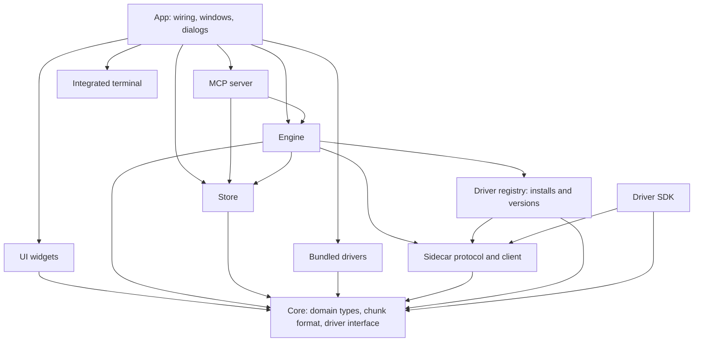
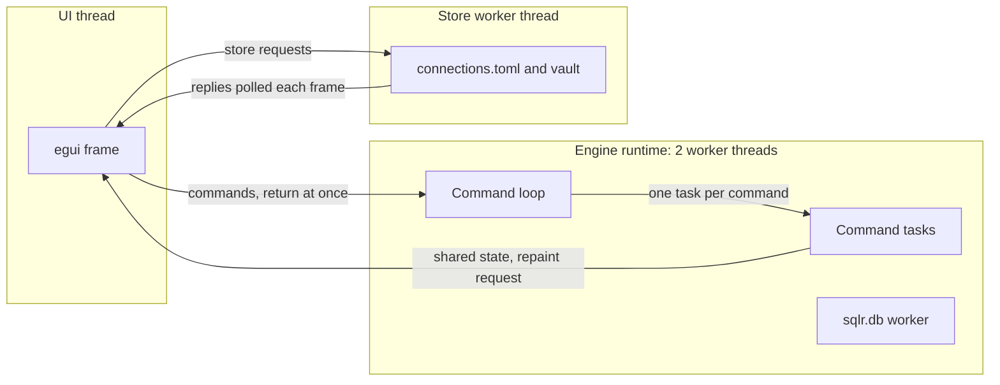

# Architecture

sqlr is a native database client for relational, document and key-value databases whose main promise is to stay light and fast while offering a complete set of development tools. This spec describes the shape of the whole application: its performance targets, how its components are layered, which thread does what, how work is cancelled and how failures are contained, the result data format at a high level, the performance budgets and the testing strategy that keeps all of it true. Every other spec builds on the rules stated here.

## Concepts

- The **UI** is the egui application: windows, panels, widgets and dialogs. It runs on one thread.
- The **engine** owns everything live: Sessions, Results, the Catalog cache, Operations, Jobs, History and Snippets, and the installed Sidecar drivers. It runs on its own background runtime.
- The **store** owns everything persisted: `connections.toml`, `profiles.toml`, settings, the Credential vault and the local SQLite database (`sqlr.db`) for History, Snippets, the Catalog cache and layouts.
- A **Driver** speaks one database's protocol. A Bundled driver runs inside the app; a Sidecar driver runs as a separate process behind the sidecar client, which exposes the same driver interface, so the engine handles both the same way (see [Drivers](drivers.md)).
- An **Operation** is any in-flight piece of client work (connect, catalog read, query, fetch, script, Job). Every Operation can be listed and cancelled on its own.
- A **Result chunk** is a columnar block of rows in sqlr's own binary format; a **Doc chunk** holds documents.

## Behaviour

### Purpose and performance targets

sqlr is one native app for relational, document and key-value databases, with a modular Driver system, open source under the MIT license. Lightness is a hard requirement with measured targets:

| Metric | Target |
| --- | --- |
| Cold start to first completed frame | under 1 s |
| Resident memory at idle, two connected databases | under 150 MB |
| Result grid scrolling, 1,000,000 rows loaded | 60 fps (frame p99 under 16.7 ms) |
| Autocomplete popup and opening a table | under 50 ms perceived |
| Release binary, Bundled drivers included, no external runtime | under 75 MB |

These targets rule out Electron, any webview and the JVM, and are why the UI is native Rust. The app collects no telemetry; diagnostics stay local (see [Diagnostics](diagnostics.md)).

### Component layering

The application is split into components with one role each. Dependencies point downward only.

The dependency rules:

- **Core** depends on nothing internal. It holds the domain types (values, Nodes and Node paths, Connection settings, errors), the driver interface, the Dialect interface, statement classification and the chunk formats. It performs no I/O and draws no UI.
- **Drivers** depend only on core. A driver written as a sidecar depends on the driver SDK, which re-exports the driver API and turns a driver into an executable.
- **The engine** depends on core, the store, the driver registry and the sidecar client. It sees Drivers only through the driver interface; the app registers the Bundled drivers into it at startup.
- **The store** depends only on core.
- **UI widgets** depend only on core. A widget takes data in and returns action values, which the app turns into engine calls.
- **The MCP server** depends on core, the engine and the store, and reaches the app through a host interface the app implements.
- **The integrated terminal** depends on no other sqlr component.
- **The app** depends on everything and is the only place where components are wired together.
- Test fakes (a fake Driver for each Family) and the Conformance suite are used by tests only.

The dependency set itself is constrained: TLS is rustls only (OpenSSL never enters the build), and `egui`, `eframe`, `egui_extras` and `egui_kittest` are pinned to one exact version with `egui_dock` alongside, so the build holds a single egui version. A dependency check in CI fails the build when either rule breaks.

### Threading model

- **The UI thread** runs egui. It only draws and handles input; I/O and waiting happen elsewhere. Every engine method it calls returns immediately: it either sends a command to the engine or reads shared state (a Result, the Catalog cache, Operations, transaction state) under a short lock. A read guard on a Result is released before calling any other engine method, because some engine methods lock the Result too.
- **The engine runtime** is a multi-threaded async runtime with 2 worker threads on its own named thread. Its command loop receives commands over an unbounded channel and spawns one task per command, so a slow command never holds up the next one. Work on one Session is still ordered: executes, fetches and transaction commands on a Session take tickets and run in issue order. Blocking calls (vault reads, SQLite driver calls, file I/O) run on blocking workers or dedicated threads.
- **The `sqlr.db` worker** applies History, Snippet, Catalog cache and profile writes in order, off the UI thread. Dropping the engine flushes queued writes (waiting up to 2 s) before the runtime shuts down; tasks still parked after 1 s more are dropped.
- **The store worker** is one thread in the app that reads and writes `connections.toml`, folders and the Credential vault, and runs connection import and export. It answers each request with the saved Connections and Folders as they now are; the UI polls the replies every frame. Keychain prompts therefore leave the window responsive.
- **Repaint.** Whenever the engine changes shared state it asks egui for a repaint. egui coalesces repaint requests into the next frame, so the frame rate (bounded by vsync) is the effective throttle; the engine adds no throttle of its own. Panels that wait for time to pass (an idle transaction check every 15 s, a forced disconnect after 5 s) schedule a delayed repaint instead of polling.

### Cancellation and the Operation registry

Every Operation is registered in the engine's Operation registry when it starts, with its kind (Connect, Browse, Query, Fetch, Script or one of the Job kinds), a label (the first 80 characters of a statement, the Connection name, or the Job kind), its Connection, start time, progress (rows, bytes) and state. States are Running, Cancelling, Done (ok or not), Cancelled and Failed with a message. The Operations panel lists them, running ones first, newest first; see [Settings and workspace](settings-and-workspace.md) for the panel itself.

Cancelling an Operation moves it to Cancelling and signals its target:

- a **connect** attempt is raced against its cancel signal and its timeout (`connection.connect_timeout_s`, 15 s by default, covering SSH setup plus the driver's connect and ping). Cancelling drops the attempt, which tears down any SSH tunnel or sidecar start it owned, and the Operation ends Cancelled instead of waiting for the timeout;
- a **catalog or explorer read** stops at its next await point;
- a **query or fetch** asks the Driver for a real server-side cancel where it declares the server cancel Capability, then stops reading the stream at the next chunk boundary (see [Query execution](query-execution.md));
- a **script** stops after the running statement, which is cancelled;
- a **Job** sees its cancel flag and, when it registered one, its Driver cancel handle is called.

Finished Operations stay listed for `operations.keep_finished_s` seconds (30 by default, 0 removes them at once) and then disappear; their outcome remains reported by the toast or result tab that owned them. The Operations panel is client-side only: Server sessions and locks belong to the administration panels.

### Errors and failure containment

Every Driver error carries a kind, a message, an optional character position in the statement and an optional hint. The kinds are:

| Kind | Meaning | How the UI shows it | Log level |
| --- | --- | --- | --- |
| Connection | the link to the server is gone or unreachable | the Session fails; the result shows the error and the explorer offers Retry or Reconnect | warn |
| Auth | credentials refused | error in the result tab or the connection test | info |
| Syntax | the server rejected the statement | the editor underlines the position when there is one | info |
| Timeout | a time limit passed | error in the result tab | info |
| Cancelled | the user stopped it | the result ends Cancelled | debug |
| Permission | refused by privileges or by read-only mode | inline on the explorer Node, or error in the result tab | info |
| Unsupported | the Driver or Connection cannot do this | error in the result tab | warn |
| Protocol | the Driver or sidecar broke the protocol | error in the result tab; a crashed sidecar offers Restart driver | warn |
| Other | anything else | error in the result tab | warn |

A Connection error on a Session fails that Session, closes its open stream, forgets its other-database connections and its SSH tunnel, and closes any open transaction with a note that it was lost. The next statement on that Session reconnects.

No Driver failure crashes the UI:

- Each engine command task runs under a panic guard. A panic fails the query, script or Job it belonged to, fails every Operation that task started, and records one `engine_panic` Incident; every other Operation keeps running. The app's global panic hook recognises panics inside engine tasks and leaves them to the engine, so one event produces one Incident.
- A Sidecar driver runs in its own process. When it crashes, only its own Connections fail with a Protocol error and offer Restart driver.
- A database (`sqlr.db`) that cannot be opened falls back to an in-memory one with a warning; unreadable settings fall back to defaults.

Logging, Incidents and crash reports follow [Diagnostics](diagnostics.md): exactly one log line is written when an Operation settles, at the level in the table above, and `error` is reserved for unexpected failures.

### Result data format

Rows travel as Result chunks: columnar, immutable blocks in sqlr's own minimal format, Arrow-like but without the Arrow dependency tree. Each column has a physical kind (boolean, 64-bit integer, 64-bit float, text, bytes, or mixed for dynamically typed databases such as SQLite) plus a display hint (plain, number, exact decimal, temporal, interval, JSON, XML, UUID, array, geometry, binary). Exact decimals and temporal values travel as text with their hint, so no precision is lost. Every column has a validity bitmap for NULLs; variable-length values are an offsets array over one byte arena. Documents travel as Doc chunks: one compact buffer per page, each value a tag byte and its payload, lengths as varints.

The same bytes are used by in-process Drivers and over the sidecar protocol, so a sidecar costs no transcoding. The engine reads at most 1,024 rows per chunk from a Driver. A loaded Result holds its chunks immutably; grid snapshots share them without copying. Under memory pressure the engine writes older chunks to private anonymous temporary storage on a blocking worker and publishes read-only mappings. The core provides the columnar encoding and cell access without file I/O. Snapshots retain either heap payloads or mapped storage, and the associated heap reservations or file handles follow their last reader. The wire framing belongs to [Drivers](drivers.md); paging, memory limits and closing belong to [Query execution](query-execution.md).

### Testing strategy

Testing is part of the architecture: each layer has a seam that is tested at the highest point possible, and every change starts with a failing test.

- **Unit tests** in core and the engine: chunk encoding and decoding, statement splitting per Dialect, DML generation, the Changeset, Mongo shell parsing, the statement classifier, the transaction state machine.
- **Engine tests** drive the public engine interface with the fake Drivers for every Family, and against real servers where behaviour depends on the server.
- **The Conformance suite** runs the same checks against every relational Driver on a real database: connect, ping, browse, execute and streaming, fetch more, affected rows, syntax errors, identifier quoting round trips, cancel, the type round-trip matrix and describe for editing. A Sidecar driver runs it through the protocol and must pass the same checks as its in-process build.
- **Widget and app tests** use `egui_kittest`: widgets in isolation, and the whole app driven through simulated input with fake Drivers. Visual audits that render screenshots need a GPU and run on demand.
- **Fuzzing** covers the sidecar frame decoder and the chunk decoder.
- **Shared test services.** PostgreSQL, MySQL, MariaDB, MongoDB, Redis, Elasticsearch, SQL Server and Oracle run once, in containers on fixed ports, for the whole run. No test starts its own server: parallel tests isolate themselves with per-test databases, and tests that touch server-global state take a cross-process test lock. Setting `SQLR_SKIP_CONTAINER_TESTS=1` skips every test that needs a service and runs everything else. SAP HANA runs only where a test instance is available.

### Known accepted risks

| Risk | How it is handled |
| --- | --- |
| egui's text editor re-lays out the whole text and lacks multi-cursor, completion and serious undo | sqlr has its own query editor widget with a per-line lexer and layout cache that limit work to changed and visible lines (see [Query editor](query-editor.md)) |
| Non-native look; egui's fonts lack CJK and emoji | curated light and dark themes; system fallback fonts load on a background thread the first time such text is painted |
| Accessibility and IME | AccessKit and egui's IME support, verified per platform |
| GPU-dependent rendering on old or virtualized machines | the app renders through OpenGL (glow), the most widely available backend |
| A single-maintainer SAP HANA driver library | the HANA Driver is a sidecar, so another implementation can replace it transparently |
| Mongo shell expectations beyond the supported subset | the subset is documented and a raw-command mode covers the rest |

## Data model

- **Command**: a request from the UI to the engine (connect, browse, execute, fetch, cancel, close stream, load catalog, run script, transaction command, apply Changeset, describe, transfer, native tool, generic task). Commands carry what they need and return nothing; results appear in shared state.
- **Operation**: id, kind, label, Connection, start time, progress, state, cancellable flag, elapsed time; retained for the retention window after it ends.
- **Driver error**: kind, message, optional position, optional hint.
- **Result chunk**: columns (name, physical kind, display hint, source table column when known), row count, per-column validity and values. **Doc chunk**: a page of documents in one buffer.

## Non-functional requirements

Performance budgets are measured by two harnesses on release builds:

| Metric | Limit | Measurement |
| --- | --- | --- |
| Cold startup | under 1,000 ms | process entry to the first completed egui frame |
| Idle RSS | under 150 MB | resident memory 2 s after start, two connected SQLite databases |
| Release binary | under 75 MB | stripped executable, decimal MB |
| Grid scroll p99 | under 16.7 ms | headless CPU frames, 1,000,000 loaded rows, 300 verified jumps |
| Editor scenarios p99 | under 8 ms | editor harness |
| Editor scope parsing p99 | under 5 ms | parsing on the UI thread |
| Editor first frame | under 200 ms | editor harness |
| Editor peak RSS | under 120 MB | per-process editor scenarios |

The app harness launches the release binary with temporary configuration and data directories (the user's own stay untouched), connects two SQLite databases, records the first-frame time the app logs, samples resident memory after 2 s, closes the window, then measures the binary and runs the grid fixture (an integer and a text column). Every grid jump measures all three settling frames and verifies the requested row became visible. A startup failure, a missing report, a timeout or fewer than two connected databases fails the run. The editor checker fails on any budget verdict that is not a pass, on missing phases and on a report with no checks. Native measurements include graphics initialisation; headless frame times exclude GPU work. On Linux the native harness needs a graphical session or a virtual framebuffer.

Continuous integration runs on every push to `main` and every pull request: formatting, Clippy with warnings denied, the dependency check (no OpenSSL, one egui version), and the whole workspace test suite on Linux without container services. Release builds for macOS (arm64 and x64), Linux and Windows run a smoke test of the binary.

Security and privacy rules that hold everywhere: secrets never reach `connections.toml`, logs or debug output; diagnostics make no network requests; the UI thread never touches the keychain or the vault.

## Decisions

- **Native Rust with egui, no webview.** The performance targets (start under 1 s, idle under 150 MB, a 75 MB binary with no runtime) exclude Electron, webviews and the JVM. egui's weaknesses (text editing, native look, accessibility) are accepted and handled as listed under the known risks.
- **OpenGL rendering through glow.** It is eframe's default backend and the widest-reaching on old and virtualized machines; wgpu is used only by tests that render screenshots.
- **An engine runtime off the UI thread, reached through commands.** The UI stays responsive whatever the database does, and every engine method can be called from a frame. A per-command task (rather than one task per Session) lets independent work proceed, while tickets keep each Session's statements in order.
- **Engine reads through shared state, not message replies.** The UI reads Results, the Catalog cache and Operations through cheap snapshots each frame. This keeps the UI code free of callback plumbing and makes a repaint the only signal it needs.
- **A store worker thread for connections and the vault.** Keychain authorization dialogs can block for as long as the user takes; running them on a worker keeps the window alive.
- **Our own columnar chunk format instead of Arrow.** The Arrow crate brings far more dependencies than sqlr needs; a small format with typed columns, validity bitmaps and one byte arena covers every Driver, and the same bytes cross the sidecar protocol without transcoding.
- **Sidecar processes for third-party drivers** (rather than dynamic libraries or WASM): Rust has no stable ABI and an in-process crash would take the app down; WASI sockets are immature and a WASM runtime adds 15 to 20 MB. A sidecar is isolated and can be written in any language. Details in [Drivers](drivers.md).
- **rustls only.** One TLS stack across every Driver, no system OpenSSL to find or ship. Servers that only speak TLS 1.0 or 1.1 cannot be reached, and this is documented.
- **Panics contained per command task.** A bug in one Driver path fails one Operation and leaves an Incident, instead of taking down the session or the app.
- **Shared, long-lived test services instead of a server per test.** Starting eight database servers per test is too slow; per-test databases plus a cross-process lock for server-global state give isolation at a fraction of the cost.

## Related specs

- [Drivers](drivers.md): the driver interface, Families, Capabilities, Dialects, the sidecar protocol and chunk wire format.
- [Query execution](query-execution.md): Sessions, Results, paging, memory budgets, cancellation of statements, transactions.
- [Connections](connections.md): how Connections are stored and connected, the Credential vault, SSH and TLS.
- [Diagnostics](diagnostics.md): logging, Incidents, crash reports and Diagnostics bundles.
- [Settings and workspace](settings-and-workspace.md): the Operations panel, layout, settings and Setting levels.
- [Query editor](query-editor.md): the editor widget and its performance work.
- [Results and editing](results-and-editing.md): the result grid and its local sort.
