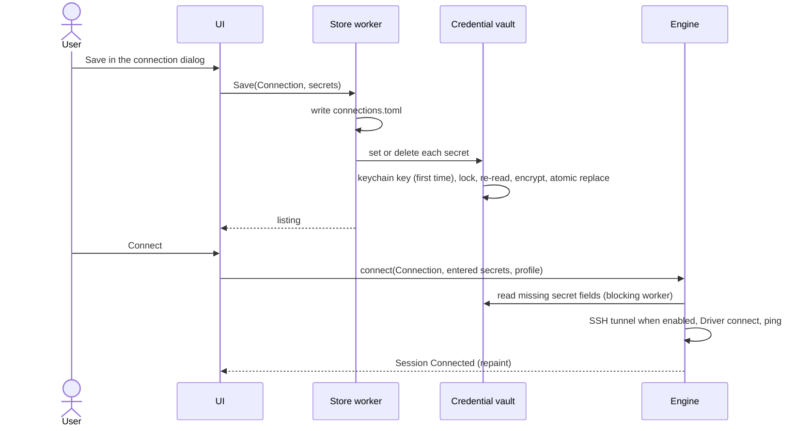

# Connections

Connections are how a user tells sqlr where their databases are and how to reach them. This area covers saving, organising and editing Connections and Folders, the connection form each Driver generates from its Driver manifest, filling it from a Connection URL, testing it, reaching servers through SSH tunnels and TLS, the catalog of Known databases, the Demo database and the welcome screen, the Credential vault that holds every secret, the files Connections and Connection profiles live in, and moving Connections in and out of other database clients.

## Concepts

- A **Connection** is a saved set of settings that identifies one database server or file and how to reach it. It has an id (a UUID), a name, a Driver id, an optional Folder, an optional color, the values of its Driver's non-secret form fields, a Connection profile id, a "Save password" flag and its Agent access level. Its secrets live only in the Credential vault, keyed by Connection id and field.
- A **Folder** groups Connections in the explorer. Folders nest: a Folder is identified by its path of `/`-separated names (`Clients/Acme`).
- A **Connection URL** such as `postgresql://user@host:5432/db` fills a Connection's form and is then discarded; the saved form is the Connection.
- A **Connection profile** is the policy a Connection follows (commit mode, read-only, confirmations, color, idle transaction timeout); its behaviour is described in [Query execution](query-execution.md). A Connection names its profile by id, and Development applies when it names none.
- A **Known database** is an entry of sqlr's catalog of databases. Each entry is bundled (a Driver of its own ships with sqlr), compatible (it speaks a Bundled driver's protocol and presets some fields), installable (its Sidecar driver is downloaded from the sqlr release) or planned (not reachable yet).
- The **Demo database** is a SQLite file sqlr generates on first use and opens as the Connection "Demo".
- The **Credential vault** is the encrypted file that holds every secret: database passwords, SSH passwords and key passphrases, other secret Driver fields and the MCP token. Its encryption key lives in the OS keychain.

## Behaviour

### Saving, editing and deleting Connections

The connection dialog creates and edits Connections. Its left list shows the saved Connections plus a new one; switching between them keeps each unsaved draft, so edits survive switching back. The right side has the Connection's identity (name, Folder, color from six presets or none), the Driver, the Connection profile (with "Manage profiles…"), Agent access (see [Agents and terminal](agents-and-terminal.md)) and the Driver's generated form.

- **Save** validates the form and sends the Connection to the store worker. A name is required. Required fields must be filled; a port must be 1 to 65535; a number must be a whole number; a choice must be one of its options; Driver properties are validated by their own rules. On a store failure the dialog stays open with the error.
- The store writes `connections.toml` first, then each secret: a non-empty secret is stored in the vault, an emptied secret is deleted, and with "Save password" off every secret named in the form is deleted instead.
- When the dialog opens an existing Connection, its stored secrets are read on the store worker and fill the empty secret fields when they arrive. If the vault cannot be read, the dialog says so and saving keeps whatever the vault holds: only secrets that were read and then emptied are deleted.
- Saving an edited Connection that is connected reconnects it with the new settings once the new listing arrives. A changed configuration or secret closes the Connection's Editor sessions opened with the old ones.
- **Duplicate** saves a copy right after the original, named "`<name>` copy", then "`<name>` copy 2" and so on (compared case-insensitively), with the original's stored secrets when it saves them.
- **Delete** asks for confirmation, removes the Connection from the explorer at once, disconnects it, drops its Catalog cache and recent entry, then deletes it and its secret fields on the store worker. A failed delete lists it again.

When "Save password" is off, connecting asks for the secrets in a "Connect to `<name>`" prompt: the Driver's secret fields, plus the SSH password or key passphrase when the tunnel uses that method. Entered secrets stay in memory until sqlr quits. A run that triggered the connect starts once the prompt is answered; Cancel drops the connect.

### Folders and ordering

Connections and Folders appear in the explorer in the order the user arranged them, which is the order of `connections.toml`.

- **Create folder** adds an empty Folder at the end; a nested path creates every missing parent. Names are trimmed per segment, empty segments are dropped, and an existing path is refused.
- **Rename folder** renames the Folder, its subfolders and the group of every Connection inside, keeping the same parent. Renaming onto an existing name is refused.
- **Delete folder** removes only the Folder: its Connections and subfolders move to its parent (the top level for a top-level Folder). No Connection is deleted.
- **Drag and drop** moves a Connection before or after another Connection, into a Folder (at its end) or to the end of the top level. A Folder moves with its whole subtree before or after another Folder, into a Folder, or to the end of the top level. Moving a Folder next to or into itself or its own subfolder is refused, as is a move that would collide with an existing Folder.
- A Folder named only by a Connection's group is listed too, after the explicit ones, with its parents. Each write records every such Folder explicitly.
- The explorer shows each Connection's Driver or file, its profile color, and a mark while it has an open transaction.

### The connection form

Each Driver's manifest declares its form fields: key, label, type (text, password, port, number, boolean, choice, file), default, required flag, secret flag and group (tab), such as Main, SSH, TLS, Advanced or Properties. The app generates the form from them, so a community Driver gets a working form without UI code. The first group's fields show first; several groups become tabs.

- Defaults fill a new form: the field's default, `false` for a boolean, the first option of a choice.
- A secret field's value goes to the vault only; the form's debug output lists secret keys without values. Password fields are masked, with a toggle to show them.
- A file field has Browse…, which opens a native file dialog in the folder of the current value; picking a database file names an unnamed Connection after the file.
- A Driver with free-form properties lets the user add name and value pairs, stored as `property.<name>` values.
- Switching the Driver of a new Connection rebuilds the form and keeps the name, Folder, color, profile, "Save password" and Agent access.
- Every Driver that declares the SSH Capability gets the SSH group described below, added by the engine, which runs the tunnel for every Driver.

### Connection URL

The form's URL box accepts `scheme://[user@]host[:port][/database][?key=value&…]` for server databases and `sqlite:/path`, `sqlite:///path` or `sqlite://localhost/path` for file databases (also `sqlite3`, `duckdb` and `file`). Pasting or typing a URL fills the fields it names:

- `host`, `port`, `database`, `user` and `path`, then each query parameter whose name matches a non-secret field key, ignoring case, `_` and `-` (`sslmode` fills `ssl_mode`); `dbname` means `database` and `username` means `user`. A choice takes the option matching the value the same way; an unknown option is ignored.
- The scheme must be one the Driver declares (`postgresql` or `postgres`, `mysql` or `mariadb`, `sqlserver` or `mssql`, `oracle`, `sqlite`, `mongodb`, `elasticsearch`, `redis` or `rediss`, `snowflake`); another scheme shows which ones the Connection takes.
- A URL holding a password is refused with "Remove the password from the URL; enter it in the Password field": a `user:password@` part, or a parameter whose name is `pass`, `apikey` or contains `password`, `passwd`, `pwd`, `secret` or `token`. The box then keeps only the redacted URL, so a typed password does not stay on screen.
- Redaction replaces a password with `***`: the part after `user:`, password-like parameters, and the whole authority while it could still be a half-typed `user:password` (no `@` yet and text after the last `:` that is not a port). Error messages never echo the port text or an unbracketed IPv6 address, since either may be a password being typed.
- IPv6 hosts go in brackets (`[::1]:5432`). A file URL with another host (`sqlite://foo.db`) is refused, because it would name a file on another host or a path relative to the working directory.
- Opening a saved Connection shows its URL rebuilt from its fields, without secrets.

### Test connection

"Test connection" connects the form's current values on a temporary Session, with the Development profile, and reports the server's product and version, the time the connect took (SSH setup, the Driver's connect and a ping) in milliseconds, and the SSH host key fingerprint when a tunnel was used ("new, recorded" on first use). A failure shows the Driver's error message. The temporary Session ends when the dialog closes or another test starts.

### Connecting

Connecting opens the Connection's explorer Session (see [Query execution](query-execution.md)). The engine reads the secrets once per connect: those the user entered, then, for a Connection that saves its secrets, the vault's value for every other secret field, SSH ones included, read on a blocking worker. Later Sessions of the same Connection reuse them until the configuration or the secrets change. A vault read failure becomes a notice and the connect proceeds with what it has. Each successful explorer connect records the Connection in the recent list. A Connection whose Driver is missing fails with "unknown driver"; one whose Driver can be downloaded opens the Driver Manager on it (see [Drivers](drivers.md)).

### SSH tunnels

With "Use SSH tunnel" on, the engine opens a tunnel and the Driver connects to `127.0.0.1` on the tunnel's local port; the TLS server name stays the host the user named, so certificate checks still verify the real server.

- Fields: SSH host (required), SSH port (22), SSH user (required), Authentication (Password, Key file or SSH agent), SSH password, Private key (a file), Key passphrase, Trust new host keys (off), Jump host, Jump port (22) and Jump user (defaults to the SSH user).
- One jump host is supported: sqlr connects and authenticates to it, opens a channel to the SSH host and runs the second SSH session through it. Both hops use the same authentication method and secret.
- Host keys are checked against `known_hosts` in the data directory. A known key passes; a changed key is refused ("Host key changed"); an unknown key is refused with its SHA-256 fingerprint unless the Connection enables "Trust new host keys", in which case it is recorded and the test reports it as new. Host certificates are refused.
- The tunnel sends a keepalive every 30 s and checks every 500 ms that its SSH session is still open. One tunnel serves every Session of a Connection; a dead tunnel is replaced on the next connect, and the tunnel closes when the last Session holding it ends.
- SSH errors are Connection errors with a readable message (the jump host could not reach the SSH host, authentication failed, the host key check).

### TLS

TLS uses rustls everywhere, with the system's root certificates plus any custom CA. Each Driver declares its TLS fields in a TLS group. Typical fields are a mode or an on/off switch, a CA file, a client certificate and key, and a verification switch:

- PostgreSQL: SSL mode `disable`, `prefer` (default), `require`, `verify-ca` or `verify-full`, root certificate, client certificate and client key. `prefer` and `require` without a root certificate encrypt without verifying the server.
- MySQL and MariaDB: SSL mode, CA, client certificate and key. SQL Server: encryption and "trust server certificate". Oracle: a TLS switch. MongoDB, Redis and Elasticsearch: a TLS switch and CA, and for Elasticsearch "skip verification".

Per-Driver TLS behaviour is detailed in [Drivers](drivers.md). Servers that only speak TLS 1.0 or 1.1 cannot be reached.

### Known databases

The new-connection catalog ("More databases…") and the Databases matrix list every Known database with its Family, default port, status and a note:

- **Bundled**: PostgreSQL, MySQL, MariaDB (through the MySQL Driver), SQL Server, Oracle, SQLite, Snowflake, MongoDB, Elasticsearch, Redis.
- **Compatible**, opening the PostgreSQL Driver's form with presets: CockroachDB (port 26257, database `defaultdb`), YugabyteDB (5433, `yugabyte`), Amazon Redshift (5439, `dev`), Greenplum, TimescaleDB, Neon and Supabase (SSL mode `require`), Amazon Aurora PostgreSQL. Through the MySQL Driver: TiDB (port 4000), SingleStore, Amazon Aurora MySQL. A compatible database also names a new Connection after itself.
- **Installable**: SAP HANA, DuckDB, and through the JDBC bridge (Java 17 or later) Generic JDBC, Db2, ClickHouse and H2.
- **Planned**: BigQuery and Cassandra.

Only what works is listed as working.

### Welcome screen and Demo database

With no tab open, the editor area shows the welcome screen:

- **Driver cards** for PostgreSQL, MySQL, SQLite, MongoDB, Redis, SQL Server, Oracle and ClickHouse, each with a detail ("Native · SQL", "Local file", "Documents", "Key-value store", "Install driver" or "Installed driver"). A card opens the new-connection dialog on that Known database; a card whose Driver is not installed offers to install it. Cards whose Driver is neither installed nor installable are hidden.
- **New connection**, **More databases…**, **Import connections…** and **Open demo database**.
- **Recent**: up to 8 saved Connections by last successful connect, each with its Driver and host or file name, its color and a relative time ("just now", "5 min ago", "3 h ago", "yesterday", "4 days ago", then the date). Clicking one connects it in a new Editor tab (its Key browser for a key-value store). Deleted Connections leave the list.

**Open demo database** prepares `demo.sqlite` in the data directory in the background, then opens it as the saved Connection "Demo" with a tab running `SELECT * FROM order_summary LIMIT 100;`. The file is generated deterministically from a fixed seed, so every machine gets the same data: departments, 40 employees, 200 customers, 60 products, 2,000 orders with 1 to 5 items each, indexes and the `order_summary` view, written by one transactional apply that leaves no History entries. A marker table records that sqlr wrote the file. A file that is ours and complete is reused; ours but incomplete, or empty, is regenerated; any other `demo.sqlite` is left untouched and the demo goes to `demo-sqlr.sqlite` instead.

### Credential vault

Every secret lives in `secrets.vault` in the config directory. One vault instance is shared by the connection dialog, the engine, the MCP server and connection migration.

- **Encryption.** The file holds a format header, a fresh random 96-bit nonce for every write, and the AES-256-GCM encryption of the secrets (authenticated with the header). The plaintext is a map of entries keyed by owner (`connection:<id>` or `mcp`) and field.
- **The key.** A random 256-bit key is created with the vault and stored in the OS keychain (macOS Keychain, Windows Credential Manager, Linux Secret Service) under the service `sqlr`, in an account derived from the SHA-256 of the canonical config directory path. Several config directories therefore have independent keys.
- **Unlocking.** Creating the vault performs no I/O. The first operation reads the key from the keychain, which may show the OS authorization dialog; the key is then cached in memory until the app quits and erased when dropped. A denied or failed keychain read is not cached, so the next operation asks again. There is no plaintext or master-password fallback: with the keychain unavailable, secrets cannot be read or saved, and the dialogs say so.
- **Concurrency and integrity.** Each operation takes an in-process lock and an OS file lock on `secrets.vault.lock`, re-reads the file, applies its change and writes the whole vault to a private temporary file (owner-only), syncs it, atomically replaces `secrets.vault` and syncs the directory. Plaintext buffers are erased after use.
- **Failure modes.** A vault that cannot be decrypted, a key that is missing for an existing vault, or a key of the wrong size fails the operation without replacing the stored file and without generating a new key. Error messages never include decrypted content.
- **Moving.** Copying the config directory without its keychain key does not transfer credentials; moving it to another path needs the original key under the new path's account.
- **Legacy migration.** Secrets stored by older versions as one keychain item per Connection field (service `sqlr`, account `<id>/<field>`), and the old MCP token item (service `sqlr-mcp`, account `token`), migrate lazily the first time each one is read or written: the value is first persisted in the vault with a pending mark, then the old item is deleted, then the mark is cleared. An interrupted migration resumes on the next access. A deleted secret leaves a tombstone so a stale old item never comes back. Migration may prompt once per old item; afterwards there is one keychain lookup per App session. Connection secrets and the MCP token are separate entries, so rotating the token never changes a Connection password.

### Storage files

| File | Location | Holds |
| --- | --- | --- |
| `connections.toml` | config directory | the Folder list and every Connection, in display order, without secrets |
| `profiles.toml` | config directory | user Connection profiles and overrides of the built-in ones |
| `secrets.vault`, `secrets.vault.lock` | config directory | the Credential vault and its lock |
| `known_hosts` | data directory | SSH host keys learned with "Trust new host keys" |
| `sqlr.db` | data directory | History, Snippets, Catalog cache, layouts, recent Connections |
| `demo.sqlite` | data directory | the Demo database |

`connections.toml` has a layout version. A file without one is shown sorted by Folder and name until its first write records an explicit order. Every write goes through a uniquely named temporary file and a rename, so concurrent saves leave one whole file. `profiles.toml` stores only user profiles and overrides: the built-in profiles are never written, and resetting a built-in deletes its override. A user profile used by any Connection cannot be deleted. A Connection naming an unknown profile follows Development. The config and data directories default to the platform's application directories and can be set with `--config-dir` and `--data-dir`.

### Import, export and migration from other clients

File → Import/Export and the welcome screen's **Import connections…** open connection migration. Discovery, file reads, imports and exports run on the store worker.

- **Sources.** Automatic discovery looks in the standard macOS, Linux and Windows locations of DBeaver (every workspace project's data sources), TablePlus, DataGrip and JetBrains IDEs (application options and projects), Tabularis (`connections.json`) and Beekeeper Studio (its local database). A file or the clipboard can also be read (up to 16 MiB); its format is recognised from its content.
- **Import.** The preview lists the connections with checkboxes and skips duplicates: a duplicate has the same Driver, host (case-insensitive), port (with the Driver's default when empty), database, path, user, service, SID, instance and SSH settings, whatever its name or Folder. Imported Connections get fresh ids, keep their Folder, get a unique name within it ("Imported connection" when blank), are written in one atomic write, never get Agent access, and keep only an allowlist of portable fields (host, port, database, user, path, service fields, TLS and SSH fields, read-only, Show all databases and similar), so credential aliases, JDBC properties, embedded URLs and startup commands are dropped. A source environment of "prod" or "production" maps to the Production profile and "test", "testing" or "staging" to Test. Credentials that came with the source are stored in the vault and turn "Save password" on; Connections without them ask on connect.
- **Export.** The user picks a format and Connections. **Include credentials** is off each time the export opens and resets when the format changes; when on, the dialog warns that the file holds plaintext secrets, and only saved credentials of the selected Connections are read. Export files are owner-only on Unix and written atomically.
- **SQL Server.** Imports map external SQL Server driver names and `mssql` URLs to the bundled Driver id `sqlserver`. DBeaver, DataGrip and TablePlus exports use each client's SQL Server identifiers and URL syntax, with port 1433 when the Connection leaves it empty.

| Format | Import | Export | Credentials |
| --- | --- | --- | --- |
| sqlr | backup JSON version 1 or 2 | one JSON file | every saved secret field (version 2); version 1 has none |
| TablePlus | plist or connection URLs | URLs, one per line | the database password in the URL |
| DBeaver | `data-sources.json` | an additional `data-sources-sqlr.json` | kept in DBeaver's own store, not included |
| DataGrip | `dataSources.xml` or clipboard XML | XML | kept in DataGrip's own store, not included |
| pgAdmin | servers JSON | servers JSON, PostgreSQL only | the format has none |
| Beekeeper Studio | connection JSON or its local database | a new folder with one JSON file per connection | database and SSH passwords and key passphrase; the encrypted columns of its database are never read |
| Tabularis | plaintext export JSON or `connections.json` | one export JSON with nested groups and linked SSH profiles | database and SSH passwords and key passphrase |

Format notes: Beekeeper and Tabularis exports cover PostgreSQL, MySQL and MariaDB, and SQLite; other Drivers and SSH jump hosts are excluded with a note, and Tabularis also excludes SSH agent authentication. Beekeeper keeps agent authentication and excludes incoming bastion profiles; its databases are opened read-only and limited to the personal workspace; TLS modes that do not map exactly produce a review note. Tabularis imports take the primary database of multi-database profiles (and say so), skip Kubernetes and AWS SSM transports, need encrypted exports re-exported as plaintext, and need a full export when a profile references an external SSH profile. DataGrip and TablePlus exports exclude SSH Connections. Each format's export dialog explains how to import the file in the other client.

## Architecture

- **The UI** owns the connection dialog, the generated form widget, the URL box, the explorer tree with drag and drop, the welcome screen, the Known databases catalog, the profiles window, the secrets prompt and the migration dialog. Its file and keychain work goes through the store worker.
- **The store worker** (a thread in the app) runs every operation on `connections.toml`, Folders, the vault and migration in order, and answers each with the current listing.
- **The store** implements the Connection repository (Connections, Folders, ordering, import), the Credential vault, the profile repository and the client format adapters (pure parsing and encoding; discovery and file reads run on the worker).
- **The engine** reads secrets on connect, opens SSH tunnels, connects Sessions, records recent Connections in `sqlr.db`, and loads and saves profiles on its `sqlr.db` worker.
- **Core** holds the Connection model, URL parsing and redaction, and the Known database catalog.

## Data model

- **Connection**: id, name, Driver id, Folder path, color, field values, profile id, save secrets flag (default on), Agent access (default None).
- **Folder**: a path; its position in the Folder list orders it.
- **Vault entry**: owner, field, value or tombstone, legacy-pending mark.
- **Known database**: id, name, Family, status (bundled with its Driver, compatible with its Driver and presets, installable with its Driver, planned with a note), default port, note.
- **Recent entry**: Connection id and last connect time.
- **Import batch**: Connections, their credentials, their source client, warnings.

## Non-functional requirements

- Secrets never reach `connections.toml`, exports without "Include credentials", logs or debug output. A Connection URL with a password is never accepted or kept.
- The UI thread never touches the keychain, the vault or connection files.
- Vault writes are atomic and durable (file and directory synced); a crash mid-write leaves the previous vault intact.
- The vault, its lock and exported files are owner-only on Unix.
- Connect attempts end within `connection.connect_timeout_s` (15 s by default, 1 to 600, settable per Connection) or when cancelled.

## Decisions

- **Secrets in an encrypted vault whose key is in the OS keychain**, rather than one keychain item per secret. One key lookup per App session replaces a prompt per item on platforms that ask, the vault is one file that moves with the config directory, and the keychain still protects it. A plaintext or master-password fallback was rejected: it would weaken every installation for the sake of machines without a keychain.
- **The key is scoped to the canonical config directory path.** Test and portable setups with their own config directory get their own key and can never read or overwrite another directory's vault.
- **Lazy migration of old keychain items, persisting before deleting.** Migrating on first use avoids a burst of keychain prompts at startup; writing the encrypted value before deleting the original, plus tombstones, means an interruption never loses or resurrects a secret.
- **Passwords are refused in Connection URLs.** A URL is pasted text that ends up in shells, chats and screenshots; refusing passwords keeps them on one path (the Password field into the vault), and redaction keeps a mistyped one off the screen.
- **Connections are a TOML file without secrets.** It is readable, diffable and shareable inside a team; the explicit order makes drag and drop survive restarts.
- **The form is generated from the Driver manifest.** A community Driver gets a complete form, URL support and secret handling without UI code.
- **SSH lives in the engine, not in Drivers.** Every Driver gets tunnels, jump hosts and host-key checking for free by connecting to a local port, while TLS still verifies the real host name.
- **Unknown SSH host keys are refused by default.** Learning a key silently would make the first connection to a spoofed server look normal; trusting new keys is an explicit per-Connection choice.
- **Imports keep an allowlist of fields and never grant Agent access.** Another client's file is untrusted input: arbitrary properties could carry startup commands or secrets into `connections.toml`, and exposing a Connection to Agents is a decision only the user makes in sqlr.

## Related specs

- [Query execution](query-execution.md): Sessions opened for a Connection, Connection profiles and transactions.
- [Drivers](drivers.md): Driver manifests, per-Driver fields and TLS, the Driver Manager and installable Drivers.
- [Agents and terminal](agents-and-terminal.md): Agent access and the MCP token kept in the vault.
- [Explorer and objects](explorer-and-objects.md): the explorer tree that shows Connections and Folders.
- [Settings and workspace](settings-and-workspace.md): settings, Setting levels and per-Connection overrides.
- [Architecture](architecture.md): the store worker and the threading rules.
