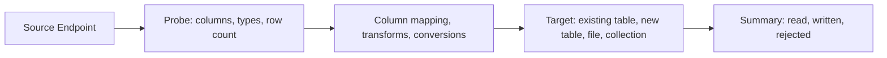
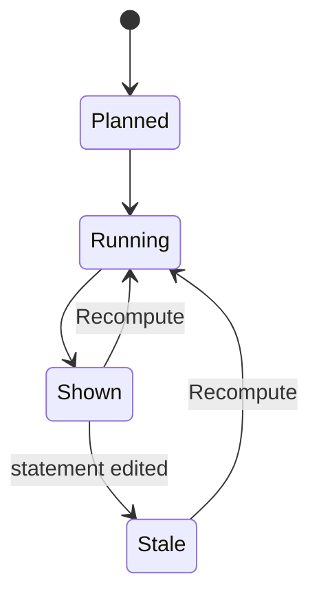

# Data and schema tools

These are the tools that work on whole databases rather than on a single result: backing up and restoring with the database's own command-line programs, moving rows between any two Endpoints, generating test data, comparing two schemas and producing a migration script, drawing an ER diagram, and reading a statement's Explain plan. Every tool runs as an Operation or a Job away from the UI thread, reports progress while it runs, and can be stopped.

## Concepts

- A **Data transfer** moves rows between two Endpoints through sqlr's own drivers. Import and Export are presets of the same engine.
- An **Endpoint** is one side of a Data transfer. As a source it is a table, a query, a delimited or JSON file, a workbook sheet, a Parquet file, a document collection, a set of key-value keys, or the Test-data generator. As a target it is an existing table, a new table created from generated DDL, a file, a workbook sheet, a Parquet file, or a document collection.
- A **Column mapping** pairs each source column with a target column or skips it, and carries an optional Transform and an optional target type.
- A **Transform** rewrites a value on the way through: trim whitespace, upper case, lower case, blank text to NULL, or a constant text for every row.
- A **Conversion** adapts a value to the type of its target column: integer, decimal number, boolean, binary, date and time, or text.
- A **Batch** is the set of rows written between two commits.
- A **Rejected row** is a row that a conversion or the target refused. Its position, reason and source values are recorded.
- A **Dump** writes a database to a file with the database's native dump program. A **Restore** reads such a file back with the native program.
- A **Schema snapshot** is the object list of one schema, with each object's definition and dependencies.
- A **Diff** classifies each object as added, removed or changed between two snapshots, with the changed pieces of a definition.
- A **Migration script** is SQL generated from a Diff that transforms the target schema into the source schema.
- An **ER diagram** is a drawing of the tables of one schema and their foreign keys.
- An **Explain plan** is the tree of operators a database used or would use for one statement. An **operator** has a role (scan, join, sort, aggregate, other), a cost, a row estimate, an actual row count, a time, and child operators.
- The **hot path** is the chain of operators that carries most of the work, measured by self time when the plan was analyzed and by cost otherwise.
- The **Test-data generator** fills a table with generated rows through a Data transfer.

## Behaviour

### Dump

A Dump starts from the database node in the Explorer, or from SQLite's `main` schema, when the Driver declares native dump support. The dialog shows the native program it will use and the formats that program supports:

- PostgreSQL: plain SQL, custom archive, directory, tar.
- MySQL and MariaDB: a SQL script.
- SQLite: a SQL script written by its dump command, or a binary copy of the database file taken through its online backup interface.

The user picks the output. A suggested name combines the database and the date, and the extension follows the format: `sql` for a plain script, `dump` for a custom archive, `tar`, `dir` for a directory, `db` for a SQLite binary copy. A directory dump writes into a directory that is new or empty.

The options are:

- Schema only or data only, never both.
- Clean, which drops each object before creating it again, with an optional if-exists qualifier.
- Create, which includes the statements that create the database.
- Parallel jobs, from 1 to 64, for a PostgreSQL directory dump.
- Compression from 0 to 9 for PostgreSQL custom and directory archives.
- Encoding for the resulting script.
- No owner and no privileges, which leave ownership and grants out.
- For MySQL, stored routines, events and triggers included by default, and a single-transaction snapshot of InnoDB tables on by default.
- Extra arguments appended to the command line, split on whitespace with quotes honoured.
- An executable path that overrides tool discovery.

A clean dump asks for confirmation first, because the resulting script drops every object it recreates.

The dump runs as one Job. A SQLite binary copy also reports pages copied out of the total. The tool's standard output and standard error stream into the Job log, which keeps the last 5,000 lines. The log starts with the full command line, with the password left out. Progress shows bytes written when the tool reports them and log lines otherwise.

Output is first written to a hidden partial file next to the destination and renamed only when the tool succeeds. A failure or a cancel deletes the partial file, so the destination never holds a truncated dump. Cancel terminates the tool's whole process group, so no child of the dump program keeps running.

The tool is found on `PATH` first, then in the usual install locations: Homebrew and `/usr/local/bin` on macOS, the newest Postgres.app version, versioned PostgreSQL client folders, `/usr/bin`, `/bin`, and the Windows program folders. When none is found the Job fails with an install hint: the PostgreSQL client through Homebrew with `libpq` or Postgres.app, through the system package manager on Linux, the MySQL client through Homebrew, or the SQLite program that ships with the system. The per-Connection executable, when set, is used before discovery.

### Credentials and the command line

Passwords reach the native tools without appearing on the command line, in the log, or in the display of the command:

- PostgreSQL tools receive the password in their environment. With an SSH tunnel, the host address is passed as a separate numeric address while the host name stays in the connection string, so the tool connects through the tunnel.
- MySQL tools receive a temporary defaults file with owner-only permissions, deleted when the Job ends. Values inside it are escaped.
- SQLite needs no credentials.

The command display omits the password, and the environment and file contents never enter the log.

### Restore

A Restore starts from the same database nodes, on a Driver that declares native dump support. The input file determines the path:

- A PostgreSQL plain SQL script runs through the client program; a custom archive, tar or directory runs through the restore program. A SQL script for MySQL runs through the MySQL client.
- A SQLite SQL script runs through the SQLite program with bail-on-error. A SQLite binary copy replaces the database file through the online backup interface.

The options are clean, if exists, create, schema only or data only, no owner, no privileges, exit on error on by default, single transaction on by default, parallel jobs from 1 to 64, extra arguments, and the executable path. A create-database restore never uses a single transaction or parallel jobs, because those cannot create a database. A plain PostgreSQL script gets single transaction and on-error-stop instead.

A restore that replaces a SQLite database file warns that the current contents are replaced, and a clean restore asks for confirmation. Cancelling stops the tool but leaves whatever it already wrote to the target database; the summary says so.

### Data transfer

A Data transfer reads a source Endpoint chunk by chunk and writes the target in batches. It never holds the whole data set in memory.

#### Sources

- A table or view, read through the Driver.
- A query, which must be a read statement. A query source that is not read-only is refused before any row moves.
- A delimited file in CSV or TSV, with or without a header row.
- A JSON file holding an array of objects, or a JSON Lines file holding one object per line.
- A workbook sheet, with an optional sheet name and a header row.
- A Parquet file.
- A document collection.
- A set of key-value keys, selected by database and pattern.
- The Test-data generator.

A source on a file, a collection or the generator is probed to discover its columns and types, with up to 100 rows for a preview. A connection-backed source is probed from the live connection. The wizard probes automatically shortly after the source and its connection are complete, and offers a Load preview action otherwise.

#### Targets

- An existing table.
- A new table, whose DDL is generated from the source columns and can be edited before running.
- A delimited, JSON, JSON Lines or SQL INSERT file.
- A workbook sheet.
- A Parquet file.
- A document collection.

A transfer whose table or query source sits on the same Connection as a table target is refused, with the advice to use `INSERT … SELECT`. For a document collection the source and target may be collections, or a collection to a JSON or JSON Lines file, and the target stores one document per row.

#### Column mapping

The mapping step lists every source column with a chosen target column of the same name, matched without regard to case. Columns with no match start skipped. The user can map any source column to any target column, skip a column, apply a Transform (trim, upper, lower, blank to NULL, constant), and set an explicit target type for the conversion. A target column that receives no source column is left to its default or nullability rules.

When the target is an existing table, the target columns and their types come from the table itself. When the target is a new table, the target types come from the type mapping below and every generated column is nullable.

#### New tables and type mapping

For a new table, the source column types are mapped to the target Driver's own types, with these losses reported as warnings next to the generated DDL:

- PostgreSQL to MySQL: a time-zone timestamp becomes `datetime(6)` with its values stored as UTC and the zone dropped; an interval becomes `varchar(64)`; an enum becomes `varchar(255)`; an array becomes `json`.
- MySQL unsigned integers widen to the next signed type that holds their range, and an unsigned 64-bit integer becomes `decimal(20,0)`.
- To SQLite: integers become `integer`, small and double floats become `real`, booleans become `boolean`, bytes become `blob`, and a decimal with more than 15 digits stays `text` so its value remains exact.
- A type unknown to the target maps to text, with a warning naming the original type.
- Between two Connections of the same Driver the type is kept as written.

The DDL is shown in the Review step with its warnings and is editable; an edited DDL is used instead of the generated one. The target table is created before any row is written.

#### Conversions

Values are converted only when their target column type requires it:

- Integer: text is trimmed and parsed, a float with no fraction is accepted, a boolean becomes 0 or 1. A text prefixed with `0x` is read as hexadecimal.
- Decimal number: text is trimmed and parsed; `NaN` and infinities are accepted.
- Boolean: `true`, `false`, `yes`, `no`, `1` and `0`, compared without regard to case.
- Binary: text that starts with `0x` is read as hexadecimal bytes; other text is stored as its UTF-8 bytes.
- Date and time: an instant with a time-zone offset is folded to UTC.
- Text: the value as it is.
- A NULL stays NULL at every type.

A value that cannot be converted rejects its row, naming the column, the value and the expected type.

#### Options and writing

- Rows per batch, from 1 to 100,000 in the dialog, default 500. The engine writes at most 10,000 rows per batch.
- Commit after each batch, off by default. When off, one commit covers the whole transfer. When on, a cancel keeps the batches already committed, and the summary says how many rows were committed before stopping.
- Truncate the target first.
- Upsert by key columns, which updates a row when its key already exists.
- Disable constraints and indexes during the load, restored when the transfer ends, including when it is cancelled.
- Skip bad rows, which then go to the rejected rows file instead of failing the transfer.

For a table target the engine requires a connection that supports transactions, that is not read-only, and that has no transaction already open; otherwise the transfer is refused with the reason.

Writes are grouped into batches and flushed to the Driver in pieces of up to 256 KiB. A loaded Result used as a source is read in pieces of up to 1,000 rows; a file or collection export uses chunks of up to 500 rows. Memory stays bounded whatever the size of the data set.

The transfer takes its turn on the target Session as any other Operation does.

#### Rejected rows

With Skip bad rows on, a rejected row is written to the chosen CSV file with a header and one line per rejection holding the line number, the reason and the source values, quoted for a spreadsheet. The transfer stops once 1,000 rows have been rejected, with a summary saying so. The first 100 rejections are also listed in the dialog while the transfer runs.

#### Summary and cancellation

The transfer ends with a summary of rows read, written and rejected, and the name of the rejected rows file when one was written. A cancel stops at the next batch boundary and reports what was committed. The dialog keeps a running log and a Stop action.

#### Export preset

Export is offered from a result's status bar, from a table or view in the Explorer, and from a document collection, a key-value database, a key prefix or a single key. It writes CSV, TSV, JSON array, JSON Lines, SQL INSERT or Markdown, chosen in a small dialog:

- CSV and TSV: delimiter, quote character, header row, the text used for NULL, and CRLF line endings.
- JSON array and JSON Lines write one object per row with the column names as keys.
- SQL INSERT writes one insert per row for the chosen table name.
- Markdown writes a table.

A sample of the first rows shows exactly what the file will contain, and the suggested file name combines the source name and the current time. When the source is a result that holds only some rows, the dialog offers the loaded rows alone or a rerun of the whole statement; a rerun is refused for a statement that is not a read. The file is written to a hidden partial name and renamed on success, as a dump is.

#### Import preset

Import is offered from a table or view in the Explorer and from a document collection. It reads CSV, TSV, JSON array or JSON Lines, shows the first rows and the columns it found, and lets the user map each file column to a table column, with the same batch, commit, skip-bad-rows, truncate and rejected-file options as the wizard. The batch range is 1 to 100,000 and the default is 500, with the engine writing at most 10,000 rows per batch.

#### The transfer wizard

The wizard runs in five steps: Source, Target, Mapping, Options and Review. Mapping appears for a table target. The defaults are the Explorer's current schema on each side (`public` for PostgreSQL, `main` for SQLite), the same table name on the target, and another connected Connection as the target when one exists. Steps are shown as a row of five, each marked complete or missing something; Next is enabled only when the current step is complete, and Back keeps every choice. The Review step lists both Endpoints, the mapped column count, the row estimate, the batch count, whether it is an upsert, the bad-row handling, the rejected rows file, the source encoding, and the DDL of a new table with its warnings.

Truncate and disabling constraints are marked as risky and ask for confirmation before the transfer starts. A running transfer shows its log, a progress line and a Stop action, and ends with the same summary as the Import preset.

### Test-data generator

The generator opens from a table in the Explorer. It reads the table's columns and picks a generator for each from the column name and type:

- Sequence, integer range, float range, decimal, boolean, date range, timestamp range, UUID.
- First name, last name, full name, email, phone, city, country, company, lorem text.
- A pattern where `#` is a digit, `?` a letter and `*` a letter or digit.
- One of a list, a constant, the column default, or a foreign-key pick from another table.

The dialog sets the row count, default 100 and up to 100,000,000, and the seed, default 42. Each column row carries its generator and parameters, a NULL ratio in percent, and a unique switch; uniqueness is offered for a single-column primary key or unique constraint. A foreign-key generator reads up to 100,000 key values from the referenced table once at the start and picks among them.

A preview of 20 rows shows the result before anything is written; foreign keys in the preview use small stand-in values. Insert asks for confirmation and writes through the Data transfer engine in batches of 1,000, then reports rows written and rejected. A failure with unique values after 200 attempts stops with an error saying the domain is too small. The generator is deterministic: the same specification and seed produce the same rows.

### Schema compare

Compare takes a source and a target Schema side: a Connection, an optional database and a schema. The two sides must be Connections of the same Driver. The dialog offers Swap, and enables Compare once both sides are complete.

A compare reads both schemas into snapshots and computes the Diff without writing to either database. The result shows:

- Counts of added, removed and changed objects.
- A tree of differences grouped by object kind, each with a checkbox; unchecking an object leaves it out of the migration script.
- A side-by-side definition diff for the selected object, with the target on the left and the source on the right.

Objects are matched by kind, name and, for routines, signature. Definitions are compared after normalizing type names and whitespace, so a formatting difference is not a change. The diff reports the pieces of a definition that changed, marks the changes that lose data, and lists the dependencies of each object. A schema rename is applied to the target snapshot by requalifying its objects, while string literals and name-taking casts stay as written.

The migration script transforms the target into the source:

1. A header comment, then a warning block listing every destructive step.
2. New sequences.
3. New tables without foreign keys or triggers.
4. Removed views first, so their dependents can go.
5. Changed tables.
6. Views in dependency order.
7. Routines.
8. Triggers.
9. Foreign keys added last.
10. Removed objects in reverse dependency order.

Excluded objects are skipped. The script is deterministic for the same pair of snapshots, uses the target Driver's DDL generator, and opens in an editor tab as a new unsaved script. The compare itself changes no database.

ER diagrams are described next; the ER model is built from the same snapshots.

### ER diagrams

An ER diagram opens from a schema in the Explorer. The source snapshot is read in a Job, and the diagram shows every table of the schema as a box of column names and types, with the primary key and foreign keys marked. A foreign key draws an edge from the referencing column to the referenced column with a crow's foot at the many end, a single stroke when the referencing column is unique, and a loop for a table that references itself.

The layout is layered from the foreign-key graph: tables are placed in layers so that a referenced table sits before its referencing tables, sibling order is settled over four barycenter passes, cycles are broken by reversing the edge to the later-named table, and the result is deterministic. Table order within a layer is alphabetical before the passes.

The user can drag a table; the layout is saved per Connection, database and schema, keyed also by the sorted table names, so a diagram reopens where it was left. Relayout discards the saved positions for that diagram. Export writes an SVG file through the save dialog. An identical set of tables opens the same diagram tab instead of a second one.

### Explain plans

Explain runs on the current statement of an Editor tab, using the statement at the caret, from the Explain split button in the strip above the results, from the Query menu, or from the keyboard: Explain and Explain Analyze. It needs a SQL tab on a connected Driver that declares Explain support.

The plan is computed on the tab's own Session, reopening it when needed, and takes its turn there like any other Operation. The Driver builds the engine's own Explain command:

- PostgreSQL: `EXPLAIN (ANALYZE, BUFFERS, FORMAT JSON)` or, without Analyze, `EXPLAIN (FORMAT JSON)`. A statement using numbered parameters is refused, because the plan needs the real statement.
- MySQL: a tree plan; MariaDB and MySQL JSON; Analyze is refused for a statement that is not a read.
- SQLite: `EXPLAIN QUERY PLAN`; Analyze is refused.
- Oracle: its text plan. SQL Server: its showplan.

Only one statement is accepted: a read, a statement that writes, or `TABLE`/`VALUES`. A script with several statements, or a statement the tab cannot select, reports that Explain is not available for it.

Analyze executes the statement. When the statement writes, the tab asks inline before running and the Driver wraps the analyzed statement in a transaction that is always rolled back; the plan is real, and the writes leave no trace. The tab refuses Analyze while a transaction is open.

A running Explain shows progress and can be stopped; Stop cancels it on the server where the Driver supports cancellation. While a new plan runs, the previous plan is dimmed.

The plan is a snapshot of the statement as it was: editing the statement marks the shown plan as changed instead of replacing it, and Recompute runs it again. Retry does the same after a failure. The result stays until the tab closes.

The Plan pane shows:

- The statement's first line, an Estimated or Analyzed chip, a Text changed chip when the statement has been edited, Copy of the raw plan, a Raw plan toggle, Collapse all and Expand all, and Recompute.
- Execution time and planning time where the plan reports them, total cost, estimated rows, actual rows, and the warning count.
- Up to four plain-language warnings in full, then a count for the rest.
- The operator mix by role: scans, joins, sorts, aggregates and other.
- An Explain Analyze action when the plan is estimated.
- The hot path as a horizontal bar of the operators that carry the most work, in plan order, each selectable.
- The operator tree as cards with a HOT badge for the three hottest operators, self time, total time and percentage, cost, rows and loops. Selecting a card reveals it in the tree and shows its inspector: cost, estimated and actual rows, loops, timing, issues, extra properties and buffer counters.
- The raw plan as text.

The warnings are raised when:

- The estimated rows are off from the actual rows by a factor of 10 or more.
- A sequential scan returns or processes more than 10,000 rows.
- An operator runs 1,000 times or more.
- The plan spills: a temporary block, an external sort, or MySQL's temporary table or filesort.

A plan without Analyze is labelled as estimated and carries a note that the times and actual rows are missing.

## Architecture

The core holds the pure parts: the Endpoint and transfer specification, column mapping, transforms and type mapping; the generator specification and the deterministic row generator; the schema snapshot, the Diff, the migration script, the ER model and its layout; the plan tree with its warnings, roles and hot path; the Dump and Restore specifications; and the command lines for the native tools, built as data.

The engine executes them. It discovers the native tool, resolves the real Connection including credentials and any SSH tunnel, runs the child process with a dedicated process group, streams its output into the Job log and turns Cancel into a signal for that process group. It probes transfer sources, reads foreign-key pools, creates new tables, writes the target in batches with savepoints for bad rows, and writes the rejected rows file. It reads schema snapshots through the Drivers, computes the Diff in the core, and generates the migration script with the target Driver's DDL. It loads and saves ER layouts through the store worker. It runs Explain on the tab's Session and hands the raw plan to the core parser.

The app owns the dialogs: Dump and Restore with their tool options and logs, Export and Import as presets, the five-step transfer wizard, the generator, the compare view with its tree and side-by-side definitions, the ER canvas, and the Plan pane with its cards and hot path. Dialogs follow the Job they started and show its progress, log and result. File and folder pickers are native dialogs opened asynchronously and polled, so the UI thread never blocks on them.

The Drivers supply what differs per database: whether databases can be dumped and restored, the native program names and their arguments, the DDL generator and type names, the Explain command and the parser for its output.

## Data model

- **Transfer specification**: source Endpoint, target Endpoint, column mappings with transforms and target types, import options, and a transform list.
- **Import options**: batch size, commit per batch, truncate, upsert key columns, disable constraints, skip bad rows, rejected rows file, maximum rejected rows, and file encoding.
- **Endpoint**: a role and its details: connection and table for a table; connection, database and SQL for a query; path and format for a file; path, sheet and header for a workbook; path for Parquet; connection, database and collection for a collection; connection, database and pattern for key-value keys; the table for a new table with optional DDL.
- **Generator specification**: table, row count, seed, and one entry per column with its generator, NULL ratio, unique switch and optional target name.
- **Schema snapshot**: engine, schema, objects with kind, name, signature, definition and dependencies.
- **Diff**: object kind, name, added, removed or changed, the changed parts, the destructive flag, and dependencies.
- **Plan tree**: planning time, execution time, the raw plan text and a root operator. Each operator has a role, cost, estimated rows, actual rows, loops, self time, total time, extra properties, buffers and children.
- **ER layout**: a position per table, keyed by Connection, database, schema and the sorted table names.

## Non-functional requirements

- A transfer holds bounded memory: 500-row chunks from files and collections, 1,000-row reads from a loaded Result, and 256 KiB write flushes. A dump streams tool output rather than buffering it.
- A Job log keeps the last 5,000 lines.
- The generator is deterministic for a given specification and seed, and holds at most 100,000 foreign-key values per referenced table.
- Rejected rows are capped at 1,000 per transfer.
- The Compare, ER and Explain tools read only. A migration script is generated and opened, never applied; an analyzed write runs inside a transaction that is rolled back.
- Passwords, passphrases and tokens stay out of command lines, logs, displays and temporary files with wider permissions than the user.
- Native tools and every Job run off the UI thread. Cancel reaches the server or the process group within 100 ms of the request.
- The migration script is deterministic for the same pair of snapshots; the ER layout is deterministic for the same schema.
- Explain never executes a write without the user's confirmation, and the confirmation is inline in the tab.

## Decisions

- **The database's own tools for Dump and Restore instead of reimplementing them.** A native dump covers every object kind, privilege, extension and encoding detail of its server, and a restore is the vendor's own tested path. Reimplementing it in sqlr would lag behind each server version and would still not produce archives the server's tools accept.
- **Dump after the tool succeeds, through a partial file.** Writing to a hidden partial name and renaming on success means a cancelled or failed dump never leaves a file that looks complete.
- **Passwords through the environment or a temporary defaults file.** PostgreSQL tools read the password from the environment and MySQL tools from a defaults file; neither form appears on the command line where other users of the machine could read it.
- **Tool discovery that includes the usual macOS locations.** A GUI app started from the Finder inherits a minimal `PATH`, so a PostgreSQL dump program from Homebrew or Postgres.app is invisible unless those folders are searched explicitly. The per-Connection executable covers the rest.
- **Transfers through sqlr's own drivers instead of the native tools.** The native loaders understand only their own server and file formats. The driver-based engine crosses databases, file formats, collections and key-value sources with one mapping model, shows a preview and rejects rows individually.
- **Import and Export as presets of the transfer engine.** One write path means one place for batching, conversions, cancellation and rejected rows; the small dialogs only fix the Endpoints the user already chose.
- **Type mapping with warnings instead of a refusal.** Some pairs of types have no exact equivalent across databases. Mapping to the nearest type and reporting the loss lets a transfer proceed while the user sees what changed; the DDL stays editable for the cases where the user knows better.
- **Row-by-row savepoints only when bad rows are skipped.** Savepoints per row cost a round trip each, so they are paid only when the user asked for a transfer that survives individual failures.
- **A rejected rows CSV with the source values.** The user can fix the file and import it again, which a summary count alone would not allow.
- **Snapshots and a pure diff for Schema compare.** Reading both schemas once and comparing data structures keeps the comparison fast, deterministic and independent of either server's current state, and guarantees that comparing writes nothing.
- **The migration script targets the target schema.** Generating the SQL that turns the target into the source matches the direction the user picked and can be reviewed before it runs.
- **The migration script is opened, never applied.** DDL that drops and recreates objects is exactly the kind of change that needs a human reading it first, and it may need edits for data that cannot be converted.
- **ER layout from the foreign keys, with a saved manual layout.** The foreign keys already contain the graph a reader expects to see; saving the user's drags per schema keeps a diagram recognizable across sessions.
- **SVG as the ER export format.** SVG stays sharp at any zoom and opens in browsers, design tools and documents, while a raster copy can be produced from it by any of those tools.
- **Explain on the tab's own Session.** A plan must reflect the settings and the transaction state the statement would run with, so it runs where the statement itself runs rather than on a shared Session.
- **Analyzed writes inside a transaction that is rolled back.** The measured plan is what the user wants, and the rollback makes it safe to ask for it on a statement that writes.
- **The plan stays as a snapshot.** A plan describes one statement at one moment; keeping it and marking it changed lets the user compare it with the edited statement without losing it.
- **The generator is deterministic from a seed.** The same specification can be reproduced and shared, and a failing run can be repeated exactly.

## Related specs

- [Explorer and objects](explorer-and-objects.md): where Dump, Restore, Data transfer, the generator, Compare and ER diagrams are started, and how object definitions feed them.
- [Query execution](query-execution.md): Sessions, Operations, Jobs, cancellation, commit modes and the transactions a transfer or an analyzed write uses.
- [Results and editing](results-and-editing.md): Results as transfer sources and the status bar actions that open Export.
- [Query editor](query-editor.md): the statement at the caret that Explain runs, and the editor tab a migration script opens in.
- [Drivers](drivers.md): dump and restore support, DDL generation, type names, Explain commands and their parsers.
- [Connections](connections.md): the Connection, its credentials and SSH tunnel that the native tools and transfers use.
- [Agents and terminal](agents-and-terminal.md): `explain_query` and the `explain` and `er_diagram` views that Agents use, with the same Explain rules.
- [Settings and workspace](settings-and-workspace.md): the Operations panel, panels and layout, and the settings that affect these tools.
