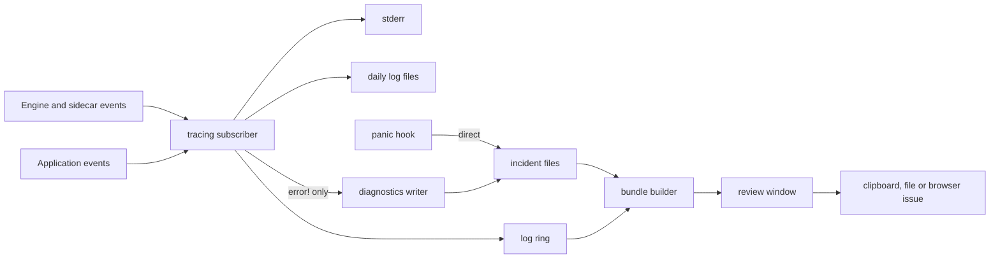

# Diagnostics

sqlr records what happens locally so the person using it can understand a failure and the maintainer can reconstruct it. Expected server errors become structured log lines; unexpected failures become Incidents, standalone JSON files under the data directory. The same system captures panics, distinguishes a clean exit from an unclean one, shows a non-blocking notice on the next launch, and builds a bounded Diagnostics bundle that the person reviews before copying, saving or handing to a public GitHub issue. sqlr sends nothing over the network and collects no telemetry.

## Concepts

- An **App session** is one run of the app from launch to exit. Every log line and Incident carries its identifier.
- An **Incident** is a JSON record of one unexpected event: a panic, a startup failure, an unclean shutdown, an engine task panic, a sidecar driver crash, an unexpected application error, or a manual report.
- The **Log ring** is the in-memory copy of the most recent log lines. The panic hook reads it when the file writer has not flushed.
- A **Diagnostics bundle** is the bounded JSON document the Diagnostics window previews, copies, saves and turns into a GitHub issue.
- A **Startup notice** is what the next launch says about the previous App session: a crash report when a panic was recorded, a lighter unclean-shutdown notice otherwise.

## Behaviour

### Logging

Logging writes to stderr and to a daily rotating file in the data directory's `logs` folder. Every stderr and file line carries the App session identifier as a field, so lines from one run correlate even across files.

The default filter is `info` with the MCP protocol library held at `warn` so request bodies stay out of the log.

Log files are named `sqlr.log.YYYY-MM-DD`, rotate on the date change, and keep today plus the thirteen previous days, fourteen files in all. Each file and the folder are owner-only (`0600` for files, `0700` for the folder on Unix). If the folder cannot be created or written, the app still starts and shows a persistent warning in the status bar that diagnostics are limited to stderr.

The log level has four values: `error`, `warn`, `info` and `debug`. It defaults to `info` and can be changed for the running App session from the Diagnostics window. The change applies immediately and is not persisted, so the next launch returns to the default. When the `RUST_LOG` environment variable is set, it controls the level for the launch, the window disables the control and shows that the environment decides.

**What is logged.**

- Startup at `info`: version, operating system, data directory, driver count and App session identifier.
- Successful and failed connects, disconnects, Session open and close, and sidecar start, stop and unexpected exit, at `info` or `warn` according to outcome.
- SQL statements with their Dialect's statement structure and classification, and document and key-value commands with their classifier, at the level the failure policy gives.
- Catalog reads, applies, imports, exports, transfers, dumps, restores and administration through the same failure-line policy.
- MCP tool calls with the client name and version, MCP session identifier, tool name, Connection, outcome, duration and numeric metadata. Never arguments or returned data.
- Sidecar driver output forwarded with a `driver` field, so lines from several drivers filter apart.

**Failure lines.** A query, fetch, Job, connect attempt or sidecar process reports exactly one line at the point its outcome is final, not at every helper that saw the error. The fields are `op`, `conn`, `driver`, `database`, `query_id`, `elapsed_ms`, `error_kind`, `error` and, when enabled, `sql`.

The level depends on the error kind:

- `Syntax`, `Permission`, `Auth` and `Timeout` are expected server errors and log at `info`;
- `Connection`, `Protocol`, `Unsupported` and `Other` are unexpected and log at `warn`;
- `Cancelled` logs at `debug`, so pressing Stop does not clutter the log.

Operation spans exist only at engine operation boundaries: connect, query, fetch, script, Job, administration, key-value and document work, and MCP tool calls. No interface-thread function or per-frame call is instrumented.

Log lines carry metadata only: server values, parameter values, secrets and result rows stay out.

### SQL in logs and reports

One global setting, `diagnostics.include_sql`, defaults to on and governs logs, Incidents and bundles together. It is persisted in the settings file and editable both in the Diagnostics window and in the General preferences section.

When on, failed SQL is recorded as typed, truncated to 4 KiB of UTF-8 at a character boundary with a `… (truncated)` marker. When off, the `sql` field is removed from log lines, Incidents and bundles, and the trailing ` sql=…` part is removed from historical ring excerpts too. SQL is always written last on a failure line so it can be removed later.

SQL literal redaction stays manual: the person reviews a bundle before sharing it. Secrets are excluded by construction.

### Incidents

An Incident is a JSON document with schema version 1. Its kinds are:

- `panic`: a panic on any thread the global hook records;
- `startup`: a failure before or during application startup;
- `unclean_shutdown`: the previous App session ended without a clean exit and without a recorded panic;
- `engine_panic`: a panic inside an engine command task;
- `sidecar_crash`: a driver process exited or broke the protocol;
- `error`: an unexpected application-level error emitted at error level;
- `manual`: a report the person created through Report a Problem.

The ingestion contract is the logging contract: an `error!` event is an Incident, and every other level is a log line. `error!` is reserved for unexpected failures; expected server errors use `info` or `warn`, and cancellation uses `debug`. An error event may name its kind with an `incident` field (`sidecar_crash`, `engine_panic` and so on); without it, the event is an `error` Incident. The event's span fields are merged into the Incident's `fields`, so operation context needs no fixed schema.

The Incident shape:

```json
{
  "schema": 1,
  "id": "2026-10-24T20-15-03Z-4711-a1b2",
  "session_id": "6f0c…",
  "at_ms": 1790000000000,
  "kind": "panic",
  "message": "assertion failed: …",
  "target": "diagnostics",
  "thread": "main",
  "file": "…",
  "line": 812,
  "error_kind": null,
  "fields": {"op": "query", "conn": "c1", "driver": "postgres"},
  "note": null,
  "acknowledged": false,
  "environment": {"version": "0.1.1", "os": "macos", "arch": "aarch64"},
  "logs": ["…recent lines…"],
  "backtrace": null
}
```

`error_kind` reuses the driver error kinds when the event came from a driver error. `fields` carries operation context, with unknown fields preserved across a read. `note` is set only for manual reports. `backtrace` is reserved and stays empty in release builds.

The identifier is `YYYY-MM-DDTHH-MM-SSZ-pid-suffix` in UTC: the time sorts lexicographically, the process identifier and a short random suffix keep two processes writing at the same instant apart. The store reads and writes only files whose names match the scheme.

**Storage.** Incidents live in a `diagnostics` folder under the data directory, one JSON file per Incident named from its identifier, newest first when listed. Writes go through a private temporary file in the same folder, sync and rename, and the file is owner-only; the folder is owner-only. The store uses ordinary files only, independent of the local SQLite database, the vault and the configuration, so a report works even when those are broken.

Retention is twenty files or thirty days, whichever is reached first. Pruning runs at startup and after each write, ignores unrelated files, and leaves the caller's result untouched.

Acknowledging an Incident rewrites its `acknowledged` flag atomically. Acknowledged Incidents stay listed and are no longer announced at startup.

Incident files contain the event, the environment summary and the log ring excerpt. A live snapshot of Connections, tabs or Operations belongs to a bundle built in the Diagnostics window, because the panic hook and the logging layer run on arbitrary threads and keep away from application locks. That snapshot is labelled as the current session.

### Panic capture and operation failure

The global panic hook is installed as early as the data directory is known, before logging and before the engine starts. It records:

- the panic payload as text;
- the source file and line;
- the current thread name, or `unnamed`;
- the App session identifier;
- the log ring excerpt.

It writes the Incident directly with plain file operations, stays away from application locks, and then calls the previously installed hook so the standard stderr output is preserved. When the diagnostics folder cannot be written, it falls back to stderr safely. An engine command task panic belongs to the engine's own converter, so each panic is recorded once.

Engine command tasks are spawned per command. Each is wrapped so a panic is caught and converted into:

- a failed query or document result with an internal-panic message, and a failed Job when applicable;
- failed Operations and Jobs belonging to that command;
- one `engine_panic` Incident carrying the operation kind, Connection, driver, query id, operation id and Job kind where known.

Other commands and the engine loop continue, so one bug does not stop unrelated work.

Support threads keep the global hook for recording. The store and Agent request paths additionally fail the operation that was waiting when their worker disappears, instead of leaving it pending for the rest of the App session.

The interface thread is not wrapped in a per-frame `catch_unwind`. A panic there means an invariant was violated; continuing risks writing over good data. On macOS the event loop stops and the process exits, and the hook has already written the report.

### Clean and unclean shutdown

At startup the app opens `session.lock` in the diagnostics folder and takes an exclusive non-blocking lock on it. The current session marker lives in a separate `session.json`, written atomically. Keeping the lock and the marker apart means replacing the marker by rename does not move the locked inode, so a second process still sees that the first is alive.

The marker contains the App session identifier, process identifier, start time and application version.

- A clean exit removes the marker and releases the lock.
- The next startup that acquires the lock and finds a marker knows the previous App session ended uncleanly.
- A second instance that finds the lock held treats the first as alive and leaves the marker alone.

When the previous session ended uncleanly, the startup notice depends on what was recorded:

- if an unacknowledged `panic` Incident exists for that App session, the banner offers the full crash report;
- otherwise the app writes an `unclean_shutdown` Incident saying that the previous session left no crash report, and shows the lighter wording.

A segmentation fault, an out-of-memory kill or a power loss therefore appears as an unclean shutdown rather than as a whole crash.

### Startup notice

The startup notice is a non-blocking banner anchored at the top center of the window. It stays until dismissed while work continues.

- When the previous session panicked, it reads "sqlr crashed the last time it ran."
- Otherwise it reads "The previous session did not close cleanly."

It offers:

- **Open report**, which opens the Diagnostics window with that Incident selected;
- **Report on GitHub**, which builds a bundle from the Incident, shows the review window and then opens a prefilled issue;
- **Copy**, which copies the Incident JSON exactly as written;
- **Dismiss**, which acknowledges the Incident so it is not announced again, and hides the banner.

### Startup failures

Argument parsing errors stay command-line errors on stderr with exit code 2.

Once the data directory is known, the panic hook and diagnostics are initialized, so any later failure is reportable: settings, Connections, the vault, the keychain, the driver registry, the engine, the graphics backend or the window system.

Such a failure is written as a `startup` Incident and shown in a native blocking dialog before the process exits non-zero. The dialog carries the failure message, whether a startup report was saved, a **Copy details** button that copies the Incident JSON, and an **Open logs** button that opens the logs folder. It is a native dialog because no event loop exists yet.

### The Diagnostics window

The Diagnostics window opens from Help → Diagnostics…, including the native macOS Help menu, from the command palette, and from the startup banner. It is a non-modal viewer, so it can sit next to the work.

**This session** shows the application version, build profile and target, the App session identifier, uptime, the operating system version and architecture, the data directory, the driver count and the number of connected Connections, with a note when another instance uses the same data directory. From here the person can build a bundle with **Copy diagnostics**, **Save bundle…** or **Open GitHub issue…**, open **Report a Problem…**, and see the size and truncation summary of the last bundle plus its collapsible preview.

**Incidents** lists the recent Incidents with time, kind, message and a dismissed marker. Selecting one shows its kind, time, message, thread, source location, note, event fields, environment and log excerpt, with **Copy**, **Save…** and **Open GitHub issue…**.

**Logs** offers the level for this App session, a note when `RUST_LOG` controls it, the statement that files rotate daily and the newest fourteen are kept, and **Open logs folder**.

**Privacy** holds the **Include SQL in logs and reports** checkbox with the explanation that SQL is recorded as typed without literal redaction, secrets are never recorded, and a bundle is reviewed before sharing.

### Review, copy, save and the GitHub issue

Copying, saving or opening a GitHub issue from a bundle goes through a review window that shows the exact JSON and offers **Copy reviewed bundle**, **Save reviewed bundle…** and **Open GitHub issue with this report**.

- Copying puts the serialized bundle on the clipboard.
- Saving uses the native save dialog with a default name `sqlr-diagnostics-YYYYMMDD-HHMMSS.json` and writes an owner-only file without changing the destination folder's permissions.
- Opening an issue builds a public new-issue page at `github.com/mceck/sqlr/issues/new` with a title and a body.

The title names the Incident kind and its first message line, for example "Crash: assertion failed: …", and falls back to the kind and application version when there is no message. The body carries a short description, the environment, the session identifier and, for a selected Incident, its kind, time, thread, location, up to four fields and a short log excerpt.

GitHub rejects long request lines, so the whole URL budget is 6 KiB. When the body with the full bundle inside a collapsible code block fits, it is embedded. Otherwise sqlr copies the full bundle to the clipboard and the body carries a marker asking for one paste. The browser opens only after the review, and the submission happens when the person presses Create on GitHub; sqlr itself stays offline.

A bundle too large for the URL always leaves the person with the copied text and an issue that explains where to paste it.

### Copy details

A result's error panel offers **Copy details**. The text contains the error message, the hint, the Connection, the database, the source position as line and column when known, the statement subject to `diagnostics.include_sql` and truncated to 4 KiB, and the elapsed time. It writes no Incident and keeps the person in the result area.

### Report a Problem

Report a Problem is available from Help, from the command palette and from the Diagnostics window. It offers:

- a free-text note describing what the person was doing;
- **Include SQL statements**, disabled when the global SQL setting is off;
- **Include open tab titles**;
- **Copy report**, **Save report…** and **Prepare GitHub issue…**.

Creating a report records a `manual` Incident whose message is the first non-empty line of the note, truncated to 120 characters, and whose full note is kept. The SQL and title choices are stored on the Incident and applied when its bundle is built; the SQL choice can only narrow the global setting. A manual report then appears in the Incident list and can be reopened, copied, saved or shared like an automatic one. The GitHub path goes through the review window.

### Bundle contents and limits

A bundle is one JSON document with schema version 1. It contains:

- **Session**: identifier, start time, uptime, process id, version, data directory and the other-instance flag.
- **Application**: version, build profile, target triple, short commit hash when the build embeds one, and the graphics backend.
- **Environment**: operating system and best-effort version, architecture, locale, and resident memory when available.
- **Drivers**: identifier, name, version, bundled or installed, sidecar running state and restart count.
- **Settings**: resolved values by global, profile and Connection level, with sensitive settings omitted.
- **Connections**: identifier, display name, driver, host, port, database, user, TLS mode, profile, session status and open transaction state. The bundle collects metadata only; secret values stay in the vault.
- **Interface**: open tab count and titles, each tab's Connection and database, open transactions and visible panels.
- **Operations**: the last fifty Operations with kind, Connection, label, duration, outcome and error.
- **Logs**: the ring excerpt, newest lines that fit.
- **Incidents**: the selected Incident in full with its log excerpt capped, and the recent Incident summaries.

Caps:

| Section | Limit |
| --- | --- |
| Whole bundle | 512 KiB |
| Log lines in the bundle's own section | 128 KiB |
| Log lines inside the selected Incident | 64 KiB |
| Operations | 50 |
| Open tabs | 100 |
| Settings entries | 200 |
| Connections | 200 |
| Drivers | 200 |
| Recent Incident summaries | 20 |
| One string | 4 KiB |
| One setting value | 1 KiB |

Sensitive settings are omitted by identifier: `terminal.shell`, and any setting whose identifier contains `password`, `passphrase`, `secret` or `token`. Query and fetch operation labels become `<SQL omitted>` when SQL is off. Tab titles become `<title omitted>` when the person excluded them.

Every truncated section carries a marker naming what was omitted, and the top-level `truncation` list repeats them. If shrinking the sections still leaves the bundle over 512 KiB, the renderer keeps the schema, session, application and environment and replaces every large section with an omission note, so the document stays valid and bounded.

Absolute paths under the home directory and the data directory are shortened to `<home>/…` and `<data-dir>/…`, with the data directory applied first because it may sit under home. A final redaction pass replaces any supplied secret sentinel with `<redacted>`.

The app collects the inputs as cheap copies on the interface thread, then serializes, shortens and writes on the diagnostics worker. File I/O stays on the worker, and saving and clipboard work happen only after the text is ready.

Incident files are valid standalone reports; copying from the crash banner copies the Incident JSON as written, while saving from the Diagnostics window saves a bundle.

### Privacy

Diagnostics stay offline. The only hand-off is the browser opening the public new-issue page after an explicit review; the submission happens when the person submits the form. The app collects no telemetry, keeps no installation identifier and uploads no crash data.

Passwords, passphrases, bearer tokens and vault contents stay out of logs, Incidents and bundles; diagnostics work without reading the vault. The SQL setting controls SQL in one place for logs and reports. Log and diagnostics folders and their files are owner-only.

## Architecture

The diagnostics system lives in the application, with the existing engine and sidecar tracing used as its input; it adds no new workspace component and no dependency to those components.

The engine, the sidecar client and the application emit structured events with the tracing library they already use. The application installs a tracing layer that:

- writes every event to the ring;
- implements the failure policy for expected errors;
- turns `error!` events into Incidents and queues them to a dedicated writer thread.

The panic hook is the only producer that writes an Incident directly, because a crashing process has to write on the spot.

The application owns one initialized diagnostics value with the Incident model, the file store, the session marker and lock, the log ring, the bundle builder and the window state. The engine and the sidecar client stay unaware of files, JSON and the UI.

The diagnostics writer thread runs Incident writes, bundle building and folder work in order, so reports keep their order. File work stays on that thread. The writer survives until the diagnostics value is dropped, and it flushes on request for tests.

Environment information is collected once per App session and once per bundle on a background thread, keeping the interface thread free. Values a platform cannot provide are omitted rather than guessed. The short commit hash is embedded at build time when available.

Engine instrumentation attaches operation context at the command boundary and propagates it through the Operation registry and query, Session and Job identifiers. Failure logging happens where the outcome is final. Engine command panics are caught per command and converted as described. The sidecar client logs process exit, handshake failure, protocol violations, kill reasons and forwarded driver output with the driver identity.



## Data model

- **Incident**: schema, id, App session id, time, kind, message, target, thread, file, line, error kind, free-form fields, note, acknowledged flag, environment, log excerpt, reserved backtrace.
- **Incident summary**: id, App session id, time, kind, message, acknowledged flag.
- **Environment**: application version, operating system, architecture, OS version, locale, build profile, target triple, commit, graphics backend, resident memory.
- **Session marker**: App session id, process id, start time, application version; guarded by a separate lock file.
- **Bundle**: the rendered document described above plus its outline: byte size, tab, Operation, log-line and Incident counts, and the truncation list.
- **Log ring**: up to 500 lines and 256 KiB, with the dropped line and byte counts.

## Non-functional requirements

- Incidents, the ring and the writer are bounded: 20 Incident files or 30 days, 500 ring lines or 256 KiB, 8 KiB per ring line, and a 512 KiB bundle.
- Log retention is fourteen daily files, and SQL in a report is capped at 4 KiB.
- The diagnostics folder and its files are owner-only; the logs folder and each log file are owner-only.
- The interface thread leaves file I/O to the diagnostics writer and continues while a report is built.
- The app starts even when the diagnostics or logs folder is unavailable, and shows a persistent warning that diagnostics are limited to stderr.
- A panic inside the writer or the hook stays contained: the hook uses plain file operations with a stderr fallback, and the writer catches panics in background work.
- Diagnostics code stays offline; a bundle leaves the machine only when the person submits the opened issue.
- Bundle building and saving complete promptly enough to keep the review window responsive; the largest allowed bundle is 512 KiB.

## Decisions

- **`error!` means Incident, and the logging pipeline is the ingestion path.** The engine and sidecar already emit structured tracing events, so making error level the signal turns one existing path into Incident capture without a second observability system or new dependencies in those components. The alternative, a typed diagnostics sink, would be more explicit but would add a component and dependencies merely to write a JSON file. The rule is a hard project rule because a new `error!` is a new Incident.
- **The panic hook writes directly.** A crashing process cannot count on a background writer thread. The hook takes no application locks, uses plain file operations, and chains to the previous hook so stderr keeps its usual output.
- **No frame-level `catch_unwind` on the interface thread.** A panic means an invariant was violated; continuing risks overwriting good data. The honest recovery is to exit and report on the next launch.
- **Incidents do not depend on SQLite, the vault or the configuration.** The worst failures include a broken database or configuration, so the store uses ordinary files only and the diagnostics folder is created independently.
- **A separate lock file and marker.** The lock must not move to a new inode when the marker is rewritten, or a second process could believe it is alone. Splitting the two keeps second-instance detection correct.
- **A second instance is treated as alive.** Multiple windows on one data directory must not produce false crash notices, so only the lock holder writes or clears the marker.
- **An unclean shutdown is its own Incident.** A kill or power loss leaves no panic report; inventing a cause would be wrong, so the app says only that the session did not close cleanly. Dismiss is then remembered like any other Incident.
- **No backtraces or symbols in reports.** Release binaries are stripped to stay within the installed-size budget, so a backtrace would be addresses. The Incident schema keeps room for one if symbols ever become available, and the limitation is stated to the person.
- **SQL is included by default and never redacted automatically.** The statement is usually the only way to reproduce a failure; a single global setting removes it from logs and reports together, and the review window lets the person decide before sharing. Masking literals automatically was considered and rejected as unreliable and surprising.
- **Bounded bundles with explicit truncation markers.** Reports must be easy to attach and predictable in size, so every section has its own cap and the whole document has a hard limit. Silent truncation would make a report misleading, so every omission is named.
- **The browser hand-off instead of an upload.** Opening the public new-issue page keeps the no-telemetry promise. The full report is embedded when the URL allows it, and otherwise copied for one paste; sqlr never performs the request.
- **The log level is session-only, with `RUST_LOG` on top.** A debugging session should not silently leave the app at debug forever, and launch scripts that already set the environment keep working.
- **Owner-only files.** SQL, Connection details and paths are sensitive to other local users, so folders and files are private by construction.

## Related specs

- [Architecture](architecture.md): threading, failure containment, error kinds and the Operation registry.
- [Query execution](query-execution.md): where queries, fetches and transactions settle and produce failure lines.
- [Drivers](drivers.md): sidecar lifecycle, driver errors and forwarded driver output.
- [Agents and terminal](agents-and-terminal.md): Agent tool-call logging, the terminal's exclusion from logs, and the MCP protocol library's log suppression.
- [Connections](connections.md): Connection metadata included in a bundle, while the vault stays outside it.
- [Settings and workspace](settings-and-workspace.md): settings persistence, the status bar warning and the General preferences section.
- [Results and editing](results-and-editing.md): the result error panel that carries Copy details.
