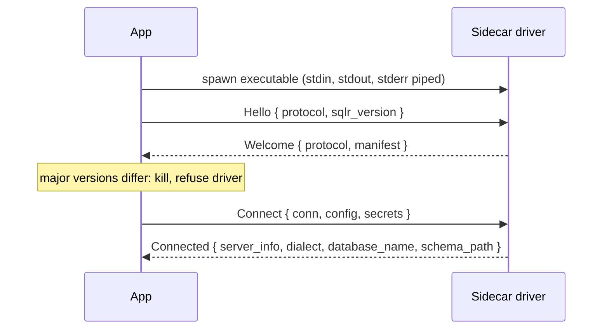
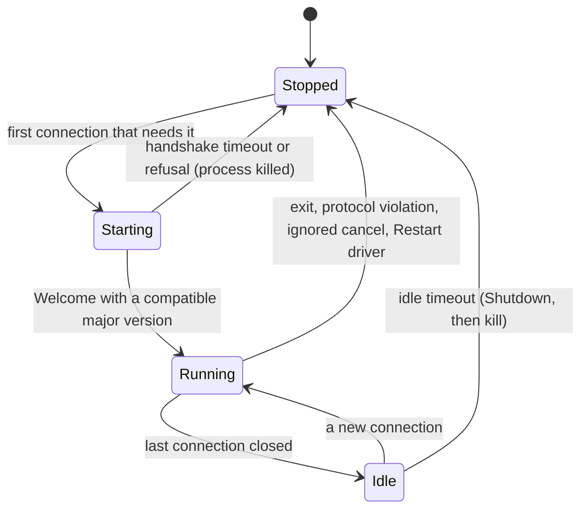
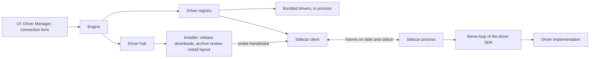

# Drivers

A **Driver** speaks one database's protocol and exposes it to sqlr through one shared driver interface, so the engine and the UI work the same way with every database. This area covers that interface and its three Families, Capabilities, the Dialect, the Driver manifest and the connection form it generates, the behaviour of every supported database, the split between Bundled drivers and Sidecar drivers, the sidecar protocol (a wire contract that drivers in any language implement), the driver SDK and the Conformance suite, and the Driver Manager that downloads, installs, rolls back and removes Sidecar drivers. Adding a database means writing a Driver; the app itself does not change.

## Concepts

- A **Driver** has a **Driver manifest** (its self-description) and opens **driver connections**: live links to one database server or file. The engine wraps each driver connection in a Session (see [Query execution](query-execution.md)).
- A driver connection belongs to exactly one **Family**, which decides the operations it offers: **Relational** (SQL), **Document** (MongoDB, Elasticsearch) or **KeyValue** (Redis).
- **Capabilities** are flags in the manifest. The UI offers an action only when the Driver declares the matching Capability.
- A relational Driver provides a **Dialect**: the per-database rules for quoting, splitting, keywords, generated SQL, statement classification and transaction statements.
- A **Bundled driver** is compiled into the app. A **Sidecar driver** runs as a separate process and talks to the app over the **sidecar protocol**. The engine and the UI cannot tell them apart.
- A **Driver archive** is a packaged Sidecar driver for one platform. The **Driver Manager** installs Driver archives from the sqlr GitHub release or from a file the user picks.
- The **JDBC bridge** is a Sidecar driver that reaches any database with a JDBC driver through a Java runtime.
- The **Conformance suite** is the shared test harness every relational and Document Driver passes against a real database.
- A **Known database** (see [Connections](connections.md)) names the Driver that serves it: bundled, compatible (served by a Bundled driver with preset fields), installable (a Sidecar driver the release publishes) or planned.

## Behaviour

### The driver interface

Every Driver offers two things: its manifest, and **connect**, which takes a Connection's non-secret settings and its secrets and returns a driver connection or a driver error. A relational Driver can also hand out its Dialect before any connection exists; a Driver can compute that Dialect from a Connection's settings (Snowflake uses the configured schema as the default schema).

Every driver connection offers:

- **ping**: the server's product name and version.
- **browse(path)**: the children of one explorer Node (see [Explorer and objects](explorer-and-objects.md)). Browsing is lazy: one call per expanded Node.
- **a cancel handle**: stops the statement the driver connection is running, from any thread.
- **its Family interface**: exactly one of relational, document or key-value.
- optionally, **its database name** and **the Node path that holds its schemas** (empty for drivers whose schemas sit at the root; a database Node when the explorer lists databases first).
- optionally, **connect to another database** of the same server with the same credentials, and **the database a Node path belongs to**. PostgreSQL and MySQL use this when "Show all databases" is on.

Driver errors carry a kind, a message, an optional character position in the statement and an optional hint. The kinds are `Connection`, `Auth`, `Syntax`, `Timeout`, `Cancelled`, `Permission`, `Unsupported`, `Protocol` and `Other`. A `Syntax` error with a position marks the statement in the editor; `Cancelled` ends a cancelled statement quietly; how the UI presents the other kinds is described in [Query execution](query-execution.md).

### Families and their operations

**Relational.** A relational driver connection offers:

- **execute(sql)**: either a number of affected rows, or a row stream.
- **execute with bound parameters**: the same, with values bound to the Dialect's placeholders. Optional.
- **row streams**: the result's column metadata, then Result chunks of at most N rows on demand, then close. A stream is read one page at a time; the engine asks for the Page size (see [Query execution](query-execution.md)).
- **describe(table)**: columns, keys and indexes of a table, used for editing results. Each column says whether it is **generated** (it refuses explicit values: computed columns and always-generated identities) and whether it is **automatic** (the server supplies a value when it is omitted: identities, sequence defaults, rowid aliases; an automatic column may still accept explicit values). The grid uses the difference when duplicating rows and when regenerating ids of pasted rows.
- **catalog(schema)**: every relation of a schema with its columns, for autocomplete and the Palette.
- **explain(sql, analyze)**: an Explain plan, built from the Dialect's explain rules (see [Data and schema tools](data-and-schema-tools.md)).
- **the DDL of a Node**, the **object a Node stands for**, **introspection** (object definitions, roles, whole-schema snapshots for Schema compare) and **administration** (see [Explorer and objects](explorer-and-objects.md)).
- **server notices** since the last call (PostgreSQL `NOTICE`s, MySQL warnings), shown in the Messages pane.
- **an origin check**: before result edits apply, the driver confirms that cached column origins still name the same table (PostgreSQL resolves origins by table oid and drops its cache when a table was renamed or dropped).
- **its Dialect**.

Every optional operation answers `Unsupported` when the driver leaves it out, and the matching feature stays hidden or reports that it is unavailable.

**Document.** A document driver connection offers:

- **its query language**: the Mongo shell subset or the Elasticsearch console syntax (both below).
- **run(database, text)**: one statement or request, which returns a document stream, a row stream (tabular results: ES|QL, SQL, `distinct`, `show dbs`), a write summary (matched, modified, inserted, deleted, and the `_id`s of inserted documents) or a single value (a count, a command reply, a response body).
- **document streams**: Doc chunks of at most N documents on demand, notices for the user (such as a search restarted after its point in time expired), and close. Closing releases server cursors and points in time and may be called twice.
- **statement splitting** of a script into statement ranges.
- **replace, insert and delete one document** by its `_id` in a target (a MongoDB collection, or an Elasticsearch index, alias or data stream). Insert returns the `_id`, generated when the document has none.
- **whether a target is a read-only view** (MongoDB views), whose documents cannot be edited.
- **the indexes of a target** (MongoDB `listIndexes`; Elasticsearch mappings and settings).
- **the text that opens a target's documents**, one page at a time, and **the target a Node stands for**.
- **classification** of a statement into a Statement class, and **a read-only switch**: while it is on, every statement that may write fails with `Permission` "The session is read-only".

**KeyValue.** A key-value driver connection offers, for a logical database number:

- **scan(pattern, cursor, count)**: one `SCAN` call, returning keys with type and TTL and the next cursor (0 when complete). Browsing never uses `KEYS`. The engine asks for 500 keys per call.
- **key info**: type, TTL in milliseconds, memory size and length; nothing for a missing key.
- **page(key, from, count)**: one page of a value, 200 elements per page, or 1 MiB of a string.
- **edit(key, change)**: set a string; set or delete a hash field; set, push or remove a list item (a removal is refused when the item at that index changed since it was shown); add or remove set and sorted-set members; add or delete stream entries; set or remove the expiry; rename (refused when the new name exists); delete; create a key with its first element (refused when the key exists).
- **command(args)**: one console command; a server error reply is a reply, not a driver error.
- **exec block**: several commands as one `MULTI`/`EXEC` block.
- **classification** of a command, **the number of logical databases** and **a read-only switch**.

Key names and values are bytes. Names that are not valid UTF-8, or that hold control characters, display with each such byte escaped as `\xNN` and `\` as `\\`, and parse back from that form. How the Key browser presents keys and values is described in [Results and editing](results-and-editing.md).

### Capabilities

| Capability | Meaning, and what the app does with it |
|---|---|
| `transactions` | The driver honours begin, commit and rollback. Without it the commit mode is ignored (color, confirmations and read-only still apply). |
| `server_cancel` | Stop triggers a real server-side cancel. |
| `editable_results` | Results can be edited in the grid; the Conformance suite also checks table descriptions. |
| `explain` | The Explain button and the Plan pane are offered. |
| `multi_resultset` | Declared by drivers; the app reads it only to report it to Agents. |
| `tabular_query` | Declared by drivers; the app reads it only to report it to Agents. |
| `schemas` | The database has schemas. |
| `ssh` | The connection form offers an SSH tunnel. |
| `dump` | Databases dump and restore with native tools; the explorer also gates ER diagram and Schema compare entries on it. |

Object editing has its own descriptor in the manifest (below); a manifest without one hides every object editor.

### The Dialect

A relational Driver's Dialect provides:

- **identifier quoting**, used for every identifier in generated SQL;
- **syntax data**: keywords, reserved words, built-in functions, comment and string rules and the tree-sitter grammar id, used for highlighting, completion and statement splitting (see [Query editor](query-editor.md));
- **opening a relation's data**: the `SELECT` for a table or view Node, with an optional row limit;
- **default schemas**, and whether a database is a schema (MySQL);
- **placeholders** for bound parameters;
- **qualified names**, **string, boolean and bytes literals**;
- **transaction statements**: the begin statement, savepoint, rollback-to and release statements, the read-only on/off statements, and transaction quirks (DDL commits the open transaction; an error aborts the transaction; a nested `BEGIN` increments a depth; savepoint names replace each other; a savepoint starts a transaction; `BEGIN` starts a PL/SQL block);
- **statement classification** into Statement classes, used by read-only sessions, confirmations and Smart commit mode;
- **wrapping** a query for server-side sort and filter (`SELECT * FROM (<query>) sqlr_q ORDER BY … NULLS LAST` and `… WHERE …`, with trailing semicolons removed outside literals and comments);
- **DML generation** for the Changeset, including `INSERT … DEFAULT VALUES`, upserts and `MERGE` statements used by imports;
- **load-session statements** (MySQL loads in UTC) and **constraint toggles** for bulk loads;
- **explain rules** for the Explain plan;
- **DDL generation** for object editors: statements for a list of schema changes, the `CREATE` script of an object, the statements that turn one table definition into another, and each statement's **placement**: in the transaction, alone (before it), or as cleanup that runs even after a failure.

Generated scripts end every statement with `;`, on its own line when the statement ends in a line comment.

| Driver | Quoting | Placeholders | Row limit in "open data" | Begin | Read-only statements |
|---|---|---|---|---|---|
| PostgreSQL | `"…"` | `$1` | `LIMIT n` | `BEGIN` | `SET SESSION CHARACTERISTICS AS TRANSACTION READ ONLY / READ WRITE` |
| MySQL / MariaDB | `` `…` `` | `?` | `LIMIT n` | `START TRANSACTION` | `SET SESSION TRANSACTION READ ONLY / READ WRITE` |
| SQLite | `"…"` | `?` | `LIMIT n` | `BEGIN` | `PRAGMA query_only = 1 / 0` |
| SQL Server | `[…]` | `@P1` | `TOP (n)` | `BEGIN TRANSACTION` | none (client classifier only) |
| Oracle | `"…"` | `:1` | `FETCH FIRST n ROWS ONLY` | `SET TRANSACTION READ WRITE` | none |
| SAP HANA, DuckDB, Snowflake | `"…"` | `?` | `LIMIT n` | `BEGIN` | none |

Further per-dialect rules: PostgreSQL text holding a backslash uses an `E'…'` string and bytes are `E'\\x…'::bytea`; an error aborts its transaction. MySQL DDL commits the open transaction and savepoint names replace each other. SQL Server savepoints are `SAVE TRANSACTION` / `ROLLBACK TRANSACTION` with no release, a nested `BEGIN TRANSACTION` increments a depth, and bytes are `0x…`. Oracle DDL commits, `BEGIN` opens a PL/SQL block, bytes are `HEXTORAW('…')`, and only plain SQL loses its trailing `;` (PL/SQL keeps its `END;`). SQLite's `SAVEPOINT` starts a transaction.

A Sidecar driver's Dialect crosses the protocol as data (see "Dialect over the wire"). Until a Sidecar driver's first connection announces it, saved Connections of that driver use ANSI syntax; they adopt the Dialect as soon as it is known.

### The Driver manifest and the connection form

A Driver manifest holds:

- **id**: saved Connections name their Driver by it, so it never changes. Ids are lowercase letters, digits, `-` and `_`, at most 64 characters.
- **name** and **Family**;
- **Capabilities**;
- **fields**: the connection form;
- **dialect id**: also selects the editor's query language (SQL dialects, Mongo shell, Elasticsearch console, Redis commands);
- **URL schemes** the connection form accepts in its URL box (see [Connections](connections.md));
- **default port**;
- **object editing**, when the driver supports object editors: the object kinds it can create, alter, drop and rename, whether DDL is transactional, column type suggestions, whether objects and columns take comments, and whether a table's columns can be reordered.

Each field has a key, a label, a type, an optional default, a required flag, a secret flag and a group. Field types are text, port, password, boolean, number (a non-negative whole number), choice (value and label pairs) and file (a native picker, for an existing file or a new one, with extension filters). Groups become the form's tabs: `Main`, `TLS`, `Advanced`, `Properties`, `Connection` and any other name a driver uses. The app generates the form from the fields, so a Driver gets a working form without UI code. The SSH tab comes from the app when the Driver declares `ssh`.

Secret fields are stored in the Credential vault and reach the Driver only inside connect; they never enter `connections.toml`. A driver receives the secrets of the fields its manifest declares secret.

**Driver properties.** The PostgreSQL, MySQL and SQLite manifests add typed session properties in the `Properties` group, with keys `property.<name>`:

- PostgreSQL: `application_name`, `options`, `statement_timeout` (number), `search_path`, plus any other property (free-form).
- MySQL: `sql_mode`, `time_zone`, `wait_timeout` (number), plus any other property (free-form).
- SQLite: `foreign_keys` (boolean), `journal_mode` (`DELETE`, `TRUNCATE`, `PERSIST`, `MEMORY`, `WAL`, `OFF`), `busy_timeout` (number), `cache_size` (a whole number, negative allowed).

A property name starts with a letter and holds letters, digits, `_` and `.`; values are free of NUL bytes and match the field's type. An unknown property is accepted only by drivers whose properties are free-form; any other invalid property refuses the connection with "Invalid driver property" or "Unknown driver property".

### Bundled and Sidecar drivers

| Database | Family | Delivery | Driver id |
|---|---|---|---|
| PostgreSQL | Relational | Bundled | `postgres` |
| MySQL / MariaDB | Relational | Bundled | `mysql` |
| SQLite | Relational (file) | Bundled | `sqlite` |
| SQL Server | Relational | Bundled | `sqlserver` |
| Oracle | Relational | Bundled, pure Rust, no Oracle client libraries | `oracle` |
| Snowflake | Relational | Bundled, HTTPS SQL API | `snowflake` |
| ClickHouse | Relational | Bundled, pure Rust HTTP client | `clickhouse` |
| MongoDB | Document | Sidecar, downloaded from the release | `mongodb` |
| Elasticsearch | Document, with tabular queries | Bundled | `elasticsearch` |
| Redis | Key-value | Bundled | `redis` |
| SAP HANA | Relational | Sidecar, downloaded from the release | `hana` |
| DuckDB | Relational (file or memory) | Sidecar embedding the DuckDB engine, downloaded from the release | `duckdb` |
| Any database with a JDBC driver | Relational | JDBC bridge Sidecar, downloaded from the release, needs Java 17+ | `jdbc`, `jdbc-<database>` |

Every Bundled driver is registered at startup. Installed Sidecar drivers are registered from the install directory at startup and after every install, update, rollback or removal, without a restart. When an installed Sidecar driver has the id of a Bundled driver, the Bundled driver wins and the installed one is ignored with a warning in the log.

### Per-database behaviour

#### PostgreSQL

- Connection form: host (`localhost`), port (5432), database (`postgres`), **Show all databases** (off), user (`postgres`), password; TLS group: SSL mode (`disable`, `prefer` (default), `require`, `verify-ca`, `verify-full`, with libpq's meaning), root certificate, client certificate and client key (PEM files). URL schemes `postgresql` and `postgres`.
- TLS goes through rustls on the `ring` provider. `prefer` uses TLS when the server offers it and plain otherwise; `require` without a root certificate skips verification; `verify-ca` checks the chain and not the host name; `verify-full` checks both. Without a root certificate the verifying modes use the system roots. A failed TLS negotiation is a `Connection` error.
- Each driver connection holds two clients: an **explorer client** for browsing, catalog, describe, DDL, administration and ping, and a **query client** for user statements. Browsing answers while a result stream holds the query client; objects the query client created and has not committed are not visible to it.
- Reads stream through a server-side cursor (`DECLARE sqlr_cursor` and `FETCH`). Outside a user transaction block the cursor lives in its own transaction, committed (or rolled back after a cancel or failed fetch) when the stream ends; inside the user's block only the cursor is closed. A statement that cannot be a cursor (a data-modifying CTE, a top-level DML with `WITH`) is buffered instead; an `INSERT`/`UPDATE`/`DELETE … RETURNING` is wrapped so every column comes back as its type's text output.
- Result columns carry their origin (table and column), resolved by table oid once per connection.
- Server notices are kept, at most 1,000, until the Messages pane takes them.
- Cancel uses the native cancel request over the same TLS settings.
- **Show all databases**: the explorer root lists every database that allows connections, the current one first and marked "current"; each other database browsed or queried opens its own connection on first use with the same server and credentials.
- Explorer tree: schemas (`information_schema` and `pg_catalog` last; toast and temp schemas hidden) → `tables`, `views`, `materialized views`, `functions`, `sequences` → tables with `columns` and `indexes` folders, views with their columns. Tables show `~N rows` from the planner estimate; columns show their type and `NOT NULL`; functions are listed with their identity arguments and procedures are told apart.
- A whole schema is read for Schema compare in nine catalog queries, whatever the number of objects.
- Object editing: create, drop and rename databases, schemas, tables, views, materialized views, indexes, sequences, functions, procedures and triggers; alter tables, views, materialized views, functions and procedures; transactional DDL; comments; no column reordering.
- Administration: roles from `pg_roles`, grants from the catalogs' ACLs (owners' implicit privileges included), sessions from `pg_stat_activity`, locks from `pg_locks` with `pg_blocking_pids`, settings, database sizes and table statistics.

#### MySQL and MariaDB

- One Driver (`mysql`) serves both; the MariaDB Known database uses it too. Connection form: host (`localhost`), port (3306), database (optional), user (`root`), password, **Show all databases** (off); TLS group: SSL mode (`disabled`, `preferred` (default), `required`, `verify_ca`, `verify_identity`), CA certificate, client certificate, client key. URL schemes `mysql` and `mariadb`.
- Results stream row by row off the wire. The protocol cannot abandon a result, so a stream closed early first stops the statement with `KILL QUERY` from the control connection, then reads what is left.
- Cancel is `KILL QUERY <id>` from a separate connection.
- Databases are schemas. Without Show all databases the root lists the connection's database and a **System** folder holding `information_schema`, `mysql`, `performance_schema` and `sys`; with it, every database. Under a database: `tables`, `views`, `functions`, `procedures`, `triggers` (functions and procedures have separate folders because they may share a name); tables have `columns` and `indexes`.
- Loads run in UTC: the session time zone is saved, set to `+00:00` and restored afterwards. Bulk loads turn `FOREIGN_KEY_CHECKS` and `UNIQUE_CHECKS` off and back on.
- A whole database is read for Schema compare in ten `information_schema` queries.
- Object editing: create and drop databases, tables, views, indexes, functions, procedures and triggers; alter databases, tables, views, functions and procedures; rename tables, views and indexes; DDL is not transactional; comments; column reordering (`AFTER`). Option values (engine, character set, collation) must be plain words.
- Administration: accounts (`user@host`) and roles from the `mysql` schema (MariaDB roles have no host), grants from `mysql.db`, `mysql.tables_priv` and `mysql.procs_priv`, sessions from the process list, locks (MySQL `performance_schema.data_locks`, MariaDB `information_schema.INNODB_LOCKS`), variables, database sizes and table statistics. Session ids are parsed as numbers before `KILL`.

#### SQLite

- Connection form: database file (picker for `.db`, `.sqlite`, `.sqlite3`; required), read-only (off), create the file if missing (on). No secrets, no host or port. URL scheme `sqlite`.
- One worker thread per driver connection owns the database handle; the async side sends it commands over a channel, and an open result keeps its prepared statement on that thread between fetches, stepping rows incrementally.
- Cancel interrupts the running statement.
- Values keep SQLite's dynamic typing: each cell is decoded by its storage class, and declared types give display hints.
- Schemas are the attached databases (`main`, `temp` and any attached file). Tree: schema → `tables`, `views`, `indexes`, `triggers` → objects → columns (for tables and views).
- The DDL of an object is the statement SQLite keeps for it, as written: comments and formatting included. Object definitions are parsed from those statements; column constraints are read as table constraints. A whole schema is read in one statement.
- Object editing: create and drop tables, views, indexes and triggers; alter tables and views; rename tables; transactional DDL; no comments; column reordering. Table changes `ALTER TABLE` cannot make (a type, nullability, default, key or constraint change; dropping a column something refers to; reordering) go through a **table rebuild** following SQLite's documented procedure:
  1. foreign key enforcement is turned off in a statement that runs alone before the transaction (SQLite ignores the pragma inside one), and turned back on as cleanup; a guard fails the transaction if enforcement is still on;
  2. views and other tables' triggers that name the table are dropped;
  3. the new table is created under a temporary name and the rows are copied column by column (renamed columns from their old name); an `AUTOINCREMENT` table keeps the old high-water mark, so ids of deleted rows are never reused;
  4. the old table is dropped and the new one takes its name;
  5. indexes, triggers and dependents are created again; a guard reads every dependent view; when triggers were recreated, a scratch table is created, renamed and dropped so SQLite resolves every trigger and view and fails on a missing column or table;
  6. a guard runs `foreign_key_check` on the table and the tables referencing it;
  7. the table is renamed when its name changes, which SQLite carries into views, triggers and foreign keys.
- Administration: properties (PRAGMAs, library version, integrity check) and statistics (file sizes; per table an exact row count from `sqlite_stat1` when `ANALYZE` ran, else a cancellable `count(*)`, and bytes from the `dbstat` virtual table). SQLite has no users, grants or sessions.

#### SQL Server

- Native TDS driver over rustls. Connection form: host (`localhost`), port (1433), database (`master`), user (`sa`), password, application name (`sqlr`); TLS group: encryption (`required` (default), `on` when possible, `off` (login only), `not_supported`), trust server certificate (off). URL schemes `sqlserver` and `mssql`.
- Streaming is demand-driven and bounded: at most one page is in flight. A partial row stream owns the query connection, so explorer and describe work uses a second connection opened on first use.
- Cancel opens a side connection and runs `KILL <spid>` for the session's `@@SPID`; it fails as `Unsupported` while the session id is unknown.
- Tree: schema → `tables`, `views`, `functions`, `procedures`, `sequences`; tables have `columns`, `indexes`, `triggers`. Only the connection's own database is browsed.
- A whole schema is read for Schema compare in six queries. Showplans come back as a rowset only for a batch of their own, so explain runs its statements as separate batches.
- Object editing: create, drop and rename schemas (create and drop only), tables, views and indexes; alter tables and views; transactional DDL; no comments; no column reordering. DDL generation covers tables, views, indexes and schemas.

#### Oracle

- Pure-Rust driver, no Instant Client. Connection form: host (`localhost`), port (1521), service name (`FREEPDB1`), connect by (`service` or `sid`), user (`system`), password; TLS (off). URL scheme `oracle`.
- The driver declares no `server_cancel`: Oracle cannot cancel a running statement without closing the connection, and a cancel answers `Unsupported`.
- Autocommit: outside an explicit transaction (opened by the engine with `SET TRANSACTION READ WRITE` in Manual and Smart modes, applies and imports) each writing statement commits its own work. DDL commits on the server, so a list of DDL statements is not atomic.
- A failed statement can make Oracle close the session without saying so. The driver then opens a fresh connection and carries on; session state (an open transaction, `ALTER SESSION` settings) is lost and the error says so, reported before any work runs in the new session.
- Rows are prefetched and paged with `OFFSET … FETCH NEXT`.
- Tree from the `ALL_*` dictionary views: schema → `tables`, `views`, `sequences`, `functions`, `procedures`, `triggers`; tables have `columns`, `indexes`, `triggers`. Only the connection's own pluggable database is browsed.
- A whole schema is read for Schema compare in five queries.
- Object editing: create, drop and rename tables, views and indexes; alter tables and views; DDL is not transactional; no comments; no column reordering.

#### Snowflake

- Bundled driver over the public SQL API, HTTPS with rustls; no Java, JDBC or ODBC. Connection form (group `Connection`): account host (a bare host name such as `myorg-myaccount.snowflakecomputing.com`, letters, digits, `.` and `-` only), database, schema, warehouse, role, authentication (`OAUTH` (default), `PROGRAMMATIC_ACCESS_TOKEN`, `KEYPAIR_JWT`) and the access token or JWT (secret, required). URL scheme `snowflake`, for example `snowflake://myorg-myaccount.snowflakecomputing.com/MY_DATABASE?schema=PUBLIC&warehouse=COMPUTE_WH`; the token is entered separately.
- Context names are case-sensitive: use the names Snowflake returns, usually uppercase. The server needs a usable warehouse for queries that need compute. sqlr neither generates nor refreshes key-pair JWTs; an expired token needs a reconnect with a fresh one.
- Requests carry the token as a bearer header marked sensitive, follow no redirects, connect within 15 seconds and time out after 60 seconds. Certificate verification is always on.
- Each request is independent and has no durable session. `USE`, `SET`, `UNSET`, `BEGIN`, `COMMIT`, `ROLLBACK`, `SAVEPOINT` and `RELEASE` are refused with a message pointing to the connection settings. A script runs as separate statements, so temporary tables, session variables and context changes do not carry over.
- Statements run asynchronously on the server; results arrive in partitions Snowflake sizes, fetched one at a time and handed out in chunks of the requested size. Cancel cancels the active statement.
- Exact decimals and integers outside the signed 64-bit range are text. The driver declares no transactions and no editable results, so imports and transfers into Snowflake are unavailable (they need transactional loading); exports work.
- The explorer lists schemas, tables, views and columns of the configured database; catalogs feed autocomplete.
- Statement errors show Snowflake's own message with the token removed should the server echo it; authentication, permission and service failures show a fixed message.

#### ClickHouse

- Bundled Driver using the official pure Rust client over HTTP, or HTTPS with rustls and the operating system's trusted certificates. Connection fields are host (`localhost`), port (8123), database (`default`), user (`default`), password (secret), and TLS (off). HTTPS commonly uses port 8443, selected explicitly. The Connection URL scheme is `clickhouse`. SSH tunnelling uses the standard host and port fields.
- The welcome card opens the native connection form immediately. New Connections use the `clickhouse` Driver; saved `jdbc-clickhouse` Connections continue through their installed JDBC bridge.
- Opening a Connection authenticates and reads the server version within 15 seconds. Each request carries the configured database and query settings. Statements run in auto-commit. Explicit transaction and session commands return an unsupported-operation error pointing to Connection settings and per-query `SETTINGS`. The read-only switch sends the server's readonly setting with each subsequent request.
- Results stream in JSONCompactEachRowWithNamesAndTypes, preserving column metadata for empty results. The driver reads at most the requested page of rows and retains only the current row plus the transport buffer between reads. Int8 through Int64 and UInt8 through UInt32 use signed 64-bit storage. UInt64, wider integers and decimals remain exact text; floats, booleans and SQL NULL retain their kinds. Dates and timestamps retain their server representation, UUIDs have a UUID display hint, and arrays, tuples, maps and JSON use text. Nullable and LowCardinality wrappers preserve the underlying display kind.
- Each statement gets a unique query identifier. Cancel uses a separate request to kill that identifier synchronously, with a five-second timeout. Closing or dropping an unfinished result also kills its query. The cancel handle targets the request currently being read. Paused result streams retain their query identifiers and allow catalog reads or other statements on the same Connection between pages.
- The explorer treats databases as schemas, then lists tables, views, materialized views and their columns. The system catalogs supply completion, types, nullability and default or generated expressions. Catalog filters use typed server parameters. A ClickHouse primary key describes sorting rather than unique row identity, so the Driver reports empty row keys and offers read-only result grids. SQL in the editor can write data and create objects; affected counts use the server's written-row summary.
- Server errors retain their category and message with an echoed password redacted. Upstream diagnostics that can contain server values are suppressed; the engine records failures under the global SQL diagnostics preference.

#### MongoDB

- Sidecar driver downloaded from the release. It is a sidecar because the official MongoDB client is the heaviest database dependency of the app and most users never connect to MongoDB; the driver is the first Document driver served over protocol 1.1. A saved Connection whose driver is not installed offers its install when connected (see "The Driver Manager"); the Connection stays as it was saved. Built on the official driver over rustls with the `ring` provider. Connection form: host (`localhost`), port (27017), database (`test`), user, password; TLS group: TLS (`disabled` (default), `required` (verify certificate), `allow_invalid` (skip verification)), CA certificate; Advanced: auth database, replica set, direct connection (on), read-only (off). URL scheme `mongodb`. Connect times out after 15 seconds.
- Capabilities: `server_cancel`, `editable_results`, `ssh`; no `transactions`, so the commit mode does not apply.
- Every statement runs as a raw command built from document values, so documents keep their key order and repeated keys. Write replies are checked for `writeErrors` and `writeConcernError`. A Doc chunk holds at most 32 MiB.
- Every command is tagged with a comment. Cancel finds the operations carrying the session's tags with `$currentOp` and stops each with `killOp`.
- Tree: databases (with their size on disk) → `Collections`, `Views`, `System` (shown only when the database has system collections) → collections (time series marked) and views ("on <source>") → a collection's indexes with their keys and `unique`.
- Types the document model does not cover come back in their Extended JSON shape (`{"$code": …}` with `"$scope"`, `{"$dbPointer": …}`, `{"$symbol": …}`); a document holding one is read-only, so it is never saved back.

**The Mongo shell subset.** sqlr has no JavaScript engine. MongoDB statements use a subset of the `mongosh` syntax that sqlr parses itself; anything else goes through `db.runCommand({...})`, which sends any server command as a document.

A statement starts with `db.<collection>`, `db.getCollection("<name>")` or `db["<name>"]` (for names that are not identifiers), followed by one method:

| Method | Notes |
|---|---|
| `find(filter?, projection?)` | Chains `.sort({…})`, `.limit(n)`, `.skip(n)`, `.projection({…})`; `.pretty()` and `.toArray()` are accepted and ignored. `findOne(…)` is `find(…)` with `limit 1`. |
| `aggregate([stages], options?)` | `aggregate(stage, stage, …)` is accepted too. A pipeline with `$out` or `$merge` counts as a write. |
| `countDocuments(filter?, options?)`, `estimatedDocumentCount()` | Return a count. |
| `distinct(field, filter?)` | Returns rows. |
| `insertOne(doc)`, `insertMany([docs], options?)` | Documents without `_id` get a new ObjectId. |
| `updateOne`, `updateMany`, `replaceOne`, `findOneAndUpdate` | `(filter, update, options?)`; the update is a document of operators or a pipeline; `replaceOne` refuses update operators. |
| `deleteOne(filter)`, `deleteMany(filter)` | |
| `createIndex(keys, options?)`, `dropIndex(name or keys)`, `getIndexes()` | |
| `drop()` | |

Database-level statements: `db.runCommand({...})`, `db.getCollectionNames()`, `show dbs` (or `show databases`), `show collections` (or `show tables`), and `use <db>`, which switches the tab's database and is allowed on read-only sessions.

Statements separated by `;` or by newlines at nesting depth 0 form a script: ⇧⌘↵ runs them one after another, each with its own result; ⌘↵ runs the statement at the caret.

Classification: `find`, counts, `distinct`, `getIndexes`, `getCollectionNames`, `show` and `use` read. Inserts, updates, replaces, deletes and `findOneAndUpdate` write. `createIndex` is DDL. These are Destructive statements: `deleteMany({})`, `updateMany({}, …)`, `dropIndex`, `drop()`. `db.runCommand` is classified by its first key: `aggregate` reads unless its pipeline has `$out` or `$merge`; `buildInfo`, `collStats`, `connectionStatus`, `count`, `currentOp`, `dataSize`, `dbHash`, `dbStats`, `distinct`, `explain`, `find`, `getMore`, `getParameter`, `hello`, `hostInfo`, `isMaster`, `listCollections`, `listDatabases`, `listIndexes`, `ping`, `serverStatus` and `validate` read; `drop`, `dropDatabase`, `dropIndexes`, `dropUser` and `dropRole` are destructive; `create`, `createIndexes`, `collMod`, `renameCollection`, `createUser`, `grantRolesToUser` and `revokeRolesFromUser` are DDL; `delete` with an empty filter and `limit: 0`, and `update` with an empty filter and `multi: true`, are destructive; other `insert`, `update`, `delete` and `findAndModify` commands write; anything else is "other", which counts as a write.

Values are relaxed JSON: unquoted keys, single-quoted strings, trailing commas and `//` and `/* */` comments are accepted. These literals are understood:

| Literal | Value |
|---|---|
| `ObjectId("…")`, `ObjectID("…")` | 24 hex digits, either case; with no argument, a new ObjectId |
| `ISODate("…")`, `new Date("…")`, `Date(ms)`, `new Date(ms)` | ISO 8601 only (a date without a zone is UTC); with no argument, now. `new Date("01/01/2012")` and `new Date(y, m, d)` are refused with a hint to use `ISODate("2024-01-31T00:00:00Z")` |
| `NumberLong(…)`, `Long(…)`, `NumberInt(…)`, `Int32(…)`, `NumberDecimal("…")`, `Decimal128("…")` | Integers beyond 32 bits read as 64-bit, never as doubles, so no precision is lost; a number given to `NumberDecimal` keeps its digits as typed |
| `UUID("…")`, `BinData(subtype, "base64")` | Binary (`UUID` is subtype 4; `BinData` subtypes 0 to 255) |
| `Timestamp(t, i)`, `Timestamp({t, i})`, `Timestamp()` | |
| `/pattern/flags`, `RegExp("pattern", "flags")` | A `/` inside a character class needs no escape |
| `MinKey`, `MaxKey`, `true`, `false`, `null`, `undefined`, `Infinity`, `NaN` | |
| `{$oid: "…"}`, `{$date: …}`, `{$numberDecimal: "…"}`, … | Extended JSON wrappers, as Compass writes them |

Unsupported syntax is an error at the position of the construct, naming it and pointing to `db.runCommand`, for example:

```
db.c.find().forEach(function (d) { print(d) })
→ `.forEach()` is not supported: sqlr runs a subset of the mongo shell without a JavaScript
  engine; use db.runCommand({...}) for anything else
```

Variables (`const x = 1`), functions, arrow functions, unknown `db.` methods (`db.dropDatabase()`) and invalid literals (`0x`, `ObjectId("not-hex")`, an unterminated string) are refused the same way. Text nests at most 512 levels deep.

**Documents in the JSON view.** The JSON view shows a document as relaxed Extended JSON and reads it back with the same parser, so every type survives a view, edit and save cycle: an `Int64` that fits in 32 bits keeps its `{"$numberLong": …}` wrapper, a whole double keeps its `.0`, and dates outside the years 1970 to 9999 use `{"$date": {"$numberLong": …}}`. Types sqlr does not model (JavaScript code, symbols, DBPointers) are shown, and their document is read-only.

#### Elasticsearch

- REST over rustls with the `ring` provider. Connection form: protocol (`http` (default) or `https`), host (`localhost`), port (9200), user, password, API key (secret); TLS group: CA certificate, skip certificate verification (off); Advanced: point-in-time keep-alive (`5m`), read-only (off). URL scheme `elasticsearch`. Basic or API-key authentication. Connect times out after 15 seconds.
- Capabilities: `server_cancel`, `editable_results`, `tabular_query`, `ssh`.
- **The console syntax** (Kibana Dev Tools style): a request is a `METHOD path[?query]` line followed by an optional body: one JSON value, or several values one per line (NDJSON) for `_bulk` and `_msearch`. Bodies may hold `//`, `/* */` and `#` comments and `"""…"""` strings that span lines. `ESQL <query>` and `SQL <query>` run a query whose text continues until a blank line or the next request. A request ends at a blank line outside a body or at the next request line. Running ⌘↵ on text holding several requests asks to run them one at a time or as a script.
- Request paths with fragments, control characters, backslashes, `.` or `..` segments or percent-escapes are refused, so a path cannot resolve to another API than the one classified.
- **Searches.** A `_search` (GET or POST, no `scroll`) without a `size` pages through every hit with a point in time and `search_after`, one page (the Page size) at a time. An explicit `size` caps the hits: up to 10,000 it is one plain request, beyond that the point in time pages until the cap. A body with `from`, `search_after` or `pit`, or a server older than 7.12, runs one plain request. A body with aggregations or `size: 0` returns the response itself. Hits come back as `{_index, _id, …_source}`. A search whose point in time expired restarts and says so in a notice.
- **ES|QL** (8.11 or later; older servers get `Unsupported` with the server's version) and **SQL** return tabular results. Their columns hold mixed values, because a field can hold several values in any row; the display hint follows the declared type.
- **Classification**: ES|QL, SQL, `GET` and `HEAD` read. Other methods are classified by the first `_` API segment after an index expression: `_doc`, `_create`, `_update`, `_bulk`, `_update_by_query` and `_reindex` write; `_delete_by_query` writes, and is destructive without a query or with `match_all`; `_search`, `_count`, `_msearch`, `_mget`, `_sql`, `_query`, `_field_caps`, `_explain`, `_validate`, `_termvectors`, `_mtermvectors`, `_search_shards`, `_rank_eval`, `_eql`, `_async_search`, `_pit` and `_resolve` read; `_mapping`, `_settings`, `_alias`, `_aliases`, `_index_template`, `_template`, `_component_template`, `_ingest`, `_ilm`, `_close`, `_open`, `_rollover`, `_shrink`, `_split`, `_clone` and `_data_stream` are DDL. `DELETE /<index>` and `DELETE /_data_stream/<name>` are destructive; `PUT /<index>` is DDL; anything else counts as a write.
- Every request carries an `X-Opaque-Id` tag. Cancel lists the server's tasks and cancels the cancellable ones carrying the session's tag.
- Tree: `Indices` (health, document count, size), `Aliases`, `Data streams`; hidden indices and aliases (a leading `.`) are left out. Documents are edited by `_index` and `_id`.

#### Redis

- Standalone server over rustls with the `ring` provider; a Redis Cluster endpoint is refused with an explanatory message. Connection form: host (`localhost`), port (6379), database (number, 0), user (ACL), password; TLS group: TLS (`disabled`, `required`, `allow_invalid`), CA certificate; Advanced: key separator (`:`), read-only (off). URL schemes `redis` and `rediss`. Connect times out after 10 seconds and replies after 30 seconds.
- Capabilities: `server_cancel` and `ssh`; no transactions.
- A driver connection keeps one lazily opened multiplexed connection per logical database and role: browsing never waits behind a console command that blocks (`BLPOP`), and the console's connections can be killed. A connection the server dropped is opened again by the next call, and idempotent reads run once more.
- Cancel kills the console's connections with `CLIENT KILL ID` from a separate connection.
- Tree: logical databases → key prefix groups (split at the separator) → keys. A group is listed by scanning for its prefix, bounded at 10,000 keys or 400 `SCAN` calls so a huge keyspace cannot stall the explorer; past the bound the list ends with a note.
- Values page with `HSCAN`/`SSCAN` (opaque cursor), `LRANGE`/`ZRANGE` (index), `XRANGE` (entry id) and `GETRANGE` for strings. A page never holds more than the requested count (`HSCAN` and `SSCAN` may exceed it by one bucket); nothing loads a whole value. RedisJSON values are shown raw and read-only.
- Classification: a command is a read only when it is on the driver's list of read commands. `DEL` and `UNLINK` delete; `FLUSHDB`, `FLUSHALL` and `SHUTDOWN` wipe and are destructive; anything not on a list (module commands, scripts) counts as a write.

#### SAP HANA

- Sidecar driver built on the `hdbconnect` library, downloaded from the release. Connection form: host, port (`3<instance>15` for a tenant database, `3<instance>13` for SYSTEMDB; HANA Cloud 443), tenant database, user, password, default schema (`SET SCHEMA` after connecting); TLS: use TLS (on, certificates verified), CA certificate (PEM), skip certificate verification (for default HXE certificates, which have no SAN), pin the redirect to this host, tenant SQL port.
- A custom CA works for the library only as DER files in a directory, so the PEM the user picks is converted into a temporary directory. The library enables no rustls provider, so the driver installs `ring`.
- The library has no cancel API: cancel opens a second connection of the same user and runs `ALTER SYSTEM CANCEL SESSION '<connection id>'`.
- With a tenant name, HANA redirects to the address it advertises, which is unreachable behind Docker, NAT or an SSH tunnel, and the library has no hook to change it. **Pin the redirect** skips the redirect: sqlr connects to the typed host on the tenant's own SQL port, found in SYSTEMDB with `SELECT DATABASE_NAME, SQL_PORT FROM SYS_DATABASES.M_SERVICES WHERE SERVICE_NAME = 'indexserver'`.
- Statements run in auto-commit mode (no `transactions`); LOB columns are read whole; spatial types arrive as bytes with the geometry hint.
- Tree: schemas → object folders → objects → columns, from parameterized catalog queries.

#### DuckDB

- Sidecar driver embedding the DuckDB engine, downloaded from the release. It is a sidecar because the engine alone is about 37 MB, which would take the app (about 50 MB) past its 75 MB budget. It needs no Java, server or system library.
- Connection form: database file (`.duckdb`, `.db`, default `:memory:` for a temporary database), read-only (opens an existing file without allowing changes). URLs: `duckdb:///absolute/path/data.duckdb`, `duckdb:relative.duckdb`, `duckdb::memory:`.
- The sidecar process serves every connection of the driver. Sessions of one Connection share one native database, each with its own transaction; an in-memory database lives as long as its Connection. One background thread owns each native connection and its live result cursor.
- Capabilities: `transactions`, `server_cancel`, `schemas`. Bound parameters, chunked results, schema, table and view browsing, table descriptions and autocomplete catalogs are supported.
- Decimals and integers beyond sqlr's numeric storage are kept as text; time-zone offsets and supported timestamp fractions are preserved. `TIME_NS` result columns are temporal text with up to nine fractional digits, preserving nanosecond precision, NULLs and chunked fetching, including DML `RETURNING` results.
- Extension autoloading is off and nothing is installed at startup; optional extensions need an explicit `INSTALL` and `LOAD` and follow DuckDB's extension policies.

#### JDBC bridge

- One Sidecar driver for any database with a JDBC driver: a Java 17 program speaking the sidecar protocol itself, started by a small native launcher. The launcher finds Java 17 or newer in `JAVA_HOME`, then the system Java (on macOS the one `/usr/libexec/java_home` reports) and the usual install folders (version managers, Homebrew, IDEs), then `PATH`; a candidate that is too old is skipped. Without one, the launcher answers the handshake with an error that says how to install Java, shown in the Driver Manager on install and in the connection dialog on connect.
- The class path is the bridge jar, every jar in the install's `jars` directory and the jars picked in the form.
- Presets, each naming the JDBC class, the URL shape and the form:

| Driver id | Database | Form |
|---|---|---|
| `jdbc` | Generic JDBC | JDBC URL, driver class, driver jar, more jars (separated by `;`), user, password |
| `jdbc-sqlserver` | SQL Server | host, port, database, user, password |
| `jdbc-oracle` | Oracle | host, port, service name, user, password |
| `jdbc-db2` | Db2 | host, port, database, user, password |
| `jdbc-clickhouse` | ClickHouse | host, port, database, user, password |
| `jdbc-snowflake` | Snowflake | host, database, user, password |
| `jdbc-duckdb` | DuckDB | file |
| `jdbc-h2` | H2 | file or `mem:` URL part, user, password |

- The release publishes `jdbc`, `jdbc-db2` and `jdbc-h2` (the launcher and the bridge jar, without database jars). The other presets remain for existing Connections; SQL Server, Oracle, Snowflake, ClickHouse and DuckDB have their own drivers. Database jars are picked in the connection form or packed into a Driver archive.
- Capabilities: `server_cancel`, `editable_results`, `schemas`; no `transactions`: statements run in auto-commit with one connection per Session. A typed `BEGIN` turns auto-commit off, and `COMMIT` or `ROLLBACK` ends that transaction and turns it back on. Cancel uses the JDBC statement cancel; a driver that ignores it gets its process killed after 5 seconds.
- Browsing and describing use JDBC metadata; a database that reports little there shows little.
- Values arrive as the right column kind or as text, never as a Java object's `toString()`: decimals beyond a double are exact text with the decimal hint, `TIMESTAMP WITH TIME ZONE` keeps its offset as ISO text, `BLOB` is bytes, `CLOB` is text cut at 16 MiB with the cut shown, `ARRAY` is `[1, 2, NULL]`-style text, `UUID`, `JSON` and `INTERVAL` use the driver's text, and an object the bridge cannot show is `‹unsupported TYPE›`.

### The sidecar protocol

The sidecar protocol, version **1.1.0**, is the contract between the app and a Sidecar driver. A driver written in Rust gets it from the driver SDK; a driver in any other language implements it from this section.

**Scope.** Protocol 1 serves Relational and Document drivers: the requests below carry the relational operations, the Document operations, ping, browse and cancel. A Sidecar driver therefore belongs to the Relational or the Document Family. Version 1.1 added the Document operations, additively; the Key-value Family has no protocol operations yet.

#### Transport and framing

The app starts the sidecar executable with the arguments its install names and talks to it over its standard input and output. **stdout carries frames only.** The driver logs to stderr, which the app copies into its log line by line, prefixed with the driver id.

Every message is a frame:

| Bytes | Field |
|---|---|
| 4 | `length`: big-endian unsigned 32-bit, the size of everything after it (9 + payload) |
| 1 | `type` |
| 8 | `request id`: big-endian unsigned 64-bit |
| … | payload |

A frame holds at most **64 MiB** (`length` ≤ 67,108,864). A reader never allocates the length a header claims before the bytes arrive. An unknown type, a length below 9 or above the limit, or a pipe that closes inside a frame is a protocol error.

| Type | Payload |
|---|---|
| `0x01` control | MessagePack, with named fields, of a request (app to driver) or a response (driver to app) |
| `0x02` result chunk | A Result chunk in the binary encoding below, sent before the control reply of a `Fetch` |
| `0x03` document chunk | A Doc chunk in the binary encoding below, sent before the control reply of a document fetch (protocol 1.1) |
| `0x04` log line | UTF-8 text, written to the app log with the driver id prefix |

Every request carries a fresh id, and every frame answering it carries the same id. Requests are served concurrently, so a `Cancel` can arrive while an `Execute` is running. A request whose payload does not decode is answered with a `Protocol` error.

#### Handshake and versioning



The app sends `Hello { protocol, sqlr_version }`; the driver answers `Welcome { protocol, manifest }` with its Driver manifest. Protocol versions are semver: a different **major** version makes the app kill the process and refuse the driver with "Driver <id> speaks protocol X, sqlr speaks Y". The handshake must complete within **10 seconds**; otherwise the process is killed and the driver fails with a `Timeout` error. Any other answer to `Hello` is a protocol error.

**Minor versions.** Within major version 1 a driver and the app interoperate whatever their minor versions are. A driver that answers `Welcome` with protocol 1.0 never receives a Document request, and a relational driver of any minor version works as before. A driver whose manifest declares the Document Family accepts a Hello offering 1.1 or newer within major version 1; an older Hello receives a Protocol error and the process ends. Such a driver must answer with protocol 1.1 or newer; the app refuses a Document driver that answers lower with "Driver <id> speaks protocol X, sqlr needs 1.1 for a Document driver".

#### Requests

| Request | Answer |
|---|---|
| `Hello { protocol, sqlr_version }` | `Welcome { protocol, manifest }` |
| `Connect { conn, config, secrets }` | `Connected { server_info, dialect, database_name, schema_path }` |
| `ConnectDatabase { conn, new_conn, database }` | `Connected` for `new_conn`: another database on the same server |
| `Ping { conn }` | `Pong(server_info)` |
| `Browse { conn, path }` | `Nodes([…])` for relational drivers; `DocumentNodes([{ node, target? }, …])` for Document drivers |
| `Execute { conn, sql, params? }` | `Rows { stream, columns }` or `Affected(n)`; `params` binds placeholders when present |
| `Fetch { stream, max }` | zero or more result chunk frames, then `FetchDone { exhausted }` |
| `CloseStream { stream }` | `Ok` |
| `Cancel { conn }` | `Ok` once the cancel was issued |
| `Describe { conn, table }` | `Table(…)` |
| `Catalog { conn, schema }` | `Catalog(…)` |
| `TakeNotices { conn }` | `Notices([…])` |
| `DocRun { conn, database?, text }` | `Docs { stream }`, `Rows { stream, columns }`, `Written { matched, modified, inserted, deleted, ids }` or `DocValue(values)` |
| `DocFetch { conn, stream, max }` | zero or more document chunk frames, then `DocFetchDone { exhausted, notices }` |
| `DocClose { conn, stream }` | `Ok` |
| `DocReplace { conn, target, values }` | `Affected(n)`, with exactly two encoded values: id and replacement document |
| `DocInsert { conn, target, values }` | `DocValue(values)` holding the inserted id; request holds exactly one document |
| `DocDelete { conn, target, values }` | `Affected(n)`; request holds exactly one id |
| `DocIsView { conn, target }` | `DocIsView(bool)` |
| `DocIndexes { conn, target }` | `DocIndexes(values)` holding the index descriptions |
| `DocSetReadOnly { conn, on }` | `Ok`; later writes of the connection obey the flag |
| `Disconnect { conn }` | `Ok`; closes the connection's streams |
| `Shutdown` | `Ok`; the driver then exits |

Connection ids (`conn`) are chosen by the app. `Connected` answers after the driver pinged the new connection; `dialect` is present for relational drivers. `Disconnect` also aborts a `Connect` of the same id that is still pending.

Any request may be answered by `Error { kind, message, position, hint }`, which carries a driver error with the kinds listed above. A relational request sent to a driver without a relational interface, and a Document request sent to a driver without a document interface, are answered with `Unsupported`; a request naming an unknown connection or stream with `Protocol`.

**Secrets cross the pipe only inside `Connect`.** The app's protocol log prints their keys, never their values, and the readable form of an `Execute` shows the SQL length and parameter count, never the SQL or the values, and the readable form of a `DocRun`, `DocReplace`, `DocInsert` or `DocDelete` shows the statement length or the target, never the text, ids or documents.

#### Streams

`Execute` of a query returns a stream id and the result's columns. `Fetch { stream, max }` asks for up to `max` rows: the driver answers with result chunk frames and then `FetchDone`. A chunk that would pass the frame limit is split in halves until every part fits; a single row larger than a frame fails the fetch with "a row is larger than the 64 MiB frame limit of the sidecar protocol; select fewer or smaller columns". `exhausted: true` means no more rows, and the app then sends no `Fetch` or `CloseStream` for that stream. A chunk whose columns differ from the stream's columns is a protocol violation: the app kills the process.

**Document streams.** `DocRun` returns a document stream, a row stream (read with `Fetch` like a relational stream), a write outcome or a single value. `DocFetch { conn, stream, max }` answers with document chunk frames and then `DocFetchDone { exhausted, notices }`; `max` is clamped to at least one. Each frame answers the fetch's request id. The frame limit, halving of an oversized chunk and exhaustion work as for result chunks. A single document larger than a frame fails the fetch with "a document is larger than the 64 MiB frame limit of the sidecar protocol; select fewer or smaller fields". Exhausting, closing or disconnecting releases the cursor. Closing twice succeeds. Document stream requests name the owning Connection; another Connection's stream receives a Protocol error. Notices are retained by the client until the caller reads them.

**Document values in control messages.** Each `values` or `ids` field is a MessagePack binary containing one complete Doc chunk, including its version, count and lengths, in the encoding below. An id or single value has exactly one entry; replacement has two, id first; index descriptions and inserted ids have one entry per value. A malformed chunk or the wrong number of entries receives a Protocol error. `Written` carries four unsigned 64-bit counts. Targets are named maps with `database` (optional string) and `collection` (string). Payload-bearing control variants are externally tagged MessagePack maps, for example a map keyed `DocRun` whose value is the named request fields; single-payload answers use the variant name as key too. Unit variants such as `Ok` and `Shutdown` are MessagePack strings containing the variant name.

**Local Document operations.** Statement splitting, classification and open-target text use the core parser and formatting for the manifest's query language. Document `Browse` returns each Node together with its optional target; the client caches these by Node path and resolves a target locally. An index Node carries its collection's target. `DocSetReadOnly` is enqueued synchronously and applied in wire order through a per-Connection Document request queue, together with document statements, fetches and edits. Browse and Cancel remain concurrent with that queue; the initial flag still arrives in `Connect`.

#### Dialect over the wire

`Connected.dialect` is data, not code. It holds:

- the syntax: keywords, reserved words, functions, dollar quotes, nested comments, escape strings, the line comment marker and whether it needs a following space, `#` comments, identifier quote pairs, double-quoted strings, backslash escapes and the grammar id;
- the default schemas and whether a database is a schema;
- the placeholder style: `?`, `$1` or `:1`;
- the limit style: `LIMIT n`, `FETCH FIRST n ROWS ONLY`, `TOP n` or none;
- which segments of a Node path name the relation in `SELECT * FROM …`, in order (empty means every segment), or that the Node's own name does;
- the begin statement, the read-only on and off statements, whether DDL commits the transaction and whether an error aborts it.

The app builds the Connection's Dialect from it; what the data cannot say falls back to ANSI rules with the declared quote character. A Rust driver's SDK fills the data from its own Dialect by probing it.

#### Result chunk encoding (`0x02`)

The same encoding is used in process and over the protocol. Numbers are little-endian; counts and lengths are LEB128 varints. Local spill storage uses complete column arrays with validity bitmaps and direct row offsets for mapped reads; the protocol encoding stays unchanged.

```
version u8 (1)
ncols varint, then per column:
    name (varint length + UTF-8), type_name (varint length + UTF-8),
    kind u8, hint u8,
    origin u8: 0 none | 1 followed by database?, schema? (each: u8 0 absent | 1 + string),
               table (string), column (string)
nrows varint
per column:
    validity bitmap: ceil(nrows / 8) bytes, bit set = not NULL
    values length varint, then the values of the non-NULL rows only:
        Bool u8 · Int i64 · Float f64 · Text and Bytes: varint length + bytes ·
        Mixed: tag u8 (0 null, 1 bool, 2 int, 3 float, 4 text, 5 bytes) + value
```

Kinds: 0 Bool, 1 Int, 2 Float, 3 Text, 4 Bytes, 5 Mixed (each cell with its own type, as SQLite's dynamic typing needs). Hints: 0 Plain, 1 Number, 2 Decimal, 3 Temporal, 4 Interval, 5 Json, 6 Xml, 7 Uuid, 8 Array, 9 Geometry, 10 Binary. Decimals, dates, UUIDs and similar values travel as Text, and the hint says what the text holds; exact numbers and dates are never sent as lossy floats.

A chunk with no columns may claim at most 65,536 rows. A decoder rejects every malformed encoding with an error: truncation, an unknown version or tag, invalid UTF-8, counts no remaining bytes could back, and trailing bytes.

#### Doc chunk encoding (`0x03`)

`version u8 (1)`, the document count as a varint, then each document as a varint byte length and its bytes. A document value is a tag byte and its payload: 0 null, 1 false, 2 true, 3 int32 (4 bytes), 4 int64 (8), 5 double (8), 6 decimal128 (its canonical string), 7 string, 8 ObjectId (12 bytes), 9 date (milliseconds since the epoch, 8 bytes), 10 binary (subtype byte, then bytes), 11 regex (pattern and options strings), 12 timestamp (two 4-byte numbers), 13 MinKey, 14 MaxKey, 15 array (count, then values), 16 document (count, then key string and value pairs), 17 undefined. Decoding walks every document before accepting the chunk and refuses unknown tags, lengths past the document, invalid UTF-8 and nesting deeper than 128 levels. A chunk holds at most 4 GiB.

#### Lifecycle, cancellation and crashes



- A sidecar starts on the first connection that needs it and serves any number of connections. It stops when it has had no connection for the idle timeout: the `drivers.sidecar_idle_minutes` setting, 5 minutes by default, between 1 and 240. Stopping sends `Shutdown`, waits up to 500 ms for its answer, then makes sure the process exited.
- At startup the app reads an installed driver's manifest from its install and spawns nothing.
- `Cancel` asks the driver to stop the connection's running statement. If the driver does not answer the cancel within **5 seconds**, or a statement is still running 5 seconds after it, the app kills the process.
- A process that exits, sends a malformed message or breaks the framing fails only its own connections, with a `Protocol` error ("driver <id> exited unexpectedly", "broke the protocol", "sent a malformed message"); the app is unaffected. An unexpected exit, a protocol violation and a failed handshake are logged as a `sidecar_crash` Incident (see [Diagnostics](diagnostics.md)).
- The next connection after a crash starts a fresh process. **Restart driver** in the Driver Manager kills a running sidecar on purpose: its connections fail and the next connect starts a fresh process. The engine counts restarts and respawns per driver for diagnostics.
- When the driver's serve loop sees `Shutdown` or end of input, it delivers the pending answers, closes every stream and drops every connection so the database releases its resources, and the process exits with code 0; a broken pipe exits with code 1.

### Writing a driver

A Driver for a database sqlr does not ship with is a small program that implements the driver interface and serves it over the sidecar protocol. In Rust, the **driver SDK** re-exports the driver interface and core types and provides the serve loop (handshake, framing, concurrency, cancellation, chunk splitting and encoding); a driver's `main` hands its Driver to the SDK's run function and never returns. In any other language, the driver implements the protocol directly; the JDBC bridge is such a driver, written in Java.

A Rust driver crate compiles both ways: in process, registered by the app as a Bundled driver, and as a sidecar executable through its three-line `main`.

**Documented API.** Every public item a Rust driver author reaches through the driver SDK, including the core types and the sidecar pieces it re-exports, carries a doc comment written in the vocabulary of this spec. The build of those crates fails on an undocumented public item, so the generated API reference is always complete and a driver can be written from it alone.

**From the template.** A `cargo generate` template creates a driver crate whose skeleton answers `SELECT 1`. The author fills in:

1. **the manifest**: the id (saved Connections name it, so it is chosen once), the display name, the connection form fields and the Capabilities;
2. **connect**, from the Connection's settings and secrets;
3. **ping, browse and the cancel handle**: server info, the explorer tree (Nodes with a Node path and a Node kind) and a handle that stops the running statement;
4. **execute**: affected rows or a row stream; each column has a physical kind (bool, int, float, text, bytes, mixed) and a display hint (decimal, temporal, json, …), and exact numbers and dates travel as text with the right hint;
5. **the Dialect**: quoting, placeholders and keywords, which sqlr uses for highlighting, completion and generated SQL.

The optional operations (describe, catalog, bound parameters, introspection, administration) switch on result editing, object editors and administration; a driver leaves them out until it needs them. A sidecar description that omits a column's automatic flag defaults it to off.

**Rules for driver authors:**

- stdout is the protocol: log to stderr only.
- Secrets reach connect only; never log them. The secrets map prints its keys only.
- Return driver errors with the right kind: `Syntax` with a position marks the editor, `Cancelled` ends a cancelled statement quietly.
- Honour cancel: once the cancel handle returns, the running statement stops within a few seconds, or the app kills the process.
- Lengths and counts read from the database are untrusted: no allocation is sized from them without a bound.

**Testing with the Conformance suite.** The suite is a reusable library of checks parameterized by a connection factory and a target description: setup statements that create `sqlr_conformance(n integer, t text)` holding rows `n = 1..25` with `t = 'row <n>'`, the Capabilities to check, the table as `describe` names it, an optional write statement affecting three rows, an optional slow statement and type cases (one-value queries with the value each must return). It runs these checks and reports passes, failures and skips by name:

- `connect`, `setup`, `ping` (a non-empty product name), `browse`;
- `execute_and_stream` (pages of 10, 10 and 5 rows) and `fetch_more` (pages of 7, 7, 7 and 4);
- `affected_rows` (a write of three rows reports three; the default is an `UPDATE`, and databases with asynchronous mutations use a target-supplied `INSERT`);
- `syntax_error_is_an_error` (`SELEKT 1 FROM` fails with `Syntax`);
- `quote_ident_round_trips` (an identifier holding a quote is escaped);
- `cancel` (when `server_cancel` is declared and a slow statement is given): the statement stops within 15 seconds of the cancel, with an error or a normal end;
- `type_matrix` (when type cases are given);
- `describe_for_editing` (when `editable_results` is declared): the table's description lists its columns.

A Document driver runs the document section of the suite against a target holding documents with known `_id`s: `run_each_outcome` (a statement that returns documents, one that returns rows, a write and a single value), `page_documents`, `write_by_id` (insert returns the id, replace changes the document, delete removes it), `is_view`, `indexes`, `read_only` (writes fail once it is on) and `cancel` (when `server_cancel` is declared).

A driver passes when nothing failed. It runs the suite in process first, then through the sidecar client, which must report the same passes. The Bundled relational drivers run it in their tests against the shared test services, and the MongoDB driver runs the document section against the MongoDB service.

**Packing and installing.** A release build is packed into a Driver archive (see below) and installed with **Install from file…** in the Driver Manager.

### The Driver Manager

The Driver Manager window (Settings → Drivers…) lists drivers in three sections, with a search box:

- **Installed**: Sidecar drivers on disk, with every installed version, the active one ("installed from a file" when it came from a local archive) and their jobs.
- **Built in**: Bundled drivers, "included with sqlr <version>"; they need no install and cannot be removed or replaced.
- **Available**: installable drivers of the Known databases that are not installed yet.

For a selected driver it offers:

- **Download and install**, for an installable driver that is not installed: downloads the release's version for this computer and checks its SHA-256.
- **Update to <version>**, when the release's version is newer than every installed version. The manager never offers a downgrade.
- **Install from file…**, for any driver, through a native picker filtered to `.gz` and `.tgz`.
- **Activate <version>** (roll back or forward between installed versions; instant, since every version stays on disk) and **Remove <version>**.
- **Remove driver**, which removes every version after a confirmation: "Connections that use it stop working until it is installed again."
- **Restart driver**, which stops a hung or confused sidecar.

Installs run as jobs with progress ("Installing… N%"), a failure message with Dismiss, and one install per driver at a time. Every action returns at once; the work runs on the engine runtime.

**Installing where a driver is missing.** When the user creates a Connection for a Known database whose driver is not installed, the app opens the Driver Manager on that driver: on **Download and install** when the release publishes it, otherwise on the file picker. Once the driver is installed the new-connection form opens. A saved Connection whose driver is missing (a `connections.toml` from another machine) shows **Install…** in the explorer. Dismissing the picker or closing the manager gives up an install the user did not start; an install already under way blocks a new request with "Wait for the driver being installed to finish, then try again". A finished install shows "Installed the <id> driver"; a failure shows "Could not install the <id> driver: <reason>".

### Release downloads

The primary install source is the sqlr GitHub release of the running app's version (tag `v<version>`). The release workflow builds and packs every installable driver of the Known databases (`hana`, `duckdb`, `mongodb`, `jdbc`, `jdbc-db2`, `jdbc-h2`) for every platform, as `sqlr-driver-<id>_<version>_<os>-<arch>.tar.gz` (for example `macos-aarch64`, `linux-x86_64`, `windows-x86_64`), listed in the release's `SHA256SUMS.txt`. Every packed driver has the release's version. The app reads no remote index and runs no background check: nothing is fetched until the user clicks **Download and install** or **Update to <version>**.

A download:

1. fetches `SHA256SUMS.txt` (at most 8 MiB) and finds the archive's line, in text (`<hex>  <name>`) or binary (`<hex> *<name>`) form; a release without the list says the release has no driver files, and a missing line says the driver has no build for this platform;
2. downloads the archive (at most 1 GiB) over https from `github.com`, following redirects only within the same host or from `github.com` to `https://*.githubusercontent.com` release storage, at most 5 hops; a redirect anywhere else is refused and named; connect times out after 15 seconds and the user agent is `sqlr/<version>`;
3. compares the archive's SHA-256 with the listed one before unpacking anything;
4. unpacks and installs it as below, requiring the archive to hold the driver id and version it is named after.

A version that is already installed is refused with "<id> <version> is already installed".

### Driver archives, review and trust

A Driver archive is a `.tar.gz` holding `driver.toml` (the id, the version, the executable's relative path and the arguments it starts with; the JDBC presets start the launcher with `--preset <id>`), the executable and, for the JDBC bridge, the bridge jar and an optional `jars/` directory of database jars.

Unpacking accepts only regular files and directories under the target: absolute paths, `..` segments, links and device files refuse the archive. The unpacked size is capped at 2 GiB and `driver.toml` at 64 KiB. The id must be a valid driver id and the version valid semver; the executable path must stay inside the install and exist; the executable is made executable. The driver is then **started once**: it must answer the handshake within 10 seconds, and the manifest it announces must carry the archive's id. Only then is it moved into place and made active. Staging happens in a private directory that is deleted whatever the outcome, so nothing is kept unless every check passed and the driver answered its handshake.

**Install from file** is reviewed first. The app reads the archive's `driver.toml` without unpacking or running anything and shows a warning dialog, "Install driver from file", with the file path, the driver id and version, the size in bytes and the SHA-256, and the text: the driver was not checked by sqlr, it is a program that runs on this computer with the user's rights and receives the passwords of the connections that use it, so install it only when its origin is trusted. Nothing is installed or started before **Install anyway**. On confirmation the file must still have the reviewed checksum; the checked bytes are unpacked from a private copy, so a file changed between check and unpack cannot slip through.

**Trust.** A release download is trusted as far as the project's GitHub release is: https, the allowed hosts and the release's checksums. A local file is never verified on the user's behalf: the review step is the trust boundary. Sidecar drivers run with the user's rights, without a sandbox.

### Install layout and versions

```
<data dir>/drivers/<id>/<version>/driver.toml      id, version, executable, args, source
<data dir>/drivers/<id>/<version>/manifest.json    the manifest the driver announced
<data dir>/drivers/<id>/<version>/<executable>     and any other files of the archive
<data dir>/drivers/<id>/active                     the version in use
<data dir>/drivers/.staging/…                      private, removed after each install
```

- `driver.toml` records the install's source: `release`, `manual` (a local file) or `registry`.
- Several versions coexist. The active version is the one `active` names, or the newest installed version when the file is missing or names a version that is gone. `active` is replaced atomically.
- Activating a version (rollback) takes effect at once: the running sidecar of the old version is stopped and the next connect starts the new one.
- Removing one version deletes its directory; removing the active one activates the newest that remains, and removing the last one removes the driver. Removing a driver unregisters it and stops its sidecar.

## Architecture



- **Core types** define the driver interface, the Families, Capabilities, the manifest, the Dialect, Nodes, values, Result chunks and Doc chunks and their binary encodings, the Mongo shell parser and the Elasticsearch console parser. They do no I/O.
- **Each Bundled driver** depends only on the core types.
- **The sidecar layer** holds the framing, the control messages, the Dialect-as-data, the client that implements the driver interface on top of a child process, and the serve loop.
- **The driver SDK** re-exports the core driver API and the serve loop, and adds a run function for a sidecar's `main`.
- **The installer** handles release downloads, archive inspection and unpacking, the install layout, activation and removal. It has no UI.
- **The engine** keeps the **driver registry** (Bundled drivers and registered Sidecar drivers by id) and a **driver hub** that points at the install directory, registers installed drivers at startup and after every change, runs install, update, rollback and removal jobs, and tracks each sidecar's running state and restart count. The UI reads the hub's state every frame and never touches the disk.
- **The UI** draws the Driver Manager and the review dialog and turns the user's choices into engine calls.

## Data model

- **Driver manifest**: id, name, Family, Capabilities, fields, dialect id, URL schemes, default port, object editing descriptor.
- **Field**: key, label, type, default, required, secret, group, free-form (for the `Properties` group).
- **Installed driver**: id, every installed version (oldest first), the active version and its directory, its manifest, and whether the active version came from a local file.
- **Driver job**: per driver id, running (bytes done and total), done or failed (message).
- **Manual install**: none, inspecting, review (file, SHA-256, size, id, version) or failed.
- **Sidecar state**: id, version, running, restart count.

## Non-functional requirements

- **Isolation:** a Sidecar driver crash fails only its own connections; the app keeps running.
- **Throughput:** binary columnar chunks over pipes run at hundreds of MB/s, faster than the network link to a database. Each running sidecar costs about 5 to 15 MB of RAM.
- **Bounded input:** frames at most 64 MiB, archives at most 1 GiB downloaded and 2 GiB unpacked, `SHA256SUMS.txt` at most 8 MiB, `driver.toml` at most 64 KiB, documents nested at most 128 levels on the wire. Decoders of frames, messages and chunks never panic on any input; they are fuzzed, and a seeded test runs 20,000 random mutations of the chunk decoder.
- **Security:** rustls only, no OpenSSL. Connections begin without TLS unless the Connection enables it. Catalog queries are parameterized and identifiers in generated SQL go through the Dialect's quoting. Secrets never appear in logs, in readable request forms or in errors (Snowflake strips the token from echoed messages).
- **Size:** the app with its Bundled drivers stays under 75 MB; drivers that would break that budget ship as sidecars. A macOS arm64 release built with Rust 1.98.1 using `cargo build --release -p sqlr-app --bin sqlr` measures 51,585,408 bytes (51.59 MB) with MongoDB bundled and 48,622,368 bytes (48.62 MB) with the MongoDB sidecar. The saving is 2,963,040 bytes (2.96 MB, 5.74%). Both use the same stripped release profile with fat LTO and one codegen unit; the app remains below the 75 MB budget.
- **No telemetry:** the app contacts GitHub for drivers only when the user asks.

## Decisions

- **Out-of-process sidecars for drivers that do not ship with the app.** A sidecar is isolated (its crash cannot take the app down), can be written in any language and ships as a normal per-platform binary. Dynamic libraries were rejected: Rust has no stable ABI, so mixing compiler versions breaks drivers, and a driver crash would take down the app. WASM components were rejected: drivers need real TCP and TLS, WASI socket support is immature, and the runtime adds 15 to 20 MB.
- **One driver interface for Bundled and Sidecar drivers.** The sidecar client implements the same interface as an in-process driver, so the engine and the UI cannot tell them apart, and a Rust driver compiles either way.
- **The driver-authoring API is fully documented and the build enforces it.** Third-party authors work from the API reference, not from the app's source; requiring documentation only in the core, sidecar and SDK crates keeps that reference complete without imposing the rule on app-internal crates.
- **sqlr's own columnar chunk format instead of Arrow.** The Arrow crates bring far more dependencies than needed. The protocol shares one binary encoding across Drivers. Local spill storage keeps indexed column arrays so the engine can read individual cells through mappings without decoding a whole chunk back into heap buffers.
- **The Dialect crosses the protocol as data.** A sidecar cannot ship code into the app; a data description of quoting, keywords, placeholders, limits and transaction rules covers what the editor, the grid and generated SQL need.
- **MessagePack control messages with named fields.** Compact, schema-less and available in every language, and named fields let optional fields be added within a major version.
- **Protocol 1.1 serves the Document Family additively.** Relational 1.0 peers keep their existing messages. A Document driver requires 1.1 in both handshake directions, so an older client receives a clear refusal before document frames can arrive.
- **Downloads come from the sqlr GitHub release, checked against its `SHA256SUMS.txt`; no remote index and no background update check.** The release already publishes checksums, and the app makes no network request the user did not ask for. A separate signed index (minisign) was built and is kept only for tests and local mirrors: it adds a key to manage without protecting more than the release's https and checksums do.
- **A local Driver archive is reviewed, never verified.** The user sees id, version, size and SHA-256 and confirms; sqlr does not pretend to vouch for a file it did not build.
- **Nothing is kept unless the driver answers its handshake.** An archive that unpacks but does not start is worse than none.
- **Several versions on disk with an `active` pointer.** Rollback is instant and needs no download.
- **No sandbox for Sidecar drivers.** A driver needs network and file access and receives passwords anyway; the review step and the release's provenance are the trust boundary.
- **MongoDB is a sidecar, and the protocol grew to carry the Document Family.** The official MongoDB client is the heaviest database dependency of the app, and most users never use MongoDB. Protocol 1.1 adds the Document operations additively, so a 1.0 driver and a 1.0 app keep working and a later Document driver (Elasticsearch) can follow without another protocol change. The synchronous parts of the Document interface (splitting, classifying, the target of a Node) run in the app from the manifest's query language, because a request per keystroke would cost more than the logic it moves. A saved Connection of an uninstalled driver offers the install and the download starts only on a click, as for every other Sidecar driver.
- **DuckDB and SAP HANA are sidecars.** DuckDB's engine alone would break the 75 MB size budget. HANA's `hdbconnect` has essentially one maintainer and a slow release cadence: as a sidecar it can be replaced transparently by a driver built on `SAP/go-hdb` if maintenance stalls.
- **DuckDB results containing nanosecond times use fallible Arrow batches.** The native row decoder lacks this temporal type. Reading batches directly preserves nanoseconds and returns fetch errors, including cancellation, through the Driver interface; other results retain native row decoding.
- **ClickHouse is bundled through the official Rust HTTP client.** Dynamic result metadata and streaming JSON rows support arbitrary editor queries while rustls keeps the app independent of Java and native TLS libraries. Each request carries its own context, and sorting keys are kept separate from unique row identity.
- **Snowflake is bundled over its SQL API.** It needs no Java, JDBC or ODBC and works over HTTPS with rustls; the price is independent auto-commit requests with no durable session.
- **The JDBC bridge is one generic sidecar with presets.** Any database with a JDBC driver works without a native driver; Java is required only by users of the bridge, so the app itself stays JVM-free.
- **Mongo statements are a parsed subset of the shell syntax, without a JavaScript engine.** A JS engine would cost size and attack surface; the subset covers everyday queries, and `db.runCommand` covers everything else.
- **Redis browsing uses `SCAN`, never `KEYS`.** `KEYS` blocks the server on large keyspaces; group listings are also bounded.
- **Redis Cluster is not supported.** A cluster endpoint is refused with an explanation.

## Related specs

- [Architecture](architecture.md): crate layout, threading model and the rules every driver follows.
- [Connections](connections.md): Known databases, the connection form, URLs, TLS and SSH, the Credential vault.
- [Query execution](query-execution.md): Sessions, transactions and commit modes, streaming, cancellation and error presentation.
- [Query editor](query-editor.md): how Dialect syntax drives highlighting, completion and splitting.
- [Results and editing](results-and-editing.md): the grid, the Changeset, document and key-value views.
- [Explorer and objects](explorer-and-objects.md): the tree each driver browses, object editors, DDL and administration.
- [Data and schema tools](data-and-schema-tools.md): explain, dumps, transfers and Schema compare built on driver operations.
- [Settings and workspace](settings-and-workspace.md): the Drivers settings and `drivers.sidecar_idle_minutes`.
- [Diagnostics](diagnostics.md): driver logs and `sidecar_crash` Incidents.
