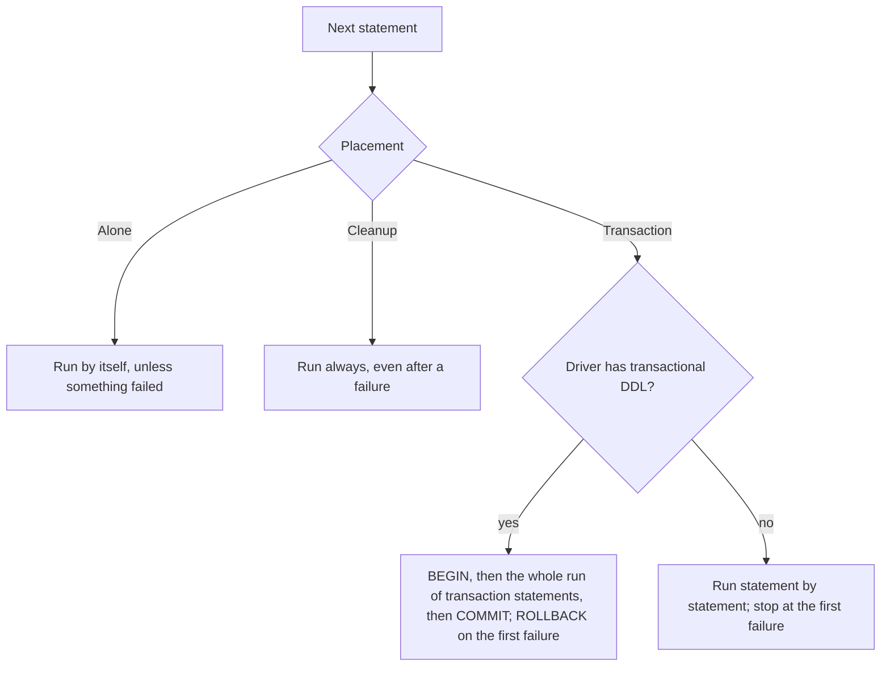
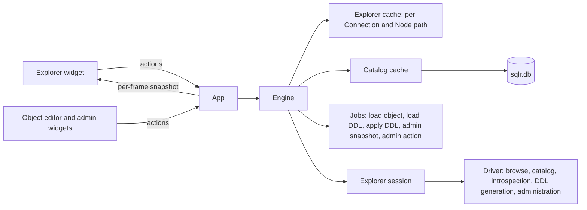

# Explorer and objects

The Explorer is the left-hand tree where the user finds every Connection and, below each one, the databases, schemas and objects its Driver exposes. From it the user opens data, reads an object's DDL, generates SQL, and opens Object editors that create, alter, rename and drop objects through a reviewed Schema change list. The same area covers the Catalog and the Catalog cache that feed autocomplete and the Palette, and the administration panels: users, roles and grants, Server sessions and locks, server properties, sizes and table statistics. Everything here reads and writes through the driver interface (see [Drivers](drivers.md)), so it behaves the same way on every database that declares the matching support.

## Concepts

- A **Node** is one entry of the Explorer tree below a Connection. It has a name, a **Node path** (the list of segments from the Connection down, such as `public / tables / orders`), a kind (database, schema, folder, table, view, materialized view, column, index, function, procedure, sequence, trigger), whether it has children, and an optional detail shown muted after its name (`~1,200 rows`, a column's type, `current`, a database's size).
- Each Driver decides the shape of its tree: which segments exist and what they mean. The engine only stores and passes Node paths.
- The **explorer session** is the Session of a Connection that serves the Explorer, Catalog loads, DDL, object definitions, DDL applies and administration. It is separate from the Editor sessions, so a long query never blocks the tree (see [Query execution](query-execution.md)).
- The **Catalog** of a Connection is its schema list plus, per schema, the relations (tables, views, materialized views) with their columns and types. The **Catalog cache** keeps it in memory and in the local database so it is available before the server answers.
- An **object reference** names the database object a Node stands for: kind, database, schema, name, parent table and, for routines, the argument signature. A Node without one (a folder, a column) is not an object sqlr can edit.
- An **object definition** is the full description of an object as Object editors load and edit it: a table with its columns, constraints, foreign keys, indexes, triggers, partitions, comment, options and dependents; a view with its query, column names and options; a sequence; a routine with arguments, return type, language and body; a trigger; an index; a schema; a database; a role.
- The **Schema change list** of an Object editor is derived from the definition as loaded and the edited copy; it is never recorded by hand, so undoing an edit removes its change.
- The **object-editing descriptor** in a Driver manifest lists the object kinds the Driver can create, alter, drop and rename, whether its DDL is transactional, column type suggestions, whether objects take comments and whether columns can be reordered. A Driver without it shows no Object editor and no DDL actions.
- A **Server session** is a session as the database server sees it, listed and acted on from the administration panels; it is unrelated to sqlr's own Sessions except that sqlr marks its own ones.

## Behaviour

### The Explorer tree

**Header.** Above the tree sit **New connection**, **New folder**, **Refresh selected** (disabled until a Connection or Node is selected; it refreshes the selection, or the selected Connection's whole tree) and a **Filter objects…** field with a clear button.

**Empty state.** With no saved Connection the panel says "No connections yet" and offers **New connection…**, **Open the demo database** and **Import from another client…**.

**Folders.** Connections are grouped in Folders that start collapsed, can be nested, renamed inline, deleted and reordered by drag and drop; Connections move between Folders by drag and drop or **Move to folder**. Folders are owned by [Connections](connections.md).

**Connection rows.** Each Connection row shows:

- the database icon of its Driver, with a state dot on its corner: green connected, amber connecting, red failed, a hollow ring offline, and a warning triangle when the Driver is not installed; the dot's tooltip spells the state out;
- the name, and muted after it the Driver's name, or the file name for a Connection with a file path (SQLite, DuckDB);
- a background tint in the Connection's own color, or else its Connection profile's color;
- a `●` mark with the tooltip "Open transaction" while any Session of the Connection has an open transaction;
- on hover or selection of a live Connection, **Reconnect** and **Disconnect** buttons.

**Expanding.** Opening a disconnected or failed Connection connects it and loads its root. Opening a Node loads its children once; while they load the row below says "Loading…". Double-clicking a table, view or materialized view opens its data; double-clicking any other Node toggles it. A Node with no children shows "No objects".

**Lazy loading.** Children load only when their parent is expanded, one browse call per Node, on the explorer session. Each load is an Operation listed in the Operations panel ("Browse <connection>") and can be cancelled there. Loaded children stay in memory, per Connection and Node path, until the subtree is refreshed, the Connection disconnects or its settings change. An expanded Node whose children were dropped (by a refresh, a reconnect or a disconnect) is browsed again as soon as its Session is live. Browsing without a live explorer session fails with "not connected".

**Counts.** A folder Node shows how many children it holds once they are loaded, open or closed; showing the count never starts a load.

**Empty folders.** A folder Node (except `tables`, which always shows and is not loaded ahead) whose children are loaded and none (a schema's `views`, `materialized views`, `functions` or `sequences` with no objects) is hidden, so the tree lists only what exists. Opening a schema or database loads its folders at once (one browse each, unless the setting below is on), so the empty ones disappear without being opened. A folder still loading stays until its count is known. The setting `explorer.show_empty_folders` (General, off by default) keeps empty folders in the tree.

**Filter.** The filter is a case-insensitive substring match over the names of loaded Nodes. A Node is shown when its name matches or when any loaded descendant matches; Nodes with matching descendants open automatically while the filter is set. Only loaded Nodes are searched: the filter never triggers a load.

**Inline errors and retry.**

- A failed connect shows, under the Connection, the first line of the error, then **Retry** (connect again and show the tree), **Edit** (the connection dialog) and **Details** (a popup "Could not connect" with the full error and **Copy error**).
- A Connection whose Driver is not installed shows a message with **Install…** (the Driver Manager, see [Drivers](drivers.md)) and **Edit**.
- A failed child load shows the error message on the affected Node, with **Retry**, which refreshes that Node. Other Nodes keep working.
- A browse error that means the connection was lost also fails the explorer session (see [Query execution](query-execution.md)).

**Refresh.** Refreshing a Node drops its cached subtree and browses it again. Refreshing the Connection's root, or the Node that holds its schemas, also invalidates its Catalog.

### Tree shapes

Each Driver browses its own shape. The Bundled ones:

| Driver | Shape |
|---|---|
| PostgreSQL | schema → `tables`, `views`, `materialized views`, `functions`, `sequences` → table → `columns`, `indexes`; views list their columns. With "Show all databases", every connectable database comes first (the current one first, marked `current`). |
| MySQL / MariaDB | database → `tables`, `views`, `functions`, `procedures`, `triggers` → table → `columns`, `indexes`. The root lists the connection's database (or every database with "Show all databases") and a `System` folder with `information_schema`, `mysql`, `performance_schema` and `sys`. |
| SQLite | attached database (`main`, `temp`, attached files) → `tables`, `views`, `indexes`, `triggers` → objects → columns of tables and views. |
| SQL Server | schema → `tables`, `views`, `functions`, `procedures`, `sequences` → table → `columns`, `indexes`, `triggers`. |
| Oracle | schema → `tables`, `views`, `sequences`, `functions`, `procedures`, `triggers` → table → `columns`, `indexes`, `triggers`. |
| Snowflake | schemas → tables and views → columns, in the configured database. |
| MongoDB | database (with size) → `Collections`, `Views`, `System` → collection → indexes. |
| Elasticsearch | `Indices` (health, documents, size), `Aliases`, `Data streams`; hidden names are left out. |
| Redis | logical database → key prefix groups (split at the separator) → keys, bounded per group. |

Details per Driver are in [Drivers](drivers.md).

### Context menus

**Connection menu**, in groups:

- **New editor tab** (shortcut from the Keymap; a Connection that runs no SQL answers with a toast pointing to its databases or collections), **Connect** or **Disconnect**, **Refresh** (connected), **New ▸ Database / Schema** (connected, not read-only, and only the kinds the Driver creates);
- **Edit**, **Duplicate** (the Connection and its stored secrets under a new name), **Copy connection URL** (never with a password; "<name> has no connection URL" when the Driver has none), **Move to folder ▸**;
- **Dump database…** and **Restore database…** on the Connection's configured database (SQLite: `main`) when the Driver declares `dump`; the administration panels the Driver supports: **Users and roles**, **Sessions and locks**, **Server properties**;
- **Agent access ▸ None / Read / Write**, with the current level checked (see [Agents and terminal](agents-and-terminal.md)). Changing it to None closes the Connection's Agent sessions;
- **Delete**.

**Node menu.** Entries appear only where they apply:

- **Open editor**: when the Node stands for an object the Driver edits (not for roles).
- **Open data**: tables, views and materialized views. On a relational Connection it opens an Editor tab titled with the object (and its database when it is not the Connection's own) running the Dialect's `SELECT * FROM …` without a row limit; results page as usual. Document and key-value Nodes open their own views (see [Results and editing](results-and-editing.md)).
- **Open DDL**: when the Connection is connected, its Driver has object editing and the Node stands for an object.
- **Import/Export ▸**: **Export data…** on tables and views (Redis: on databases, prefix groups and keys); **Import data…**, **Generate data…** and **Transfer data…** on relational tables (see [Data and schema tools](data-and-schema-tools.md)).
- **ER diagram** and **Compare with…** on schema and database Nodes, when the Driver declares `dump`.
- **Dump database…** and **Restore database…** on database Nodes, when the Driver declares `dump`.
- **New query** on a database Node (an Editor tab bound to that database), or **Open key browser** on a Redis database.
- **Refresh** and **Copy name** (the bare name) on every Node.
- **New ▸**: the kinds the Driver creates under this Node, on a writable explorer session: under a schema, tables, views, materialized views, sequences, functions and procedures; under a database, schemas; under a table, indexes and triggers; under a folder, the kind it holds (`tables` → table, `functions` → function and procedure, `indexes` → index, …).
- **Generate SQL ▸** and **Copy DDL** (below).
- **Rename** (F2, inline on the row) when the Driver renames that kind; **Truncate…** on tables; **Drop…** when the Driver drops that kind. These need a writable explorer session.

Document Connections offer index administration in the same place: **New ▸ Index** on a MongoDB collection (keys and directions, unique, TTL, partial filter) or on Elasticsearch's `Indices` folder (an index with settings and mappings JSON), and **Drop…** on a MongoDB index or an Elasticsearch index. They run the Connection's own commands (`createIndex`, `PUT /<index>`, …) as Jobs; creating follows the Connection profile's confirmation and dropping always asks. A read-only explorer session offers none of them.

### Agent access

The Connection menu shows its Agent access level as a checked entry. Who may change it, and what each level grants, is in [Agents and terminal](agents-and-terminal.md).

### The Catalog and the Catalog cache

**What it holds.** Per Connection: the schema list (the schema Nodes under the Node path that holds the Connection's schemas) and, per schema, its relations with kind and columns (name and type), sorted by name. Catalogs of other databases of the same server (a tab bound to another database) are held per database too.

**Lazy loading.** Autocomplete, the Palette and catalog pickers ask for the pieces they miss: the schema list, then the catalogs of the schemas an unqualified name resolves in (the Dialect's default schemas and the tab's schema). A load is ignored without a live or connecting explorer session, waits while the session is still connecting, and is a no-op while the same piece is loading or once it is loaded and fresh. A piece that failed is not asked for again automatically, so a missing schema is requested once. Each load is an Operation ("Catalog …") that the Operations panel can cancel. A load for another database opens a connection to that database when needed.

**Persistence.** Loaded schema lists and schema catalogs of the Connection's own database are written to the local database (`sqlr.db`), one row per Connection for the schema list and one per Connection and schema for each catalog, in the order they were loaded, off the UI thread. Catalogs of other databases stay in memory for the current App session. A write failure is only logged. Rows that no longer parse are skipped on reading.

**Startup from the cache.** At startup the stored catalogs are restored into memory before any write or delete can run, and marked as coming from the cache. Autocomplete and the Palette use them at once, before any Connection connects. When a Connection's explorer session comes up, every loaded entry is marked stale and every loaded or failed entry is reloaded in the background; the stale data stays visible until the new data lands.

**Invalidation.** A Connection's Catalog (in memory and in `sqlr.db`, for all its databases; loads in flight are dropped) is forgotten:

- after a statement the Dialect classifies as DDL succeeds on any Session of the Connection;
- after a DDL apply from an Object editor, the Explorer or an administration panel changed something;
- when the user refreshes the Connection's root or the Node that holds its schemas;
- when the Connection is deleted.

The next request loads it again from the server. An invalidation that arrives before the startup restore marks that Connection's stored rows as stale.

### The DDL viewer

**Open DDL** opens a read-only DDL viewer tab titled "DDL · <name>"; opening it again for the same object focuses the existing tab. An Agent's `show_in_app` with the `ddl` view opens the same tab, and `get_ddl` returns the same statement as text. The statement is written by the engine as a Job ("Writing the DDL…" meanwhile):

- **SQLite** returns the statements SQLite keeps for the object, exactly as written, comments and formatting included;
- **other Drivers** load the object definition from the server catalogs and generate its `CREATE` script with the Dialect's DDL generator (PostgreSQL reads view, index and trigger definitions through `pg_get_viewdef`, `pg_get_indexdef` and `pg_get_triggerdef`).

A `CREATE TABLE` is shown with one column or constraint per line, split at top-level commas with the Driver's lexer so quoted text and nested expressions stay intact. The tab's toolbar offers **Open in new editor tab** (an Editor tab named `<name>.sql`), **Copy** ("DDL copied") and **Reload DDL**; a failure shows its message, or "The DDL could not be written".

### Generate SQL

**Generate SQL ▸** loads the object definition and opens the chosen template in a new Editor tab titled "<TEMPLATE> <name>", without running it. **Copy DDL** loads the definition and copies its `CREATE` script to the clipboard. Templates per kind:

| Object | Templates |
|---|---|
| Table, view | SELECT, INSERT, UPDATE, DELETE, CREATE, DROP |
| Materialized view | SELECT, CREATE, DROP |
| Other objects | CREATE, DROP |

DROP is offered only when the Driver drops that kind; roles have no templates. Template rules:

- Values are written `/* <column> */ NULL`, so a template runs as is and shows what goes where.
- SELECT lists every column (or `*` when none is known) from the qualified, quoted name.
- INSERT lists the writable columns: generated columns and always-generated identities are left out. With no writable column it inserts default values (`INSERT INTO … DEFAULT VALUES`; Oracle `… VALUES (DEFAULT)` for its first column).
- UPDATE sets every writable column outside the row key, and when every column is in the key it assigns a key column to itself so the statement stays valid. UPDATE and DELETE filter on the row key (the primary key, else a unique key); without one the condition is `1 = 0 /* no key: write the condition */`, which matches nothing.
- CREATE is the object's `CREATE` script from the Dialect's DDL generator.
- DROP is the Dialect's drop statement with `IF EXISTS` added after `DROP <KIND>`, except for indexes (MySQL has no `IF EXISTS` for them).

### Object editors

**Opening.** **Open editor** opens an Object editor tab for the Node's object, titled with its name; opening it again focuses the existing tab. The tab loads the object definition as a Job on the explorer session. The editor holds the definition as loaded and an edited copy; the Schema change list is their difference, so reverting a field removes its change.

**Sub-tabs** depend on the object:

| Object | Sub-tabs |
|---|---|
| Table | Columns, Indexes, Constraints, Foreign keys, Triggers, Partitions (when the table is partitioned), Properties, Permissions, DDL, Data |
| View, materialized view | Definition, Properties, Permissions, DDL, Data |
| Function, procedure | Definition, Properties, Permissions, DDL |
| Sequence, index, trigger | Definition, DDL |
| Schema, database | Properties, Permissions, DDL |

- **Columns**: a virtualized table of columns (a thousand columns stay cheap) with add, duplicate, delete and move (move only when the Driver reorders columns). Each column has name, type (with the Driver's type suggestions), nullability, default, generated expression, identity, collation, comment and MySQL's `ON UPDATE`.
- **Indexes**: columns or expressions with direction and prefix length, unique, method, `INCLUDE` columns and a partial predicate.
- **Constraints**: primary key, unique and check constraints.
- **Foreign keys**: the target table picked from the Catalog, then column pairs and `ON DELETE` / `ON UPDATE` actions (no action, restrict, cascade, set null, set default).
- **Triggers**: timing, events, for each row, condition and body.
- **Partitions** (PostgreSQL): attach and detach existing tables with their bounds.
- **Definition**: a view's query and column names; a routine's arguments, return type, language and body; the form of a sequence, a standalone index or a standalone trigger.
- **Properties**: owner, comment (when the Driver takes comments) and Driver options; for tables, the table's statistics from the administration support.
- **Permissions**: the object's grants per role in a privilege grid with its own Apply and Revert. It appears when the Driver administers grants, once the object exists, and only for objects of the Session's own database.
- **DDL**: the pending statements, highlighted and read-only.
- **Data**: the object's first page in the result grid of the hosting tab, with the full Changeset editing of [Results and editing](results-and-editing.md). When an apply changed the definition, the stale Data page asks before it drops its row edits and is read again.

**Toolbar.** The name line (rename, when the Driver renames that kind; otherwise disabled with "This object cannot be renamed here"), **Preview DDL**, **Apply** (⌘S), **Revert**, **Refresh** ("Load the definition again", F5 or ⌘R), **Generate SQL** and **Open data**, and a status that counts pending changes ("No pending changes" when there are none). While a load or apply runs the toolbar is disabled. ⌘S applies what the shown page holds: the Data page's Changeset, the Permissions page's grants, or the Schema change list on every other page ([Settings and workspace](settings-and-workspace.md)).

**Problems.** The editor checks the edited definition before Apply: an empty name, a table with no column, a column with no name or type, a duplicate column name, a view with an empty query, a routine or trigger with an empty body, an index or trigger without its table, an index with no column, a foreign key without a target table or with empty columns, an index without a name. These are errors and block Apply. A column type outside the Driver's suggestions is a warning only (array types such as `integer[]` count as known).

**Preview and apply.** **Preview DDL** shows the statements the Dialect generates for the Schema change list. A table goes through the Driver's table-to-table generation, which lets SQLite rebuild the table when `ALTER TABLE` cannot express a change; a new object goes through its `CREATE`. **Apply** runs them after the Connection profile's confirmation when the profile asks for one (see [Query execution](query-execution.md)); the confirmation lists the full statements.

An apply runs as a Job on the explorer session, in its execute order, and can be cancelled from the Operations panel, which interrupts the running statement. It follows each statement's placement:

After a failure the remaining statements are skipped, except cleanup ones. A rejected `COMMIT` is followed by a `ROLLBACK`, and that transaction's statements count as rolled back. The report summarizes the outcome in one or two sentences: "N statements applied"; "Statement K of N failed: <message>. The transaction was rolled back."; or, without transactional DDL, "… The DDL is not transactional: M statements before the failure were applied." Failed `BEGIN` or `COMMIT` commands are reported as "<COMMAND> failed: <message>".

An apply is refused:

- without a live explorer session ("not connected");
- when the explorer session is read-only ("The session is read-only");
- when a transaction is open on the explorer session, or a transaction that wrote is open on another Session of the Connection, since it may hold locks the DDL would wait on ("A transaction is open in tab N: commit or roll back first"; a transaction that only read is ignored).

Once something was applied, the Connection's Catalog is invalidated and the Explorer paths the editor came from are reloaded (a loaded Node is browsed again; expanded descendants follow when shown). After a partial, non-transactional apply the editor reloads the definition and keeps the edits that did not apply as pending. A failed apply keeps every edit pending. A failed reload is shown in the editor.

**Pending edits are never dropped silently.** Refreshing the definition, closing the tab, or reloading a stale Data page with pending edits asks first.

### Create dialogs

**New ▸ <kind>**, from a Node or from the Connection, opens a small dialog "New <kind>" ("In <schema>"): it asks for the name and, for an index or trigger, its table, picked from the schema's tables in the Catalog ("Loading tables…" while it loads). **Create** stays disabled with "Enter a name" or "Choose a table" until both are given. Create then opens an Object editor in new mode with a starting definition the user completes in the same forms:

- a table with no columns yet;
- a view whose query is `SELECT 1 AS one`;
- a function returning `integer` in `sql` with body `SELECT 1` on PostgreSQL, a function returning `INT` with body `RETURN 1` elsewhere, a procedure with body `SELECT 1` (PostgreSQL) or `BEGIN END`;
- a trigger `BEFORE INSERT` for each row;
- an index, sequence, schema or database with just its name.

Roles are created in the administration panel ("Roles are created in the administration panel"). Applying a new object runs its `CREATE` as any apply, then reloads the parent Node.

### Explorer object actions

- **Rename** edits the name inline (F2). Confirming applies the Dialect's rename statement after the profile's confirmation and reports "Renamed <old> to <new>".
- **Drop…** and **Truncate…** always ask first, in a dialog that shows the statements: "Drop <kind> <name>?" or "Delete every row of <name>?". When the Dialect writes a different statement with `CASCADE`, the dialog offers a checkbox ("Cascade: also drop the objects that depend on it" / "Cascade: also empty the tables that reference it"). After it, the profile's confirmation applies too. The result is reported as "Dropped <kind> <name>" or "Truncated <name>".
- Explorer actions run as DDL applies on the explorer session, with the Driver's transactional DDL setting and the object's database, and reload the Node's parent.

#### Recovering a failed database drop

A failed database drop opens a recovery dialog when the Connection supports Server sessions. It keeps the original server error visible and loads the sessions whose database exactly matches the database being dropped. Each row shows its server id (PID on PostgreSQL), user, client, state and whether it belongs to sqlr. With sessions present the heading reads "Database in use". An empty snapshot explains that the database has no visible sessions, and an unsuccessful snapshot shows its error. **Refresh** loads a new snapshot.

**Terminate session <id>** asks for confirmation and explains that active work will be interrupted and open transactions rolled back. A session belonging to sqlr asks a second time. Termination uses the session id and the start time captured when its row was selected, so a reused id is left alone. The dialog refreshes the sessions after each termination and keeps action errors visible.

**Retry drop** reruns the original confirmed statements with the same database and refresh paths. The original error stays available when another blocker or a permission error still prevents the drop. Read-only and transaction checks apply to retry, and read-only checks apply to termination. Closing the dialog releases its snapshot and action Jobs.

### Administration

Administration panels open from the Connection menu and from the Palette (⌘⇧P), each as a tab. A panel needs a live connection ("Connect first: administration needs a live connection"). A Driver declares what it administers, and panels it does not support stay hidden:

| Panel | Shown when the Driver supports | Bundled drivers |
|---|---|---|
| Users and roles | roles or grants | PostgreSQL, MySQL / MariaDB |
| Sessions and locks | sessions or locks | PostgreSQL, MySQL / MariaDB |
| Server properties | properties or statistics | PostgreSQL, MySQL / MariaDB, SQLite |

Every read is an engine Job on the explorer session; every action that changes something is DDL applied like an Object editor's, after the profile's confirmation. Administration actions are disabled while the explorer session is read-only, and DDL actions while a transaction blocks applies ("A transaction is open on this connection: commit or roll back first").

**Users and roles.** A role list, a role form and the selected role's privilege grid:

- The form shows only the role attributes the Driver lists: login, superuser, create database, create role, inherit, replication, connection limit, valid until, member of, password. MySQL accounts are `user@host` and the form asks for the host; MariaDB roles have no host. A role the server defines for itself (PostgreSQL's `pg_*`) can be joined but is not managed.
- A typed password is never loaded from the server, never logged or printed, and is shown masked in previews, confirmations, reports and error messages. PostgreSQL can also remove a password (`PASSWORD NULL`).
- The **privilege grid** has one row per (grantee, object) pair and one column per privilege the Driver lists for the rows' kinds. For a role, rows are the database (PostgreSQL) and the chosen schema itself, the schema's relations from the Catalog, then other objects the role holds privileges on. Cells are tri-state (none, granted, grantable) and cycle on click. MySQL global privileges (`ON *.*`) are not listed, and the grid says so.
- Privileges per kind (PostgreSQL): tables and views the table privileges; materialized views `SELECT`; sequences `USAGE`, `SELECT`, `UPDATE`; functions and procedures `EXECUTE`; schemas `USAGE`, `CREATE`; databases `CONNECT`, `CREATE`, `TEMPORARY`. MySQL: database and table privileges, and `EXECUTE`, `ALTER ROUTINE` on routines.
- Form and grid changes form one pending set, previewed as the Dialect's statements (passwords masked) and applied together. Grants and revokes are grouped by object, grantee and grant option. A revoke is a Destructive statement, so profiles that confirm destructive statements ask. Selecting another role, reloading, or closing the tab with pending edits asks first.
- **Drop role** always asks ("Drop role <name>?"), and asks a second time when it is the user the Connection logged in as ("You are connected as <name>. Drop it anyway?").

**Sessions and locks.**

- The sessions table lists id, user, database, client, state, wait event, query, start time and query start time. Filters: hide idle sessions, user, database. sqlr's own sessions on the Connection (its explorer and tab Sessions, and their connections to other databases) are tinted and marked "this connection". The selected session's query shows in the Value panel.
- While the tab is shown and not paused it refreshes every interval: 2 seconds by default, between 1 and 60. A hidden or closed tab stops refreshing. Refresh now and Pause are on the toolbar.
- **Cancel query** (PostgreSQL `pg_cancel_backend`, MySQL `KILL QUERY`) and **Terminate** (`pg_terminate_backend`, `KILL`) always ask ("Cancel the running query of session <id>?", "Terminate session <id>?"), and ask twice for one of sqlr's own sessions ("Session <id> is this connection. Terminate it anyway?"). The action carries the session's start time, so a server id reused by a newer session is left alone and the action fails. MySQL session ids are parsed as numbers before `KILL`.
- The locks pane shows a blocking tree (each session that blocks others, with the sessions waiting on it indented below, recursively) and the list of every lock with its mode, object, whether it is granted and what it waits for.

**Server properties.** Three panes, each loaded when first shown and again on Refresh:

- **Properties** grouped by category (collapsible), with name, value, unit, source and description, and a search over names, values and descriptions that shows every match.
- **Database sizes.**
- **Table statistics** of one schema or every schema: row estimate, total, table and index bytes, and extras (last vacuum or analyze, scans, fragmentation), sortable by any column, sizes in human units. A long statistics read (SQLite's exact `count(*)`) can be stopped; closing the tab stops it.

Long lists in every panel are virtualized.

## Architecture

- **The Explorer widget** draws the tree from a read-only source and returns actions; it does no I/O. It flattens the visible rows first and paints only those on screen, so its cost follows the visible rows, not the schema's size. It remembers expanded paths, the selection, the filter and inline rename state.
- **The app** builds a snapshot of what the tree can show every frame (the loaded children of expanded paths, or of every loaded path while filtering), asks the engine to browse expanded paths that are missing while the Session is live, decides each Node's menu from the Driver's object-editing descriptor, the object reference and the session's read-only state, and turns actions into engine calls and tabs.
- **The engine** keeps the explorer cache (per Connection, per Node path: loading, ready or failed), the Catalog cache, and runs browses, Catalog loads, object loads, DDL writing, DDL applies and administration reads and actions on the explorer session, each as an Operation or Job.
- **The local store** keeps the persisted Catalog rows.
- **Core types** define Nodes and Node paths, the Catalog, object references and definitions, schema changes and the table diff, Generate SQL templates and the administration types.
- **The Object editor and administration widgets** take definitions, DDL text, catalog tables and snapshots in and return actions; they never call the engine.
- **Drivers** provide browse, catalog, introspection (object definitions, roles, schema snapshots), DDL generation with placements, and administration.

## Data model

- **Node**: path, name, kind, has children, detail.
- **Explorer cache entry**: Connection, Node path, state (loading, ready with Nodes, failed with a driver error).
- **Catalog**: per Connection and database: schema list (state), schema catalogs (state, with relations: name, kind, columns with name and type), "from cache" flag.
- **Stored catalog rows**: (Connection, schema list, saved at) and (Connection, schema, catalog, saved at).
- **Object reference**: kind, database, schema, name, parent, signature.
- **Object definition**: database, schema, table (columns, constraints: primary key, unique, check, foreign key, raw; indexes, triggers, comment, options, partitions, dependents), view, sequence, routine, trigger, index, role.
- **Schema change**: create, drop (with cascade), rename, add/drop/alter column, add/drop constraint, add/drop index, set comment, replace view, replace routine, set options, attach/detach partition, truncate (with cascade).
- **DDL report**: per statement its outcome (applied, rolled back, failed, skipped), whether a transaction was rolled back, whether the apply was transactional, failed transaction commands.
- **Role**: name, host, attributes, member of, new password (never loaded), remove password. **Grant**: grantee, object, privilege, grantable. **Server session**: id, user, database, client, state, wait, query, started, query started, own. **Lock**: session, blocked by, mode, object, granted. **Server property**: name, value, unit, category, description, source. **Table statistics**: table, row estimate, total, table and index bytes, extras.

## Non-functional requirements

- The UI thread never waits on the server: browses, catalog loads, object loads, DDL and administration run on the engine runtime, and the widgets read snapshots.
- The tree, the Columns sub-tab and administration lists draw only visible rows; a schema with thousands of objects or a table with a thousand columns scrolls smoothly.
- Catalog and object queries are always parameterized; identifiers in generated DDL go through the Dialect's quoting, and expression fields (defaults, checks, view queries, routine bodies, partition bounds) are written as typed.
- Whole-schema reads take a fixed number of queries per Driver whatever the number of objects (SQLite 1, Oracle 5, SQL Server 6, PostgreSQL 9, MySQL 10).
- Passwords typed in role forms never reach logs, `Debug` output, previews, reports or error messages.
- Autocomplete and the Palette work from the Catalog cache immediately at startup.

## Decisions

- **The Explorer browses lazily, one Node at a time, on a dedicated explorer session.** Large servers stay fast to open, and a long query in an Editor tab never blocks the tree.
- **Drivers own the shape of their tree.** Node paths are opaque segment lists the engine passes back to the Driver; the app only maps folder names to "New ▸" kinds.
- **Schema change lists are derived from two definitions, never recorded.** Undoing an edit removes its change, and a partial apply leaves exactly what did not apply as pending.
- **Only what the Driver declares is shown.** The object-editing descriptor and the administration support decide menu entries, sub-tabs and panels, so the UI never offers an action that cannot work.
- **DDL applies follow per-statement placement.** Transactional DDL runs all-or-nothing where the database supports it; statements that cannot run inside a transaction (SQLite's foreign key pragma) run alone, and cleanup always runs, which makes the SQLite table rebuild safe.
- **Database drop recovery reuses administration Jobs.** Server session listing and termination follow the same driver permissions and session identity checks as the Sessions and locks panel. Keeping the confirmed drop context makes retries independent of later explorer selection changes.
- **Applies refuse to run beside an open transaction.** A transaction that wrote on another Session may hold locks the DDL would wait on forever; refusing with a clear message is better than a hang.
- **The Catalog cache persists only the Connection's own database.** It is what autocomplete needs at startup; other databases' catalogs are cheap to reload and would otherwise grow the store without bound.
- **Invalidate the whole Catalog after any DDL.** Working out which schemas a statement touched would need a parser per Dialect; reloading a Catalog is cheap and the stale data stays visible meanwhile.
- **DDL comes from introspection plus the Dialect's generator, except SQLite.** One code path serves the DDL viewer, Copy DDL, Generate SQL CREATE and Schema compare; SQLite's stored statements are already the exact definition, comments included.
- **Generate SQL templates run as written.** `/* column */ NULL` values and a `1 = 0` condition without a key make a template safe to run by accident.

## Related specs

- [Connections](connections.md): Folders, connection rows' data, the connection dialog, duplicate and delete.
- [Drivers](drivers.md): the driver interface, per-database tree shapes, DDL generation and administration support.
- [Query execution](query-execution.md): Sessions, the explorer session, transactions, read-only and confirmations.
- [Query editor](query-editor.md): autocomplete fed by the Catalog cache.
- [Results and editing](results-and-editing.md): the Data sub-tab's grid, document and key-value views.
- [Data and schema tools](data-and-schema-tools.md): import, export, transfer, data generation, ER diagrams, Schema compare, dumps.
- [Agents and terminal](agents-and-terminal.md): Agent access levels set from the Explorer, and the Agent tools that reuse the Explorer, the DDL viewer and the object data tab (`get_ddl`, `show_in_app`).
- [Settings and workspace](settings-and-workspace.md): the Palette, the Keymap (F2, ⌘S) and tabs.
