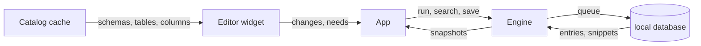

# Query editor

The Query editor is where a user writes the statements they run. It covers the Editor tab and its binding to a Connection and database, the editor widget with its text buffer, highlighting, statement structure, multi-cursor, undo, find and replace, editing aids, soft wrap, line numbers and autocomplete, the shortcuts that run a statement, a selection or a script, the Query language a tab uses, and the History and Snippets library. Running a statement and the Result it produces belong to [Query execution](query-execution.md) and [Results and editing](results-and-editing.md).

## Concepts

- An **Editor tab** is a tab holding a query editor bound to one Connection and, optionally, one server database. It is separate from an Object editor, a DDL viewer, a document tab and a Redis tab, which share the tab strip but show their own content.
- A **statement** is the text a Query language splits at its top-level separators. In SQL the separator is `;`; in the Mongo shell it is `;` and a line break outside brackets; in the Elasticsearch console it is a request line; in Redis it is a line; a JSON value is one statement.
- A **Query language** is the lexing and splitting rule a tab uses: SQL for relational Connections, the Mongo shell for MongoDB, the Elasticsearch console for Elasticsearch, Redis commands for the Redis console, and JSON for a value edited on its own.
- The **Catalog** and **Catalog cache** provide the tables, views, schemas, columns and types that autocomplete offers; their scope is described in [Explorer and objects](explorer-and-objects.md).
- **History** is the stored record of every executed statement with its Connection, database, time, duration and outcome.
- A **Snippet** is a named query kept in a folder, global or scoped to one Connection.
- A **Statement scope** is the set of relations with their aliases and the CTE names that the statement around the caret reads or writes, parsed from the text for autocomplete.

## Behaviour

### The Editor tab

A new tab opens either blank without a Connection, or bound to the Connection and database it was opened from: the explorer's new query, a table's data, a snippet, a History entry or the Palette. A tab with no Connection asks the user to choose one when they run it ("Choose a connection for this tab first").

- **Connection binding.** The tab's statements run on that Connection's Editor session, and its icon takes the Connection's color. A tab can be pointed at another Connection; its database binding is dropped, its editor switches to the new Connection's syntax, and a tab whose Session has an open transaction refuses the switch until the transaction ends. A tab that shows a Redis browser or a document result stays on the Connection it was opened on. A SQL tab pointed at a document or key-value Connection is refused with a notice ("`<name>` does not run SQL: open it from the explorer").
- **Database binding.** A tab can target a server database other than the Connection's own. The breadcrumb's database segment lists the databases the Connection's root exposes and opens a menu; choosing one rebinds the tab. Changing the database is blocked while the tab's query is running or a transaction is open on its Session ("Finish the query or transaction before changing database."). The same database that the Connection's session already uses counts as no binding.
- **What the tab shows.** The tab button carries a stripe in the Connection profile's color, a database icon in the Connection's color (or its profile's), and the title, underlined by the accent when active. Above the editor a breadcrumb reads `connection › database › title`, with the run shortcut on the right ("`⌘↵` to run"); clicking the connection segment reveals and selects the Connection in the explorer. The editor sits above the run's results in a vertical split that starts in favor of the results and can be dragged.
- **Dirty state.** The tab records that its text changed since it opened, including edits made through the MCP server, and exposes that state to Agent tools.
- **Closing** a tab closes its Editor session and, when a JSON or document edit is open, discards it; see [Query execution](query-execution.md) for transactions and session close rules.

### Text buffer and layout

- The text lives in a rope. Lines break at `\n`; a `\r\n` terminator is hidden from every position, so a caret never lands between its two bytes.
- Only the visible lines plus two of overscan are laid out and painted. A line longer than 4,096 bytes is laid out over its visible window plus 256 characters on each side, at windows aligned to 128 characters so small scrolls reuse the cache. Positions on such a window assume a monospace advance; proportional glyphs such as CJK or emoji drift there, which is documented and not corrected.
- Laid-out lines are cached, keyed by the line text, its starting lexer state, the window start, the token spans, the font and the editor colors. The cache keeps up to 4,096 entries and about 32,768 characters of text; when it overflows it drops the entries the previous frame did not use, so a retyped long line does not accumulate galleys.
- An edit is applied to the rope and to the syntax layer only around the affected lines; the rest of the layout cache stays valid. The editor is built to stay responsive on 10 MB files.

### Highlighting

- A resumable lexer produces tokens and a state, chosen by the tab's Query language and, for SQL, by the Connection's Dialect. The state covers being inside a block comment (with nesting depth where the dialect nests comments), a single-quoted string (with backslash escapes where the dialect allows them), a double-quoted string (MySQL), a quoted identifier, and a dollar-quoted string (PostgreSQL).
- The editor stores the lexer state each line starts in and lexes a line without its terminator, so a backslash that escapes a newline behaves as in a full-text lex. Lexing runs toward the lines the user looks at under a 4 ms per-frame budget, always completing at least one line. After an edit it re-lexes from the change and stops as soon as a line ends in the state the following line was already lexed from.
- A long line keeps checkpoints at token starts at or after every 4,096 bytes, with the state there and the position of the next top-level `;`. A window of, or an edit in, a multi-megabyte line lexes a few kilobytes, and the lexer peeks at most three bytes past the text it is given.
- The lexer recognizes keywords, functions, identifiers, quoted identifiers, strings, numbers, comments, operators, punctuation, semicolons and parameters. Keywords and functions come from the Dialect and are case-insensitive; a word followed by `(` is a function; parameters include `?`, `:name` and, for PostgreSQL, `$1`.
- SQL dialects set their own identifier quotes (ANSI double quotes, MySQL backticks, SQLite double quotes, brackets and backticks), their line comment (`--`, MySQL's `-- ` with a required space and `#`), whether `"…"` is a string, backslash escapes, dollar quotes, nested comments and `E'…'` escape strings.
- The Mongo shell and JSON lexer colors `db`, `new`, `true` and similar keywords, a word before `(` as a function, keys as identifiers, quoted keys as quoted identifiers, and `/re/i` as a string; an open string resumes on the next line. The Elasticsearch console colors the method (or `ESQL`/`SQL`) as a keyword, the path as an identifier and bodies as JSON, accepts `"""…"""` strings that span lines and `#` and `//` comments. Redis colors the first word of a line as the command keyword and the rest as arguments.
- Each token kind maps to a theme color; plain text uses the painter's fallback color, so a theme switch recolors and a syntax layer that has not reached a line paints it plain.
- **Toggle comment** (⌘/) uses the language's line comment: `--` for SQL, `//` for the Mongo shell, `#` for the Elasticsearch console. Redis has no comment, so toggle comment does nothing there. It comments every non-blank touched line at its minimum indent (adding a space after the token) or uncomments them, keeping a selection.

### Statement structure and run targets

- Statement boundaries come from the lexer: a SQL script splits at top-level `;`, ignoring semicolons in strings, comments and dollar-quoted bodies; the Mongo shell also splits at a line break outside brackets and not before a chained `.method()`, after a comma, a dot or an operator; the Elasticsearch console splits at request lines (a method and path, or `ESQL`/`SQL`) and blank lines; Redis takes each non-blank line; JSON takes the trimmed value.
- The statement around the caret is found by copying the whole lines between `;` lines around the caret and splitting them, then picking the statement containing the caret, else the nearest one ending before it, else the first one after it. A copy-and-split region that would exceed the configured limit is reported by byte range so the caller can fall back.
- **tree-sitter** parses only the statement around the caret to build its Statement scope, freshly, with a placeholder inserted at the caret so an incomplete name parses as one. The scope query yields the relations read or written with their schema, name, alias and whether the name was quoted, plus the CTE names; a relation named like a CTE is a CTE. A statement of at most 64 KiB is parsed on the UI thread; a longer statement, or a caret on a line over 64 KiB, goes to a background worker that receives a window of 32 KiB on each side of the caret (cut at a lexer resume point) and splits and parses the caret's statement there. The previous scope stays in use until the worker answers, and a newer request supersedes an older queued one. The grammar is fixed to the SQL grammar; another grammar yields an empty scope.
- **Run target.** The primary selection, trimmed, is the target when it is not empty; otherwise the target is the statement at the primary caret. **Script targets** are the statements in the primary selection, else in the whole text.

### Running from the editor

⌘↵ runs the statement at the caret or the selection; ⇧⌘↵ runs the script. Both are remappable actions, and the breadcrumb and the empty result pane show the current binding. The editor itself leaves these keys to the app, which applies the Connection profile's confirmations, connects when needed and starts the run; that flow is described in [Query execution](query-execution.md).

### Multi-cursor

- ⌥-click adds a caret; ⌥⌘↑ and ⌥⌘↓ add one above or below at the primary caret's column. Esc closes the completion popup first, then the find bar, then collapses the extra carets, then clears the selection. Clicking elsewhere with no modifier places one caret.
- Carets stay sorted, non-overlapping and at least one; overlapping ones merge. The primary caret is the last and drives the completion popup, the statement tint and the error reveal.
- Typing, deleting, pasting, indentation and newline edits apply once per caret as one command. Vertical moves keep a per-caret goal column, so moving through blank or short lines and back returns the caret to its column; any other motion, edit or caret placement resets the goal.
- Copying several non-empty selections joins their text with line breaks.

### Undo and redo

- Undo and redo (⌘Z, ⇧⌘Z and also ⌘Y) work in whole groups. Typing and backspacing merge into one group while they continue in the same place, within one second, with the same kind of command, and across a word boundary but not into an earlier non-whitespace character. Moving the caret, placing carets or another kind of edit closes the group.
- A paste, an indent, a comment toggle, a format, a duplicate and a replace-all each undo as one group. A new edit clears the redo groups. The stack keeps up to 10,000 groups and drops the oldest. Undo and redo restore the carets from before or after their group.

### Find and replace

- ⌘F opens the find bar over the top right of the editor; ⌥⌘F opens it with the replace row. A one-line selection prefills the needle.
- The bar offers Match case and Whole word, Previous and Next, and Replace and Replace all. ↵ goes to the next match, ⇧↵ to the previous; Esc closes the bar.
- Find scans line by line from the caret's position, wraps around the document and never matches across a line break. Replacement and replace-all are one undo group; replace all reports the number of matches.
- Matches are highlighted in the editor while the bar is open.

### Editing aids

- **Auto-indent.** A newline keeps the current line's leading spaces or tabs and adds one indent unit after an opening `(`; pressing Enter on a line that ends with `)` puts the closing parenthesis on its own line at the original indent.
- **Bracket and quote pairing.** Typing `(`, `[`, `'` or `"` inserts the closing character and leaves the caret inside, unless the next character is a word character or a matching quote. Typing a closing character that already follows the caret moves over it instead of inserting. Typing an opening character over a selection wraps the selection. Backspace between an empty pair removes both characters.
- **Indent.** Tab inserts spaces to the next indent stop (four spaces by default, or a tab when so configured); Shift+Tab outdents. With a multi-line selection both shift every touched line.
- **Duplicate line** (⌘D) copies the current line below, or copies the selection after itself.
- **Format SQL** (⌥⌘L) formats the selection, or the whole text, with the editor's format options as one undo group; it is a SQL formatting aid and leaves the Query language unchanged.
- Word motions use ⌥ on macOS and Ctrl elsewhere; ⌘← and ⌘→ go to the line start and end, and Home and End follow the platform's conventions.

### Soft wrap and line numbers

The editor has two independent view toggles. **Line numbers** are on by default and draw a gutter sized to the row count. **Soft wrap** is off by default; when on, a logical line breaks into visual rows at the viewport width using the real glyph advances, a row index maps an absolute visual row back to its line and row within it, and an edit recomputes only the lines it touched. Cursor movement, selection and hit testing work on visual rows. Both toggles are settings and commands, described in [Settings and workspace](settings-and-workspace.md).

### Statement tint

A subtle background marks the statement holding the primary caret. The tint never starts a copy-and-split of more than 64 KiB around the caret: a larger statement stays untinted, and the tint waits until highlighting has reached the caret's line. A text holding a single statement is left untinted, since it would color the whole editor. The tint can be turned off.

### Error underlines

A syntax error with a position becomes a marker: the token at that buffer position is underlined and hovering shows the message. Markers move or drop as the text is edited. An error in a script marks the statement that failed, using the line and column the server reported. An edit applied by an Agent is marked the same way.

### Autocomplete

- The popup opens on typing a prefix, on a `.` after a qualifier, and on Ctrl+Space, which also survives an empty prefix and toggles the popup off. An implicit popup opens after one character in a relation context or after a member dot, after two characters in a general context, and never after a dot that follows a number or an operator. It closes when the prefix is gone, on a caret move or on any character that leaves the context, and when it has nothing to offer.
- The context is computed from at most 4,096 bytes before the caret, lexed from a known state, and is one of: off (inside a string, quoted identifier or comment), relation (after `FROM`, `JOIN`, `UPDATE`, `INTO` or `TABLE`, or after a `,` that continues a `FROM` list at paren depth zero), member (after `qualifier.`), or general.
- **Relation context** offers the statement's CTEs, the tables and views of the default schemas, and the schema names. **Member context** resolves the qualifier as an alias first then as a relation name and offers its columns with their types; a qualifier that names no relation is treated as a schema and offers its tables and views. **General context** offers the columns of the statement's relations (each shown with its relation and type), the Dialect's functions (inserted with `()` and the caret inside) and the Dialect's keywords (inserted in upper case). CTE columns are not completed.
- Items are filtered case-insensitively: prefix matches first, then substring matches, ordered by kind (column, CTE, table, view, schema, function, keyword), then by label length and label. At most 200 items are offered.
- Identifiers that need quoting are inserted quoted with the Dialect's quote pair; a plain lowercase unreserved name is inserted as it is.
- The popup lists up to ten rows at a time with a kind badge and a detail line, and scrolls to the selection. ↵, Tab or a click accepts the selected item; the arrows move the selection. A missing schema or schema list is requested once per popup session, and the popup shows "Loading…" while only such a request would produce items. With no live Connection the popup offers keywords and functions only and requests nothing.
- The popup is drawn by the editor widget and costs one candidate computation per frame for an unchanged (text revision, primary caret); its statement scope is refreshed only when either changes.

### Query language per tab

The Query language follows the tab, not the Connection text. A SQL tab lexes and splits with the Connection's Dialect and completes from the Catalog. A document tab lexes with the Mongo shell or the Elasticsearch console and turns completion off, because there are no SQL names to offer. The Redis console lexes each line as a command. A JSON value editor, in the value panel or the document JSON view, uses the JSON language with completion off. Pointing a SQL tab at another SQL Connection keeps the tab's text and switches its highlighting rules to the new Dialect.

### History

- Every statement whose result leaves the Running state is recorded once: its SQL, Connection, server database when the tab was bound to one, start time, duration and outcome (rows, rows affected, failed with the message, or cancelled). A statement that runs as part of a script is recorded statement by statement.
- A statement whose text may hold a secret is not recorded: text containing `pwd`, `password`, `api_key` or `identified by`, case-insensitively, never enters the plaintext history. The same rule guards Snippets.
- The stored SQL is cut at 1 MiB on a character boundary. The store keeps the newest 100,000 history rows: the engine trims older rows as its first background job at startup, and the trim also removes rows written by earlier versions with password-bearing SQL.
- History lives in the local database ([Architecture](architecture.md)). When that database cannot be opened, History and Snippets live in memory for the session and the status bar carries a warning that they will not be saved.
- The History panel shows, newest first, each entry's local timestamp (`YYYY-MM-DD HH:MM:SS`), Connection name, duration (`850 ms`, `1.2 s`, `2 m 05 s`), an outcome icon with `N rows`, `N affected`, `failed` (its message on hover) or `cancelled`, and the first 200 characters of the statement's first line, with the full SQL on hover.
- **Search** is a case-insensitive substring match over the stored SQL, `%` and `_` matched literally. **Filter** narrows to one Connection or shows all. A search returns at most 200 entries. The panel and the command palette each keep their own search and results.
- **Reopen** (double-click or "Open in new tab") opens a new tab with the entry's SQL, on its original Connection and, for a SQL tab, its original server database, without running it. When the Connection is no longer saved the tab opens unbound with a notice. A document or key-value Connection opens the matching tab kind.
- **Insert** puts the SQL at the active editor's carets; **Copy SQL** puts it on the clipboard. **Clear history** asks first and deletes the entries of the filtered Connection, or of every Connection when no filter is set; Snippets are kept. History outlives the Connection it names; after a Connection is deleted its entries show the stored connection id in place of a name.
- A newly stored entry refreshes every open search, so a run appears in the panel immediately.

### Snippets

- A Snippet has a name, a `/`-separated folder path (empty at the top level), an optional Connection scope (global when absent) and its SQL. The store keeps them sorted by folder, then name.
- The Snippets panel lists global Snippets plus those of the active tab's Connection, in folders that can be expanded and collapsed; a filter narrows by name and expands every folder holding a match. A Snippet's SQL shows on hover.
- **Insert** (double-click or the menu) puts the SQL at the active editor's carets; **Open in new tab** opens it on its Connection's tab without running it; **Edit** reopens the dialog; **Delete** asks for confirmation first.
- The snippet dialog edits name, folder, scope (Global or a Connection) and SQL. Save stays disabled while the name is empty. Folder segments are trimmed and empty ones dropped; saving trims the name and gives a new Snippet an id and a saved time.
- **Save as snippet** (⌘⇧S) opens the dialog on the active editor's selection, or its whole text, and suggests a name from the first line that is not blank or a comment, with whitespace collapsed and the line clipped at 48 characters. With no editor focused it opens an empty dialog. A snippet that may hold a secret is refused with a notice ([Secrets](connections.md)).
- Snippets are saved in memory at once and written to the local database behind, with a notice if the write fails.

## Architecture

The UI owns the editor widget, which holds the text buffer, the syntax layer, the layout cache, the completion popup, the find bar and its workers, and returns the text changes and requests it makes. It calls no engine and no store.

Core provides the Dialect-aware lexer, the Query language lexers and splitters, the statement splitter, the identifier quoting and unquoting, the Catalog types and the snippet and history records. The statement scope parser and its background worker live in the UI, as does the per-line syntax layer.

The app owns the Editor tabs, their Connection and database binding, the run shortcuts, the History and Snippets panels, their dialogs, and the wiring that turns panel actions into engine and store calls. The engine owns the in-memory History views and the Snippet list, records History when a statement settles, and persists both through the store's ordered write queue to the local database. The store owns the History and Snippet tables.

## Data model

- **Editor tab**: key, title, Connection, optional server database, editor state (text, carets, language, markers, view toggles), last run, dirty flag.
- **History entry**: id, Connection, optional database, SQL (at most 1 MiB), start time, duration, outcome (`rows`, `affected`, `failed` with message, `cancelled`).
- **History search**: text, optional Connection filter, limit (0 means 200).
- **Snippet**: id, name, `/`-separated folder, optional Connection, SQL, updated time.

## Non-functional requirements

- The editor stays interactive on 10 MB files: only visible lines are laid out, only a few milliseconds of lexing run per frame, and an edit re-lexes and re-lays out only the lines it touched.
- A keystroke costs the same on a 1 MB line as on a short line.
- An unchanged line is never laid out twice, and scrolling small distances reuses the long-line windows.
- The autocomplete popup is perceived as immediate (under 50 ms) and never parses more than the statement around the caret; a statement over 64 KiB is parsed off the UI thread.
- A statement scope parse and a completion request never block the UI thread for a long statement.
- History searches and persistence run on the store worker; the UI only reads their snapshots.

## Decisions

- **A dedicated editor widget instead of the framework's text field.** The framework's text field re-lays out the whole text on every frame and has no multi-cursor, completion popup or serious undo, so it cannot handle large files. A purpose-built widget keeps the work proportional to what is visible and edited.
- **A resumable per-line lexer instead of parsing the document.** Highlighting must stay smooth while typing in a large file. A lexer that carries its state line to line, with checkpoints inside long lines, re-lexes only from an edit until the state converges, and avoids a full parse per keystroke.
- **tree-sitter only around the caret, off the UI thread above 64 KiB.** Structure is needed for autocomplete context, not for highlighting. Parsing the statement around the caret keeps the work small; pushing a large statement to a worker with a window around the caret keeps a frame from stalling, at the cost that a window may miss relations outside it, which only narrows the candidates.
- **A rope with a per-line layout cache.** Edits in the middle of a large text stay cheap and unchanged lines are never re-laid out. A char-addressable buffer with hidden `\r\n` terminators keeps positions simple and multibyte text safe.
- **Statement boundaries from the lexer, scope from tree-sitter.** The lexer already distinguishes strings, comments and dollar-quoted bodies, so splitting at top-level separators is exact and cheap; the grammar is only needed for names and aliases.
- **Grouped undo with time and locality.** Character-by-character undo would make correcting a word tedious; grouping a run of typing or backspacing while it stays in place and in time matches what users expect, and restoring carets makes undo of multi-caret edits predictable.
- **Find within a line.** Scanning line by line without building the whole text keeps memory bounded, and a needle that never spans lines mirrors how SQL and shell commands are read; the cost is that a needle with a line break finds nothing.
- **History recorded from settled Results, in the store.** Recording when a statement first leaves Running captures the real outcome and duration once, and writing through the store worker keeps the UI thread free. Secret-bearing SQL is excluded before it reaches the plaintext store.
- **History and Snippets in the local database, with an in-memory fallback.** The local database already exists for the Catalog cache and layouts; using it keeps one storage mechanism. When it cannot be opened the session still works and says clearly that nothing will be saved, rather than failing to start.
- **Snippets are global or Connection-scoped.** A snippet tied to one Connection should not clutter another's list, while shared SQL should be available everywhere; folders keep a growing list navigable.
- **A tab's Query language follows the tab kind, not the text.** The same tab strip holds SQL, document, Redis and JSON editing, and each has its own lexer and splitting rules; keeping the language on the tab means the editor never guesses from the text.

## Related specs

- [Architecture](architecture.md): the UI and engine threads, the store and the local database.
- [Query execution](query-execution.md): what a run does, Sessions, confirmations and Results.
- [Results and editing](results-and-editing.md): the Result grid and the document and value views a run produces.
- [Explorer and objects](explorer-and-objects.md): the Catalog and Catalog cache that feed autocomplete.
- [Drivers](drivers.md): the Dialects and their lexing, splitting and identifier rules.
- [Connections](connections.md): Connections, the Credential vault and the secrets rule.
- [Settings and workspace](settings-and-workspace.md): the keymap, soft wrap, line numbers, font and History panel docking.
- [Agents and terminal](agents-and-terminal.md): editor tabs edited and run through the MCP server.
