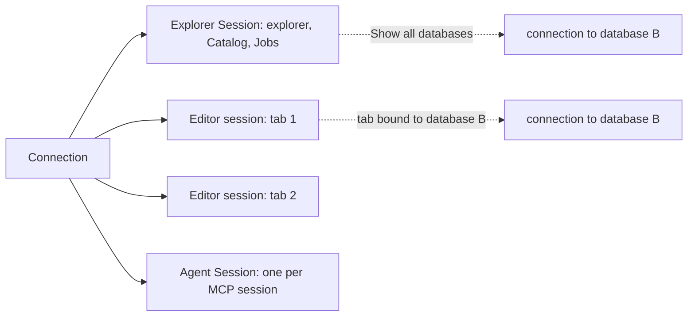
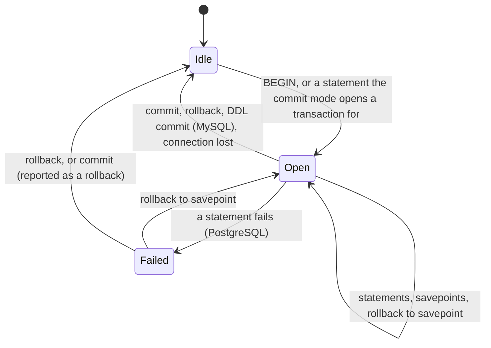
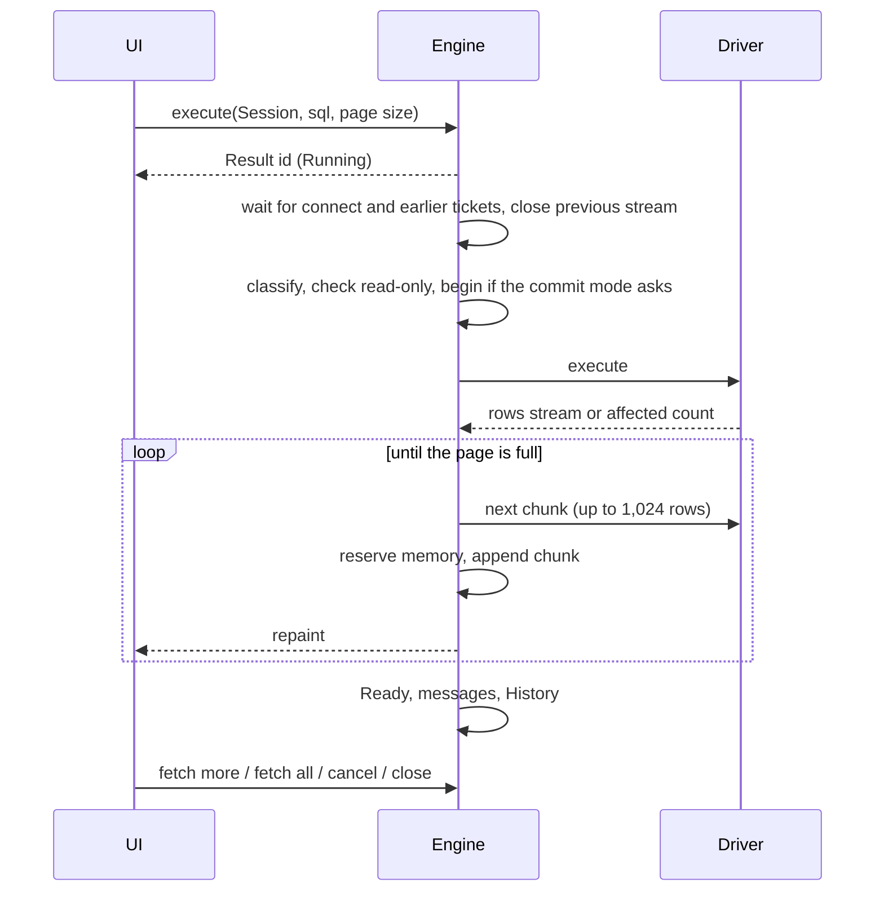

# Query execution

Query execution is how a statement typed by the user reaches a database and how its outcome comes back. It covers the Sessions the engine opens for each Connection, running single statements and scripts, Results with their paging and memory limits, sorting and filtering on the client or on the server, cancellation, the Operations and Jobs that track in-flight work, transactions under the three commit modes, Connection profiles, and the confirmations that guard production databases.

## Concepts

- A **Session** is one live connection to a database that the engine opens for a Connection. It owns a transaction state, a commit mode and a read-only switch, and holds at most one open result stream at a time.
- Each Connection has an **explorer Session**, used by the explorer, Catalog loads, Jobs and data tools. With per-editor sessions on, each Editor tab gets its own **Editor session**. Each MCP session gets its own Session per Connection (see [Agents and terminal](agents-and-terminal.md)).
- A **Result** is what one statement returns: its rows (held as Result chunks), the rows affected for a statement without rows, its status, elapsed time, Page size, messages and whether it was cut short.
- A **script** is a list of statements run one after another on one Session, each with its own Result.
- An **Operation** is any in-flight piece of client work; a **Job** is a background Operation with progress and an outcome. Their registry is described in [Architecture](architecture.md).
- A **Connection profile** decides how a Connection's Sessions commit and how carefully the app guards them: commit mode, read-only, confirmations, idle transaction timeout and color.
- A **Statement class** is how the Dialect classifies a statement: read, write, DDL, destructive (with a reason), transaction control (begin, commit, rollback, savepoint, rollback to, release) or other. A **Destructive statement** loses data in bulk.

## Behaviour

### Sessions

- **Connecting** a Connection opens its explorer Session (states: Connecting, Connected with the server's product and version, Failed with the error, Disconnected). The connect attempt is an Operation, bounded by the connect timeout and cancellable.
- **Per-editor sessions** (`connection.session_per_tab`, on by default, settable per Connection): an Editor tab opens its own Session on its first run, so a long statement in one tab never blocks another tab or the explorer. Its commit mode, read-only switch and open transaction belong to that tab alone. With the setting off, tabs run on the explorer Session. Turning the setting off affects tabs opened afterwards; a tab that already has its own Session keeps it until the tab closes.
- **Closing a tab** closes its Editor session and the server connection; a transaction still open is rolled back by the server (the app asks first, see below). A tab on the shared explorer Session leaves it open.
- **Other databases of the same server.** A tab bound to another database of the server, or the explorer with PostgreSQL's **Show all databases**, opens one more connection per database on first use, with the same server and credentials, read-only when the Session is. These connections belong to their Session and close with it.
- **Losing the connection.** A Connection error fails the Session, closes its stream and other-database connections, drops its SSH tunnel, and ends any open transaction with the message "The transaction was lost: `<reason>`". The next statement on the Session reconnects it.
- **Disconnect** closes every Session of the Connection; the explorer Session ends Disconnected, and its per-Session commit mode and read-only choices are forgotten, so the next connect starts from the profile again. Reconnect is a disconnect followed by a connect that reloads the Connection.
- A changed profile or configuration also resets the per-Session choices; commit mode and read-only otherwise survive a reconnect.

### Running statements

⌘↵ runs the statement at the caret or the selection; ⇧⌘↵ runs the script (see [Query editor](query-editor.md) for how statements are found). A tab without a Connection asks the user to choose one. A run first passes the confirmations below, then connects when needed (asking for unsaved secrets first), then replaces the tab's previous run: its Results are closed and their memory freed.

For each statement the engine:

1. Creates the Result as Running and returns its id at once. The tab shows the running state, elapsed time and rows received so far.
2. Waits for the Session's connect to finish and for every statement issued earlier on the Session (executes on one Session start in issue order).
3. Closes the Session's open stream, if any. A previous Result that still had rows ends complete with a note that it stopped early ("another query ran on this connection or it closed; re-run to continue").
4. Classifies the statement with the Connection's Dialect. In Oracle a `BEGIN … END` block is classified by its body instead of as a transaction start.
5. Refuses a transaction command on a Driver without the transactions Capability ("This driver does not support transaction controls"), a statement that modifies data on a read-only Session ("The session is read-only", a Permission error), and a statement for another database while a transaction is open on a different one ("A transaction is open on `<db>`; commit or roll back first"). Refused statements stop here, before the Driver.
6. Opens a transaction first when the commit mode asks for one.
7. Executes. A statement without rows ends with its affected-row count. A statement with rows takes the Session's stream and fetches its first page. Server notices become Notice messages. A successful DDL statement invalidates the Connection's Catalog cache.
8. Updates the transaction state, adds the outcome message and any transaction notes, and records the statement in History the first time its status leaves Running.

Each Result's Messages pane lists, oldest first: the outcome (the statement's first line up to 80 characters, then "`N` rows affected", "`N` rows" or "`N` rows (more available)", and the time in milliseconds; or the error; or "cancelled"), server notices, and transaction notes ("Transaction started", "Transaction committed", warnings). The status bar shows the row count, the time, and "stopped early" for a Result that was cut short.

Document and key-value statements run through their Families' own paths with the same Session, read-only and confirmation rules; see [Results and editing](results-and-editing.md) and [Drivers](drivers.md).

### Scripts

A script is split into statements by the Dialect, then run in order on the tab's Session, each as its own query with its own Result and History entry. Each statement waits for the previous one's first page or outcome, then takes the Session's stream over, so an earlier Result with rows left ends cut short.

- Every statement that returns rows gets its own result tab; every statement writes a line to the Output pane: "Statement `k`: `N` rows · `t` ms", "Statement `k`: `N` rows affected · `t` ms", or "Statement `k`: `<error>`".
- On error the script **stops** by default ("Script stopped after statement `k`") or **continues**, by the setting `general.stop_script_on_error` (on by default, settable per profile and per Connection).
- Stop cancels the running statement and runs no more ("Script cancelled"). Closing the script closes every Result it produced.
- The Messages of all statements are gathered in run order. The script is one Operation; it ends Done with or without errors, or Cancelled.

### Results and paging

- **Page size** is 500 rows by default (`grid.page_size`, 1 to 1,000,000, settable per profile and per Connection). Each Result's status bar has a "Fetch: `N`" selector with presets 100, 500, 1000 and 5000 and a custom value; it changes the tab's Page size and the current Result's next fetch.
- Scrolling within 50 rows of the end of the loaded rows fetches the next page while the Result has more. Each fetch is an Operation. Rows are read from the Driver at most 1,024 per chunk.
- **Fetch all** streams the rest of the Result page after page, cancellable, with the row count growing as it goes. It stops at the row cap `grid.row_cap` (100,000 by default, 0 for no cap, settable per profile and per Connection); rows fetched before count toward the cap. At the cap the engine reads one more row to tell whether the Result was truncated, closes the stream, and adds "Result truncated at the row cap (`N` rows)".
- Pages read inside an open transaction belong to it, so they see its uncommitted changes.
- **Statuses**: Running, Ready (with or without more rows), Cancelled, Failed with the error. A Result ends cut short when a later statement on its Session took its stream, or its Session disconnected or was lost.
- **Closing** a Result (closing its tab, rerunning the tab, closing a script) interrupts it when running, closes its stream and releases its chunk ownership. Snapshots and background readers keep their data until they finish.

### Memory budgets

SQL Results have two budgets, counted in the bytes of their columnar buffers:

- per Result: `grid.result_memory_mib`, 128 MiB by default;
- for all SQL Results together: `grid.total_memory_mib`, 512 MiB by default.

Both are global settings, and 0 disables the corresponding limit. Each page fetch and fetch-all reserves a chunk's heap bytes atomically before retaining it. When a per-Result budget would be exceeded, the engine spills that Result's oldest heap-backed chunks. At the global budget it spills older Results first, starting with their oldest heap-backed chunks. A chunk larger than either enabled budget goes directly to disk. Fetching continues up to the configured row cap or the end of the stream, with every received row still accessible.

Each Result lazily creates one private anonymous temporary file. A background blocking worker appends complete columnar payloads and creates read-only mappings of their completed ranges. Published ranges stay immutable. The engine holds neither its state lock nor a Result lock during file work. The core encodes and reads chunk data; file creation, writes and mappings belong to the engine. A failed write or mapping fails the fetch with an explicit storage error and preserves rows already published. Cancellation and closing are checked again after file work, before publishing an incoming chunk.

Heap reservations follow the chunks through every snapshot and background reader. Replacing a chunk with its mapped representation releases its reservation only after the last reader of the old heap payload finishes. If snapshots pin all reclaimable allocations, the incoming chunk goes directly to disk. Closing a Result releases its ownership; the file remains alive until the last mapped reader or in-flight writer finishes, then the OS removes its temporary storage. Lowering a limit takes effect on subsequent fetches; existing readers keep their rows.

The budgets cover retained SQL payload buffers. Chunk metadata, in-flight chunks and the temporary encoding of one spill chunk, sort keys, UI state, document Results (256 MiB per Result by default) and graphics memory are outside them. Mapped pages use the OS page cache and may contribute to resident process memory; their cache residency follows OS memory pressure. Reading a cold mapped page can incur a page fault. Payload-size estimates for copy and export retain their original size after spilling, so large copies still run in the background.

### Sorting and filtering

- **Local.** On a complete Result (no more rows on the server) a header click sorts locally through a permutation of the loaded rows, without copying the data; exact decimals compare exactly and ties stay stable. Sorting 10,000 rows or more runs on a background worker per grid; a newer sort replaces a pending one and a stale result never replaces the current view. There is no row filter over the loaded rows: narrowing a Result always goes through the server. Details belong to [Results and editing](results-and-editing.md).
- **On the server.** On a partial Result a header click offers "Sort on server": the tab reruns its original statement wrapped by the Dialect as `SELECT * FROM (<statement>) sqlr_q ORDER BY <columns> [DESC] NULLS LAST`, with identifiers quoted by the Dialect. The filter bar's SQL `WHERE` condition (also built by "Filter by value", joined with `AND`) reruns `SELECT * FROM (<statement>) sqlr_q WHERE <condition>`. Sort and filter combine, and an empty condition removes the filter. A rerun replaces the Result, so it is refused while the Result has a pending Changeset ("Apply or discard the pending changes first"). Document Results answer sort and filter through their own views and queries, described in [Results and editing](results-and-editing.md).

### Cancellation

Stop cancels the tab's running statement or script; the Operations panel cancels any single Operation, and "Cancel all…" asks once before cancelling every running one.

- **Before it starts**, a cancelled statement is skipped and ends Cancelled. Cancelling or closing a queued statement leaves the previous Result available; another viable statement already queued on the same Session still takes the stream at the next chunk boundary.
- **While it runs**, the engine calls the Driver's cancel handle, which cancels on the server where the Driver declares the server cancel Capability: PostgreSQL's cancel request, MySQL `KILL QUERY` on a side connection, SQL Server `KILL` of the session on a side connection, SQLite's interrupt, MongoDB `killOp` of the operations tagged with the query's comment, Elasticsearch task cancellation by the request's opaque id, Redis `CLIENT KILL` from another connection, Snowflake's query cancel. Oracle has no server cancel: its statement runs to the end and then ends Cancelled.
- **While it fetches**, the fetch stops at the next chunk boundary and closes the stream; the rows already loaded stay and the Result ends Cancelled.
- A failed cancel leaves the statement running; there is nobody to report it to.
- **Connect cancellation** drops the attempt, with any SSH tunnel or sidecar start it owned; the Session ends Failed with Cancelled.
- **Rollback** cancels the Session's running statement first.

### Operations and Jobs

Queries, fetches, scripts, connects, explorer and Catalog reads, and Jobs are Operations (see [Architecture](architecture.md) for states and retention). A Job additionally has a kind (applying a Changeset, export, import, file preview, clipboard copy, loading an object or its DDL, applying DDL, administration snapshots and actions, key-value scans, values, edits and console commands, document edits and administration, schema compare, explain, ER model, dump, restore), progress in rows and bytes, an optional total, a log bounded to 5,000 lines, and an outcome (its specific result, Failed or Cancelled). Cancelling a Job sets its cancel flag, which the Job checks between steps, and calls its Driver cancel handle when it registered one. The tools that create Jobs are described in their own specs.

### Commit modes

| Mode | Behaviour |
| --- | --- |
| Auto | Every statement commits on its own. An explicit `BEGIN` or `START TRANSACTION` typed by the user still opens a transaction, which sqlr tracks and keeps open until the user commits or rolls back. |
| Manual | Before the first statement the engine runs the Dialect's begin statement and keeps every following statement inside that transaction until the user commits or rolls back; the next statement starts a new one. Every statement except the transaction verbs `BEGIN`, `COMMIT`, `ROLLBACK`, `ROLLBACK TO` and `RELEASE` triggers the automatic begin. |
| Smart | Like Auto until a statement that writes, changes the schema or is destructive (or a typed `SAVEPOINT`); that statement and every following one run in a transaction, as in Manual. After commit or rollback the Session behaves like Auto again until the next write. |

- A typed `SAVEPOINT` opens a transaction in Manual and Smart mode; `ROLLBACK TO` and `RELEASE` with no transaction open go to the server unchanged and fail there.
- On servers whose DDL commits an open transaction (MySQL, MariaDB), schema-changing statements run outside the automatic begin, and running one inside a transaction ends it with the warning "MySQL committed the open transaction before DDL" (even when the DDL itself fails).
- A read from an object editor's Data page opens no Manual transaction; inside an open transaction it still runs in it.
- `COMMIT AND CHAIN` and `ROLLBACK AND CHAIN` start the next transaction at once. On servers with nested `BEGIN`, each `BEGIN` adds a level and a `COMMIT` ends only the innermost ("Nested COMMIT completed; the outer transaction remains open"). On SQLite a top-level `SAVEPOINT` starts the transaction and releasing it commits.
- The toolbar switches the commit mode of the current Session without changing the profile. Switching to Auto while a transaction is open asks to commit or roll back first ("Auto-commit ends the open transaction on …").
- Drivers without the transactions Capability (Redis, Elasticsearch, MongoDB, Snowflake) run in Auto whatever the profile says; color, confirmations and read-only still apply.

### While a transaction is open

- The toolbar shows **Commit** and **Rollback**, a **Savepoint** button (named `sp1`, `sp2`, … skipping names in use) and **Rollback to ▾** listing the savepoints. Savepoints can be set in Manual and Smart mode while the transaction is open and not failed.
- The status bar shows "Transaction: `N` statements · since `HH:MM`" and the explorer marks the Connection with a pending-transaction badge.
- **A failed statement** leaves the transaction open. On PostgreSQL, where an error aborts the transaction, the state becomes Failed and the status bar says only Rollback is possible; a rollback to a savepoint reopens it; a commit is turned into a rollback by the server and reported as "The failed transaction was rolled back".
- A toolbar transaction command that has no work to do leaves the current streaming Result available. Failed commit, rollback and savepoint commands reconcile the tracked transaction with the Driver's transaction rules.
- Savepoint bookkeeping follows the server: MySQL, MariaDB and Oracle replace a savepoint with the same name, PostgreSQL and SQLite keep duplicates; rolling back to a name keeps the most recent one with that name; `RELEASE` drops it and every later one.
- **Closing a tab** whose own Session has an open transaction, **disconnecting**, **reconnecting** and **quitting** while any transaction is open ask "Open transactions on `<Connections and tabs>`" with Commit, Roll back and Cancel. The action runs once every listed transaction has ended. If the commit fails, the action is abandoned. A disconnect or reconnect still waiting for the server 5 s after the answer is forced through, because a dropped network can leave a commit waiting forever. Quitting also stops the MCP server, kills the Integrated terminal and denies pending Approvals.
- **Idle transaction timeout.** When the profile sets one, a transaction with no statement or transaction command for that many minutes, and nothing running, prompts "The transaction on `<name>` has been idle for `N` min." with Commit, Roll back and Keep open. Keep open silences the prompt until the next activity. The UI checks every 15 s while any transaction is open.

### Read-only

A Session is read-only when its profile says so, when the `safety.read_only` Safety flag is on at any Setting level, when the user switches it on from the status bar, or when an Agent with Read access uses it.

- The server enforces it where it can: PostgreSQL `SET SESSION CHARACTERISTICS AS TRANSACTION READ ONLY`, MySQL and MariaDB `SET SESSION TRANSACTION READ ONLY`, SQLite `PRAGMA query_only`, and each document and key-value Driver's own switch. It is applied when the Session connects, again after a reconnect, and on every other-database connection of the Session.
- The client refuses, before the Driver, every statement whose script-wide class modifies (write, DDL, destructive or other). Statements the classifier cannot place count as modifying.
- Switching it on a live Session runs in the Session's order; the switch takes effect once the server accepted it, and a refusal becomes a notice with the flag unchanged.
- Results of a read-only Session are not editable.

### Connection profiles

| Profile | Color | Commit mode | Confirm writes | Confirm destructive | Read-only | Idle timeout |
| --- | --- | --- | --- | --- | --- | --- |
| Development | none | Auto | off | on | off | off |
| Test | amber | Smart | off | on | off | off |
| Production | red | Manual | on | on | off | 10 min |

- Built-in profiles can be edited and reset; users can add their own. A profile has an id, a name, a color (which tints the toolbar, the tabs and the Connection in the explorer, overriding the Connection's own color), a commit mode, confirm writes, confirm destructive, read-only and an idle transaction timeout in minutes.
- Profiles live in `profiles.toml` (see [Connections](connections.md)); a Connection stores its profile id in `connections.toml`, Development when it has none. The engine loads and saves profiles on its `sqlr.db` worker; the profiles window lists built-ins first, then user profiles by name.
- The Safety flags `safety.read_only`, `safety.confirm_writes` and `safety.confirm_destructive` can only tighten a profile: when switched on at the global, profile or Connection level they add to the profile's own flags, and nothing turns a profile's flag off (see [Settings and workspace](settings-and-workspace.md)).

### Confirmations and production safeguards

Before a run, each statement is classified as a whole script (so a write hidden after a harmless first statement in a batch still counts) and the Connection's effective profile decides whether to ask:

1. With **confirm destructive** on, any Destructive statement asks first: "This will `<reason>` on `<Connection>` (`<profile>` profile)." Reasons include `DROP TABLE`, `TRUNCATE`, `DELETE without WHERE`, `UPDATE without WHERE`, `ALTER … DROP`, `REVOKE`, `KILL`, `COPY TO PROGRAM`, `pg_terminate_backend` and `pg_cancel_backend`; Redis `FLUSHDB`, `FLUSHALL`, `FUNCTION FLUSH` and multi-key deletes; Elasticsearch index deletion and an unrestricted delete-by-query.
2. Otherwise, with **confirm writes** on, any statement that modifies asks: "Run `N` statement(s) that modify data on `<Connection>`?"

The dialog, titled "Run on `<Connection>`", lists the first line (up to 100 characters) of up to 10 concerned statements, then "…and `N` more", with Run and Cancel (Cancel focused). A write keyword hidden later in a batch without a separating semicolon (`SELECT 1` then `DELETE FROM t` in T-SQL, or a PL/SQL block) makes the whole batch destructive with the reason "`<KEYWORD>` in a batch of statements", so every profile asks. `EXPLAIN` without `ANALYZE` is a read even when it wraps a write or a modifying CTE; a separate write after its planned query still counts as modifying; `SELECT … FOR UPDATE` is a read; `SELECT … INTO` and writable CTEs are writes. Redis and document commands are confirmed where they are issued with the same rules. Agents' destructive requests go through the in-app Approval instead (see [Agents and terminal](agents-and-terminal.md)).

## Architecture

- **The UI** decides what to run (statement, selection or script), shows confirmations and transaction prompts, draws the status bar, toolbar and Output, and sends commands to the engine. It reads Results, script progress and transaction state from the engine every frame.
- **The engine** keeps, per Connection, the configuration, secrets, profile and SSH tunnel, and per Session its connection, cancel handle, other-database connections, open stream, running query and transaction state. Executes, fetches, transaction commands and Changeset applies on a Session take tickets in issue order and hold the Session's stream lock while they run, so a fetch and a commit never interleave.
- **Core** provides the statement classifier, the Statement classes, the commit modes and the built-in profiles. **Dialects** provide splitting, the begin, savepoint and read-only statements, the transaction rules of their server (DDL commits, errors abort, nested begin, savepoint replacement, savepoint starts a transaction) and the sort and filter wrappers.

## Data model

- **Session**: Connection, slot (explorer, Editor tab, Agent), status, live connection, cancel handle, other-database connections, running query, transaction state, transaction connection, SSH tunnel.
- **Transaction state**: commit mode, read-only, phase (Idle, Open, Failed), nesting depth, statement count, start time, savepoints (oldest first), last activity time, idle-timeout flag, whether it wrote, whether a savepoint started it.
- **Result**: statement text, database, status, rows, affected rows, elapsed time, Page size, cut-short flag, messages, memory reservation.
- **Script state**: Results by statement index, Output lines, running statement, done and cancelled flags, messages.
- **Connection profile**: id, name, color, commit mode, confirm writes, confirm destructive, read-only, idle timeout in minutes.
- **Job state**: kind, progress, total, outcome, start time, log.

## Non-functional requirements

- Every engine call from the UI returns immediately; the UI never waits for a statement, a fetch, a commit or a cancel.
- A long statement in one Editor tab never delays another tab or the explorer while per-editor sessions are on.
- Retained SQL payload buffers are reserved against 128 MiB per Result and 512 MiB globally by default; spill mappings use the OS page cache.
- Failed and cancelled statements are logged once when they settle, at info (expected server errors), warn (unexpected kinds) or debug (cancellation), with SQL capped at 4 KiB and included only when `diagnostics.include_sql` is on (see [Diagnostics](diagnostics.md)).
- A lost connection never leaves the UI believing a transaction is still open.

## Decisions

- **One Session per Editor tab, plus one for the explorer.** Users expect tabs to be independent, as in other clients: a long query or an open transaction in one tab must not block another or the explorer. The cost is one server connection per tab, so a setting turns it off for servers with tight connection limits.
- **One open stream per Session; a new statement cuts the previous Result short.** Most protocols cannot interleave two result streams on one connection. Cutting short (and saying so in the status bar) is predictable; queueing the new statement behind an unfinished Result would freeze the tab.
- **Paging with a 500-row default instead of loading everything.** Opening a large table is instant and memory stays bounded; Fetch all is explicit and capped.
- **Spill immutable columnar chunks through read-only mappings.** Results remain complete under memory pressure, and consumers keep the same cell interface. One append-only anonymous file per Result bounds open file handles and lets the OS reclaim temporary storage after the last reader, including after a process exit. Chunk-level reservations keep snapshots accounted for; a worker performs storage I/O without holding Result locks.
- **Statement classification on lexer tokens, conservative by default.** Keywords inside strings and comments never count, a `WHERE` counts only at the statement's own depth, and anything unknown counts as a write, so read-only mode and confirmations never miss a statement.
- **Read-only enforced twice.** The server's own read-only mode catches what a classifier cannot see (functions with side effects); the client classifier refuses writes before they reach a server that has no read-only mode (SQL Server, Oracle).
- **Commit modes driven by plain SQL from the Dialect and tracked by the engine.** The engine runs the begin, savepoint and read-only statements itself and follows typed transaction verbs, so the toolbar and status bar always reflect the server's real state, including server quirks (MySQL's implicit commit before DDL, PostgreSQL's aborted transactions).
- **Smart mode.** Reads stay in auto-commit and hold no locks, while the first write is protected by a transaction the user must end; this suits test databases where accidental writes are the risk.
- **Forced disconnect after 5 s.** Waiting for a commit on an unreachable server would make disconnecting impossible; the server rolls back an abandoned transaction anyway.
- **Confirmations from the profile, not per statement type settings.** One profile choice (Development, Test, Production) gives a whole policy at once, and Safety flags can only make it stricter.

## Related specs

- [Architecture](architecture.md): threading, the Operation registry, error kinds and the chunk format.
- [Connections](connections.md): Connections, secrets, SSH and the files profiles live in.
- [Query editor](query-editor.md): finding the statement at the caret, splitting, error markers.
- [Results and editing](results-and-editing.md): the result grid, local sort and filter, the Changeset and its apply.
- [Drivers](drivers.md): Dialects, Capabilities and per-Driver cancel and transaction behaviour.
- [Agents and terminal](agents-and-terminal.md): Agent Sessions, Agent access and Approvals.
- [Settings and workspace](settings-and-workspace.md): Setting levels, Safety flags and the Operations panel.
- [Diagnostics](diagnostics.md): how settled statements are logged.
