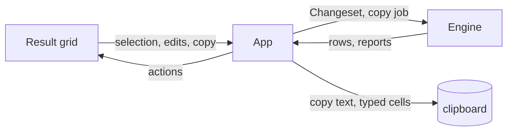

# Results and editing

Results are what a run leaves behind: the panes below an Editor tab, the grid that shows rows, and the ways a user reads, copies, edits and applies changes to them. This area covers the Result, Messages, Output and Plan panes, the Result grid with its selection, copying and pasting, the Changeset and how it is previewed and applied, the Value panel, the Table, Tree and JSON views of documents, and the Redis key browser and value views. How a run produces a Result, pages and limits it belongs to [Query execution](query-execution.md); exports and imports belong to [Data and schema tools](data-and-schema-tools.md).

## Concepts

- A **Result** is what one statement returns: its rows held as Result chunks, its affected-row count when it returns none, its status, elapsed time, Page size, messages and whether it was cut short.
- A **Result grid** is the virtualized table widget that shows a Result's rows and columns.
- A **Changeset** is the pending edits to a Result's data: modified cells, inserted rows and deleted rows, until they are applied or discarded.
- A **row key** is the primary key, or a unique key over `NOT NULL` columns, that identifies a row for editing. A Result without one is read-only.
- A **Value panel** is the side panel that shows and edits the selected cell, document or key value in full.
- **Table**, **Tree** and **JSON** are the three views of a document Result. Table shows the documents flattened into rows; Tree shows each document as an expandable value tree; JSON shows one document as relaxed Extended JSON, optionally editable.
- A **Key browser** is the Redis view that lists keys grouped by prefix with their types and TTLs.
- A **Key value view** shows one Redis key's type, size, TTL and value, per type, with editing.
- A **copy format** is one of TSV, CSV, JSON, SQL `INSERT` or Markdown; the **typed clipboard** is the cell values kept inside the application alongside their text.

## Behaviour

### The result area

Below the editor is a pane strip and the pane itself. A single statement's run has a **Result** pane (labelled "Error" after a failure) and a **Messages** pane; the run's script form has one **Result** pane per statement that returned rows (labelled "Error `n`" when statement `n` failed), an **Output** pane, a **Messages** pane, and a **Plan** pane once a plan exists. The strip also carries the Explain controls and, while a script runs, a spinner with the statement number.

- **Result.** The Result pane shows the grid, its bar with the pending changes and Export, and, for a Result that failed, an error panel with the message, its hint, the statement, a "Copy details" button, and a link to the error's line and column in the editor that reveals the caret. A failed statement shows no grid.
- **Messages.** Messages lists a statement's outcome, the server's notices and the transaction notes, oldest first, each with its local time and a level (info, notice, warning, error) in its own color. The outcome is the statement's first non-blank line up to 80 characters, then "`N` rows affected", "`N` rows" or "`N` rows (more available)", and the elapsed time in milliseconds; a failure shows its error, a cancellation says "cancelled". A script gathers the messages of every statement in run order. The pane shows the message count and a button that copies one line per message (time, level, text).
- **Output.** A script writes one line per statement: "Statement `k`: `N` rows · `t` ms", "Statement `k`: `N` rows affected · `t` ms" or "Statement `k`: `<error>`", followed by the script's stop or cancellation line when it applies.
- **Per-statement timings.** Each statement's own elapsed time appears in its outcome line; the status bar shows the shown Result's elapsed time and row count.
- **Plan.** The Plan pane shows the visual explain plan of the statement at the caret: a summary of execution and planning time, cost, output rows and the operator mix, a warning count with up to four warnings listed, a stacked hot path bar whose segments select a node, and the operators as collapsible cards connected as a tree. Each card shows its rows (estimated or measured), time or cost, and a badge when its measured rows differ from the estimate. Selecting a card, a hot path segment or a node opens an inspector beside the tree with the node's metrics, filters, indexes, buffers and extras. The hottest three nodes carry rank badges. The raw plan is one toggle away and can be copied. An estimated plan says so. A plan is a snapshot: when the statement at the caret changes, the pane offers to recompute it and keeps the old plan visible until a new one arrives. Explain Analyze of a statement that writes asks inline first, says that its changes are rolled back but side effects still happen, and runs inside a transaction that is rolled back; a running explain can be stopped. The plan computation and the per-engine explain statements are described in [Drivers](drivers.md) and [Data and schema tools](data-and-schema-tools.md).
- **Truncation.** A Result stopped at the row cap or because a later statement took its stream keeps the rows loaded so far and says so: the Messages pane carries "Result truncated at the row cap (`N` rows)", and the status bar appends a "stopped early" note for a cut-short Result. Its row count is presented as the loaded portion. SQL memory budgets move older chunks to temporary storage while the Result continues loading. The grid, local sorting, clipboard and Changeset read mapped cells through the same interface as heap-backed cells. Storage failures fail the fetch explicitly while retaining previously loaded rows.

### The Result grid

- **Virtualization.** The grid paints only the rows inside its viewport plus two of overscan, and only the columns intersecting the horizontal viewport. Row height is fixed. A zebra stripe marks odd rows.
- **Row numbers.** A gutter on the left numbers the shown rows from 1; a selected row's gutter is tinted. The gutter is pinned while horizontal scrolling moves the columns.
- **Column widths.** Initial widths are measured once per column set from the column name, its type name and the values of the first 100 rows, using the monospace advance, and clamped between 60 and 400 points. Dragging a header's right boundary resizes that column, with a minimum of 60 points; manual widths can exceed 400 points. Double-clicking a header's right boundary fits the column to its header and the values of up to the first 10,000 loaded rows (Excel-style autofit), with a minimum of 60 and a maximum of 2,000 points; the fitted width is a manual width. Resizing keeps sorting and selection unchanged. Manual widths stay with the grid's column set as pages arrive or display formats change; other widths are remeasured when the columns, sample size or display formats change, not every frame. A different column set starts with measured widths.
- **Headers.** A sticky header shows each column's name with its type under it, and the sort marks. Clicking a header cycles ascending, descending, then unsorted. On a complete Result the sort is computed locally; on a partial Result the grid offers "Sort on server" instead.
- **Typed rendering.** A cell is rendered by its column kind and display hint. NULL shows as the configured null text in italic grey, and inserted cells left to their default show "DEFAULT" the same way. Booleans show as `true`/`false`, `1`/`0` or `✓`/`✗` by setting; integers and floats right-aligned; exact decimals as their text, right-aligned; temporal values reformatted by the configured date, time, timestamp and zoned-timestamp patterns; intervals, UUIDs, arrays and geometry as their text; JSON compacted onto one line up to 4 KiB unless pretty JSON is configured; XML as its text; bytes as hex, base64 or UTF-8 by setting. A deleted row's text is struck through in the error color.
- **Cell truncation.** A grid cell shows one line. Line breaks become `⏎` and text is cut at 200 characters plus "…". Bytes show `0x` and the first 32 bytes, then "…" and their total count. The full value is in the Value panel.
- **Display formats.** A Connection's display formats (null text, date, time, timestamp, zoned timestamp, number grouping, decimals, boolean style, binary style, pretty JSON) apply to every grid and to the Value panel. Formats that change nothing let the grid use its fast path. They are configured in [Settings and workspace](settings-and-workspace.md).
- **Server filter.** A field above the grid takes a SQL `WHERE` condition; pressing ↵ reruns the tab's original statement wrapped by the Dialect with that condition. An empty condition removes the filter. "Filter by this value" in the context menu writes a condition for the selected cell. Sort and filter combine. A rerun replaces the Result and is refused while the Result has pending changes ("Apply or discard the pending changes first").
- **Loading more.** When the user scrolls within 50 rows of the end of a partial Result, the grid asks for the next page.

### Selection

- A click selects one cell. Dragging, or Shift+click, extends one rectangle from the anchor to the cursor. Clicking a row number selects the whole row, Shift+clicking a row number extends to it, and clicking a column header with Shift selects the whole column. The corner selects everything. ⌘A selects every shown cell.
- ⌘-click adds a separate cell, row or column rectangle, and ⌘-click on an already selected cell removes it from the selection by subtracting its area from the selected rectangles, which can split one rectangle into up to four. The primary rectangle is the one the keyboard moves.
- Selections are kept in view coordinates: loading another page keeps them over the same positions, a sort resets the extra rectangles and leaves the primary rectangle where it is, and a selection shrinks when the view shrinks.
- The status bar summarises the selection: one cell shows its row, column and byte length; more cells show their count and, up to 10,000 cells, the sum of their numeric values.

### Keyboard navigation

Arrows move one cell, Page Up and Page Down move one visible page, Home and End go to the row's first and last column. Shift with any of them extends the rectangle from its anchor. A vertical move keeps the column. ↵ opens the inline editor on the selected cell, and typing a character on an editable Result opens it holding that character with the caret after it; Cmd+A selects everything; Cmd+C copies as TSV; Cmd+V pastes; Cmd+Z and Cmd+Shift+Z undo and redo the pending changes; Cmd+Backspace or Cmd+Delete marks the selected rows deleted; Cmd+I adds a row; Cmd+D duplicates the selected rows; Option+Cmd+N sets the selected cells to NULL. These grid chords come from the Keymap and work on an editable Result while the grid has focus and no inline editor is open; the context menu shows them next to its entries. Moving the selection scrolls the cell into view.

Cmd+S applies the shown Result's Changeset as the result bar's Apply does, and F5 or Cmd+R runs the Result's statement again; both are described in [Settings and workspace](settings-and-workspace.md).

### Copying

- **Copy** (⌘C, or "Copy") copies the selection as TSV. A single-cell copy puts that value alone on the clipboard. Whole columns include the column names as a header.
- **Copy as** offers TSV, CSV, JSON, SQL `INSERT` and Markdown. CSV always includes the header. SQL `INSERT` writes into the edited table's name, or `result` when there is none. JSON writes an array of objects.
- **Typed clipboard.** Every copy also keeps the selected cells as values inside the application, with their column names, NULL distinct from empty text, binary values, and unselected holes as holes. A paste reuses this typed data only when the clipboard text still matches it; otherwise the text is parsed as TSV.
- **Large copies.** A selection over 100,000 cells or an estimated clipboard over 1 MiB is copied through a background job after the user confirms "Copy `N` cells to the clipboard?". The job encodes in chunks, reports progress in the status bar and can be cancelled; the app then puts the text on the OS clipboard. The typed clipboard is bounded at 128 MiB, after which the copy fails with "The clipboard exceeds 128 MiB; export the results instead".
- **Copy all results** reruns the current read query with its SQL filters and limits as a cancellable background job with progress, instead of copying only the loaded rows. It is refused when the statement is not a read, when it returns no rows, and while the Result has pending changes ("Apply or discard pending changes before copying all results"). Its output is TSV text, since it reads database values.

### Pasting

- Plain text pasted into a selection is parsed as TSV. A single value fills every selected cell; a block is repeated in every selected rectangle, tiling when the rectangle's height and width are exact multiples of the block's, and otherwise applied once from each rectangle's top-left corner clipped at the grid's boundaries. A single selected cell is a paste anchor.
- Every affected value is coerced to its column's kind (integer, number, boolean, hex bytes, otherwise text) and validated before anything is committed to the pending edits. If any value is invalid the whole paste is refused with the reason and nothing changes.
- **Paste as new rows** opens a mapping preview: each source column can be mapped to a destination column or skipped, a source with column names in its first row can use them, unmapped required columns are reported, a column mapped twice is refused, and automatic IDs (including primary keys with a server default) are regenerated by default while explicit IDs are kept when regeneration is turned off. The preview shows the first five mapped rows. "Add pending rows" validates and appends them, on a background thread with progress when there are more than 1,000 rows. It is also offered from an empty editable Result.
- A document Result's Table view treats a double-click or Enter on a cell as a request to edit that document, not as an inline cell edit.

### Inline editing and the Changeset

A Result is editable when its rows come from one table, every column carries that table's origin, the Connection's Driver declares editable results, the Result's Session is not read-only, and the table has a row key whose columns are all in the Result. Otherwise it is read-only and the bar says why: "driver does not support editing", "session is read-only", "computed columns", "columns from several tables", "no primary or unique key on `<table>`", "the key of `<table>` is not in the result", or a failed table description. The bar offers "Open table to edit", which opens the table's own `SELECT *` in a new tab.

- **Editing a cell.** Double-click or ↵ opens a single-line editor on the cell, preselecting its text. Typing on the selected cell opens the same editor with the typed text in place of the value, as in a spreadsheet; on a cell that opens in the Value panel, typing does nothing. Long text, text with line breaks, binary values, and JSON or XML columns open the Value panel's editor instead. Bytes are typed as `0x` followed by hex pairs, booleans accept `true`/`false`, `t`/`f`, `1`/`0`, `yes`/`no`, and numbers must parse. An invalid value keeps the editor open with its message and a tinted field. Setting a cell back to its loaded value drops the edit.
- **What is editable.** Only columns read from a non-generated table column are writable; `NOT NULL` columns refuse NULL; a generated or read-only column refuses every edit; a deleted row refuses edits. A Table view only offers the inline edit as a way into the document editor.
- **Change highlighting.** An edited cell is tinted in the warning color at 25 % opacity over the row. An inserted row is tinted in the success color, a deleted row in the error color with struck-through text, and an inserted cell left to its default says "DEFAULT".
- **Operations.** "Add row" appends a row of defaults. "Duplicate row" copies the selected rows, leaving automatic columns and primary keys with a server default to regenerate and copying manually assigned keys. "Delete row" marks the selected rows deleted. "Set NULL" sets every selected writable, nullable cell to NULL. "Revert selected cells" drops only the pending edits of the selected cells without touching their rows' other changes. "Revert row" drops every pending change of a row; reverting an inserted row removes it.
- **Undo and redo.** Undo and redo work on whole operations, before Apply. A new edit clears redo. Apply or a reloaded Result starts a new history. They undo pending edits only and never undo a committed database write. The history keeps up to 100 operations or 32 MiB, dropping the oldest. Inside an open inline editor, Cmd+Z and Cmd+Shift+Z undo and redo only the typing in that cell since the editor opened; a committed cell edit is one operation of the grid's history.
- **The Changeset.** Pending edits become a Changeset: deletes first, then the updates of each loaded row merged into one `UPDATE`, then inserts. Values travel as bound parameters; the preview renders them as literals only for display. Every statement expects to affect exactly one row. Untouched insert columns take their default; an insert with no values uses the dialect's default-row form. Rows are identified by their key values as read, compared with `=`, so editing a key column still finds the original row.
- **Preview and Apply.** The result bar shows the pending count, "Preview SQL", "Apply" and "Discard". ⌘S runs the same Apply. When an inline cell editor is open, ⌘S first commits it as ↵ does; an invalid value keeps the editor open with its message and nothing is applied. Preview opens a read-only editor with the generated statements, one per line, ended by `;`. Apply runs the Changeset inside a transaction and commits, or rolls back on any failure. When the Connection profile asks before writing, Apply first opens the preview with a line saying the profile asks for review. Discard drops the pending edits.
- **Where Apply runs.** In Auto commit mode with no transaction open, Apply runs its own `BEGIN` and `COMMIT` (`ROLLBACK` on failure). In Manual or Smart mode with no transaction open, it opens a transaction and leaves it open for the user to commit. Inside an open transaction it joins it behind a savepoint, so a failure undoes only the Changeset. Apply is refused on a read-only Session, on a failed transaction, and on a transaction open on another database.
- **Rows changed elsewhere.** Before applying, the table's origin is checked. If any statement affects a number of rows other than one, the whole Changeset is rolled back and reported: "`<row>` was changed or deleted by someone else: the statement matched `N` rows instead of 1. Nothing was applied; refresh the data and try again". A failure keeps the pending edits. A success clears them, re-runs the Result with its server sort and filter, and shows "Applied `N` changes".
- **Read-only Results.** A Result from a read-only Session, or from a Driver without editable results, never gets a Changeset; the grid warns that the result is read-only and to open a table to edit it.

### Document viewers

A document tab shows its run as Table, Tree or JSON; the choice belongs to the tab.

- **Table** flattens the documents into the grid. Columns are the union of the top-level keys of the first page's documents, in first-seen order; a nested value is shown as compact JSON. Later pages append rows under the same columns, and the rows are built once per page. The table's copy of the documents stops at 128 MiB by default and then says so: "The table shows the first `N` documents (its memory budget); Tree and JSON show them all". Selecting a row reports the document to the other views; double-clicking or pressing Enter on a cell edits the document in the JSON view.
- **Tree** shows one row per document with its summary (`_id: … · N fields`), and expands nested objects and arrays one level at a time. Only expanded documents are decoded and kept; rows are virtualized and rebuilt only when the documents or the expansion change. Values show as relaxed JSON cut at 120 characters. The selected field's full value appears in the Value panel. Each document has a context menu to edit, duplicate, copy as JSON or delete.
- **JSON** shows one document as pretty relaxed Extended JSON, read-only until "Edit" turns it into an editor that accepts Mongo shell literals such as `ObjectId("…")` and `ISODate(…)`. "Save" validates the text and reports the new document; a document holding a type sqlr cannot write back stays read-only and says which type. The editor highlights the document and underlines the JSON parser's first error after every edit, with the message on hover; an empty value is not marked until the user types. "Beautify" replaces the text with two-space indented JSON as one undo group.
- **Editing rules.** A document is editable when its Result is editable and the document has an `_id`. On Elasticsearch the document's own `_index` is also used. A document without `_id` is read-only ("the document has no `_id`: it is read-only"). Saving, inserting and deleting go through the app so the Connection profile can confirm them, then the Result is read again. A delete confirmation lists how many documents are deleted and says how many without `_id` were skipped.
- The Value panel shows a document's selected field with the same typed rendering as a cell.

### Redis key browser and value views

- **Key browser.** Keys are listed under a match pattern that defaults to everything, grouped by a configurable separator (the Driver's `separator` property, `:` by default): a group row shows its prefix and the number of keys at and below it, with an expand arrow; key rows show the key name, a type badge and the time to live (`12m`, `3h`, `2d`, `<1s`). Key names are bytes: valid UTF-8 is shown as text, anything else as escaped `\xNN`.
- **Scanning.** The browser uses `SCAN` only and never `KEYS`. Each scan asks for up to 500 keys per call with a `COUNT` hint and loads the next page from "Load more" while the cursor is non-zero. Changing the pattern starts a new scan. Each database keeps the scans of at most eight recently used patterns. Duplicate keys returned by `SCAN` are dropped.
- **Selecting and deleting.** Clicking a key opens its value. ⌘-click and Shift+click extend a selection; Delete removes the selected keys after a confirmation that lists up to eight of them. A refresh scans the current pattern from the start.
- **Value view.** The header shows the key's type, size (`1.5 MiB`), TTL ("expires in …") and length, with fields to set a TTL (in seconds or with `ms`, `s`, `m`, `h`, `d`), a Persist button when it expires, a Rename action that refuses a name already in use, and a Delete key action with confirmation. The value is shown per type, one page at a time with "Load more":
  - **String** shows text, pretty JSON or a hex dump; a string over 64 KiB is shown read-only.
  - **Hash** shows fields and values in a table; **List** shows indexes and values; **Set** shows members; **Sorted set** shows members with their scores; **Stream** shows entries with their ids and field/value pairs. Each row can be edited or removed, and new elements can be added at the bottom.
  - A module type such as RedisJSON is shown raw and read-only.
- An element over 64 KiB cannot be edited inline. Editing a string, field, member, score or entry, adding and removing elements, setting the TTL, renaming and deleting go through the engine and follow the Connection's read-only and confirmation rules.
- **Console.** A Redis tab also has a console for raw commands with command history, cancellation of a running command and a clear output action. Read-only and confirmation rules apply as for the browser.

## Architecture

The UI owns the Result grid, the Value panel, the document views, the key browser, the key value view and the clipboard model's presentation. Widgets take data in and return actions; they call no engine. The app turns those actions into engine calls, runs the dialogs (preview, large copy, paste mapping, delete confirmations), and publishes copied data to the OS clipboard and the typed clipboard.

Core owns the value and cell types, the display formats, the Changeset and its DML generation, the text encoders and decoders for every copy and paste format, and the typed clipboard structure. The engine owns the Results and their row buffers, applies Changesets as Jobs, encodes large copies as Jobs, runs document and key-value operations and their edits, and enforces read-only and confirmations.

## Data model

- **Grid view**: column layout, local sort, server condition, selection rectangles, pending edits, edit history, scroll and reveal targets.
- **Edit buffer**: key columns, writable and `NOT NULL` flags, automatic and default flags, missing required columns, updates by row and column, inserted rows by row number, deleted rows, revision.
- **Changeset**: table, key columns, changes (update with key, column and value; insert with values; delete with key).
- **DML statement**: SQL, parameters, whether it must affect exactly one row, and the row label used in messages.
- **Document views**: the selected document and field, expanded tree nodes, decoded documents, table rows and budget, the JSON editor and its error.
- **Key browser**: pattern, loaded keys, SCAN cursor and whether more remain, expanded groups, selected keys.
- **Key value view**: key, loaded pages, string display mode, TTL and rename fields, the element being edited.

## Non-functional requirements

- The grid paints only visible rows and columns and formats cells only for visible rows, so it scrolls at 60 fps with 1,000,000 rows loaded.
- Column widths are measured once per column set, not per frame; a local sort of 10,000 rows or more runs on a background worker while the previous order stays usable.
- A local sort never replaces the current view with a stale result; a newer sort supersedes a pending one.
- Large copies and paste-as-new-rows run off the UI thread with progress and cancellation.
- Copying a selection never blocks on more than 100,000 cells or 1 MiB without asking; the typed clipboard never exceeds 128 MiB.
- Applying a Changeset either applies all its statements or none, and a row matched by more than one row aborts the whole Changeset.
- A document Result's table copy stays within 128 MiB; the Tree and JSON views keep every document reachable.

## Decisions

- **A custom-painted grid instead of a table widget.** Virtualizing both rows and columns, painting only the viewport, formatting only visible cells and caching column layouts are what make a million-row Result usable; a generic table widget cannot meet that budget.
- **The Changeset holds values, not SQL.** Values travel as bound parameters and the DML is generated from the Dialect at preview and apply time, so quoting and placeholders are always right, values never have to be escaped into text, and the preview can show literals without changing what runs.
- **Rows are identified by a real key, never by all columns.** A row without a primary or unique key is read-only and says why. Matching on every column would silently update the wrong row when values repeat or a table has duplicate rows.
- **Apply inside a transaction, joining the user's when one is open.** All statements or none is the only safe outcome for a set of edits. Joining an open transaction behind a savepoint keeps the user's own work intact while still undoing only the Changeset on failure.
- **Expect exactly one affected row per statement.** A count other than one means someone else changed or deleted the row since it was read; rolling the whole Changeset back and asking for a refresh is safer than applying a partial set of edits to moved data.
- **Typed clipboard data kept inside the application.** Text alone loses NULL versus empty text, binary values and unselected holes, so those cannot be pasted back faithfully. Keeping the values next to the text, and using them only while the text still matches, preserves them without breaking copy and paste with other applications.
- **Repeat paste with tiling, clipped at the grid's edges.** Spreadsheet users expect a block pasted into a multiple-sized selection to repeat; clipping rather than growing the grid keeps a paste from creating rows or columns the user did not ask for.
- **Validate every value before touching the pending edits.** A paste that fails halfway would leave half a block in the Changeset; trying it on a copy and committing only when all values are valid keeps the pending edits consistent.
- **The grid has its own Keymap scope.** Row commands live in a Grid scope that does not overlap the editor's, so ⌘D duplicates rows in the grid and selects the next occurrence in the editor. Undo, redo, select all and copy stay shared, because they mean the same thing in both.
- **Whole-operation undo before Apply.** Cell-level undo would make a multi-cell paste or a row duplication awkward to reverse. Undo restores the previous edit buffer, and it stops at Apply because committed writes are no longer pending work.
- **Paste as new rows goes through a mapping preview.** A clipboard block often comes from another table, so matching by name, letting the user remap and skip columns, refusing a missing required column and regenerating automatic IDs prevents a silent wrong insert.
- **Copy all reruns the query instead of copying loaded rows.** A grid may hold one page of a much larger Result; copying the loaded rows would silently give a partial answer. Re-running the read with its filters and limits, as a cancellable job, copies the real set.
- **Document Table, Tree and JSON share one document set.** Each view answers a different question (scan, explore, edit), and a document selected in one stays selected in the others; the Table's memory budget keeps a large collection bounded while the other views still reach every document.
- **Redis browsing uses SCAN, never KEYS.** `KEYS` blocks the server on a large database. Cursors make paging explicit, and grouping by prefix makes a flat key space navigable.
- **Redis values page per type.** A hash or stream can be huge; reading one page at a time with the type's own scan command keeps memory and latency bounded while still allowing "Load more".

## Related specs

- [Architecture](architecture.md): Results, chunks, Jobs and the threading model.
- [Query execution](query-execution.md): how Results are produced, paged, sorted, filtered and closed, and read-only rules.
- [Query editor](query-editor.md): the editor above the Result and the run shortcuts.
- [Drivers](drivers.md): DML generation, type mapping, document and key-value operations, and cancel behaviour.
- [Data and schema tools](data-and-schema-tools.md): export, import, explain plan sources and other tools that reuse the grid.
- [Settings and workspace](settings-and-workspace.md): display formats, Page size, row cap, memory budgets and the Value panel docking.
