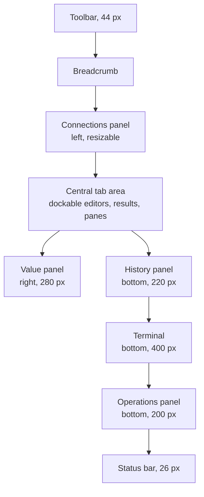
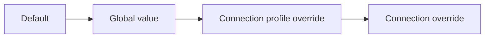

# Settings and workspace

This area is the frame everything else runs in: the main window and its panels, the chrome around the tabs, the welcome screen, the Palette, the Preferences window with every setting, the Setting levels that let one Connection differ from another, the Keymap, the themes and fonts, the command-line arguments, and updates and distribution. It owns how a user shapes the app and how the app presents itself before any database work starts.

## Concepts

- The **workspace** is the main window: a toolbar, a Connection Explorer panel, a central area of Editor tabs, optional panels for Operations, history, the value panel and the terminal, and a status bar.
- **Chrome** is the persistent interface around the content: toolbar, connection chip, run controls, breadcrumb, toasts and status bar.
- The **welcome screen** fills the central area while no tab is open.
- The **Palette** is the keyboard-first search window for objects and commands.
- **Preferences** is the settings window, with one section per area of behaviour.
- A **setting** has an identifier, a label, a description, a type, a default, the levels it accepts and whether it is a Safety flag.
- A **Setting level** is where a value is set: global, Connection profile or Connection.
- A **Safety flag** is a setting that a lower level or an agent can switch on and never off.
- The **Keymap** maps every command to a keyboard chord or a sequence of chords.
- A **chord** is one key combination, written with the platform's symbols on macOS and with `Ctrl`, `Alt`, `Shift` and `Meta` elsewhere.
- A **preset** is a complete Keymap to start from: sqlr's own or the VS Code one.
- A **theme** is the set of colors, spacings and type sizes the interface draws with.
- A **release channel** is the GitHub release the app checks and installs from.

## Behaviour

### The main window

The toolbar is 44 pixels high, tabs are 34 pixels, and the status bar is 26 pixels. The Connections panel sits on the left, resizable, with a default width of 20% of the window clamped between 200 and 270 pixels and a minimum of 160. The value panel sits on the right at 280 pixels when it is open and the active tab is not a document or key-value tab, which have their own inspector. The Operations panel opens above the status bar at 200 pixels; the history panel at 220 pixels and the terminal at 400 pixels, when they are open, share the bottom edge.

The central area is a dockable tab area. Tabs can be reordered and split into side-by-side or stacked groups inside it by dragging, and each group holds a tab bar. A new window starts from this default arrangement, and the panels the user opens keep their size for the session.

A tab holds an Editor script, an object editor, a result with its panes, an ER diagram, a migration script or another tool surface. Closing the last tab brings back the welcome screen.

### Chrome

#### Toolbar

The toolbar starts with the app mark and the classic menus (File, Edit, View, Query, Tools, Help). On macOS the same menus live in the system menu bar instead, and the in-window menus fold into a single Menu button, then disappear as the window narrows.

Next is the connection chip, between 96 and 220 pixels wide, tinted with the Connection's color. It shows the Connection name and state, and opens a menu to switch Connection, connect, edit, reconnect or disconnect.

The run controls are Run, Run script and Stop. Stop is shown while something runs and is also reachable with Escape. Transaction controls (commit, rollback, commit mode) sit next to them while a transaction is open, or under a More tools menu when space is short.

The right side of the toolbar holds, in order, the Operations toggle with a count and a spinner while work runs, Preferences, the value panel toggle, history, the terminal toggle when the window is wide enough, a divider, and a search field that opens the Palette. A hairline separates the toolbar from the content.

#### Connection chip and breadcrumb

The chip carries the Connection's color and state: connected, connecting, failed or disconnected. The breadcrumb under it reads Connection, database and current tab, with a database picker. The picker is disabled while a statement runs or a transaction is open. Clicking the Connection reveals it in the Explorer. On the right the breadcrumb shows the run shortcut, `⌘↵ to run`.

#### Toasts

Toasts appear in the bottom-right corner, at most three at a time, 320 pixels wide, with a 3-pixel colored bar on the left, a message and a Dismiss button. Information and success toasts fade out after 4 seconds, errors after 8 seconds, with a 0.6-second fade. An error stays while the pointer is over it.

#### Status bar

The status bar is one line of segments. On the left:

- The Connection state as a colored dot, a word and the name and Driver.
- The transaction line: the statement count and time since it opened, a warning when the transaction failed, or an error note when only rollback is possible.
- Rows and elapsed time for the selected result, or its final state.
- Selection counts.
- The fetch size as a combo with presets 100, 500, 1,000 and 5,000 plus a custom value, and Load all rows when the Result has more rows.
- A progress entry for a running export or copy, with a Cancel action.

On the right: the command palette shortcut hint, the MCP status and session count, the terminal toggle, the encoding (`UTF-8`), the caret's line and column, and a Not saved marker for an unsaved script. The MCP segment stays visible when disabled with a grey dot. Clicking the dot toggles the server; clicking the text opens Settings → Agents. Each control reserves its own space. Below 700 logical pixels the terminal toggle uses its icon with the same tooltip and action, leaving room for the Connection, transaction and Result segments.

The terminal toggle shows or hides the panel while its shells keep running. The terminal header holds selectable, closable tabs in place of the shell status and path summary. Each tab has a context menu to close it or the tabs to its left or right, using the clicked tab as the reference. Tab labels use the launched executable's name without numbering, and keep that name while the session runs. A + creates a new tab with the configured launcher; selecting a coding agent in Settings adds a second + with a terminal icon for a plain login shell. The actions appear in the order +, + shell when available, Restart, downward chevron. The chevron hides the panel while every shell keeps running. Closing the final tab hides the panel; reopening it starts a fresh tab.

Segments are dropped by priority as the window narrows, keeping the Connection state, the running state and the caret position last.

### Welcome screen

The welcome screen fills the central area while no tab is open. It shows the sqlr mark and the line "A fast, native database client", a New connection action, tiles for the databases sqlr knows, and two quick-start cards.

The database tiles are PostgreSQL, MySQL, SQLite, MongoDB, Redis, SQL Server, Oracle and ClickHouse. A tile appears when its Driver is installed or installable; it opens the connection form for that database, or offers to install the Driver first. The last tile, More databases, opens the full list of known databases.

A new user sees Create a connection first, then the tiles, then the quick-start cards. A returning user sees Recent connections first: up to 8, most recently used first, each with name, Driver and place, the Connection's color and a relative time (just now, N min ago, N h ago, yesterday, N days ago, then the date). Below them, Start something new and the tiles. Opening a recent Connection connects it and opens an Editor tab.

The quick-start cards open the demo database for someone just exploring, and the import from other clients for someone arriving from another client. Below them, two shortcut hints use the Keymap: the Palette to run a command and to go to a table.

### Palette

The Palette opens with `⌘P` for objects or `⇧⌘P` for commands, and from the toolbar's search field.

The object Palette lists two kinds of items, in this order:

- **Recent objects**: the last 20 relations whose data opened in an Editor tab, from the Palette, from the Explorer's Open data or from an agent's show in app, most recent first. They stay listed while their Connection is closed; choosing one connects it and opens the data. Only relations of relational Connections are recorded. A deleted Connection's recent objects are forgotten.
- **Objects of live Connections**: every relation (table, view, materialized view) in every schema of each connected or connecting Connection, sorted by Connection name, then by name, and every document collection the Explorer has loaded. When the Explorer lists the server's databases (PostgreSQL with "Show all databases"), the relations of each other database are listed too. Schemas the Dialect names as system ones are left out: PostgreSQL's `pg_catalog` and `information_schema`, Snowflake's `INFORMATION_SCHEMA`, and the users Oracle creates for its own components (`SYS`, `SYSTEM`, `XDB` and the like). MySQL and SQL Server leave their system schemas out of the schema list already. A relation that is also a recent object is listed once, as a recent object.

Each object shows `schema.name`, or `database.schema.name` for another database, followed by the Connection's name and the object's kind. Opening the Palette, and every change to what it lists while it is open, asks for the pieces it misses: the Explorer root of each live Connection (to learn its databases, asked once like the Explorer does), each database's schema list and the catalog of every schema. A piece that failed stays failed. The list fills in as the pieces arrive. Closed Connections contribute only their recent objects; their cached Catalogs feed autocomplete and are not listed.

The command Palette searches app commands, snippets and history. Each result shows its group heading, Commands, Snippets or History, its icon, its name and its shortcut when it has one. The object Palette shows the Recent and Objects headings while the query is empty and recent objects exist.

Matching is case-insensitive fuzzy matching with accents normalized when the query has none. Equal scores keep the listing order, so recent objects come first. An empty query lists the first 50 items in order. The history search contributes up to 20 matches. The list is capped at 50 rows.

The window is 600 pixels wide, near the top of the screen, with the list at most 420 pixels high. Up and down move the selection, Enter chooses, Escape closes, and a click outside closes. `⌘↵` on an object opens its structure in the Objects editor. The footer names the shortcut that opened the Palette.

Commands include app actions (new tab, connect, transfer data, compare schemas, Preferences, Driver Manager, quit), object actions (new table, view, index and the other creatable kinds), and Connection actions (connect, disconnect, reconnect).

### Preferences

Preferences opens with `⌘,`, from the toolbar, from the application menu or from the Palette. It is 880 pixels wide with a 600-pixel body. A list of sections 196 pixels wide sits on the left with a search field above it, focused when the window opens. A section with unsaved changes shows a dot. The footer has Apply, Save, Cancel and Open settings folder, plus an unsaved changes label.

Search matches every word typed against a setting's identifier, section, label, description and keywords, and lists the matching settings with their section.

Apply writes the changed settings and the Keymap through the settings store on a background thread and keeps the window open. Save does the same and closes. Cancel and closing the window restore the values the window opened with. Conflicts in the Keymap block saving with "Resolve conflicting shortcuts before saving".

A section with settings that accept more than one level shows a scope picker: Global, each Connection profile, and each Connection, defaulting to Global. Changing a value at a lower level stores an override; a dot marks it and a Reset action removes it. Each row says which level its value comes from. Settings that accept only the global level are locked at a lower level, with a note. Safety flags are shown locked on at the level where they are on.

Open settings folder opens the configuration folder with the operating system's file manager.

#### General

- Stop a script at its first error, on by default.
- Keep finished operations in the Operations panel for 30 seconds, 0 to 3,600.
- Check for updates at startup, on by default, with the current version and a Check for updates now action next to it.
- Include SQL in logs and reports, on by default, with the explanation that turning it off keeps SQL out of everything diagnostics write and that no automatic literal redaction happens.

The section groups these under Execution, Privacy and diagnostics, Operations and Updates, with Updates last.

#### Appearance

- Theme: System, Light or Dark, System by default.
- UI scale: 0.75 to 2.0 in steps of 0.05, 1.0 by default.
- Accent color: `#2E6FF0` by default.

#### Editor

- Font size: 10 to 24 points, 13 by default, for the editor and the result grid.
- Open completion while typing, on by default, with a completion delay in milliseconds (default 0, up to 2,000).
- Insert completion on Tab, on by default.
- Completion keyword case: preserve, UPPER or lower.
- SQL formatting: keyword case UPPER, indentation of 2 spaces, 4 spaces or tabs with 4 spaces as the default, maximum line length 100, commas at the start of the line off, a newline before AND and OR on, a blank line between statements on.
- Line numbers on, soft wrap off.

#### Result grid

- Rows per fetch: 500 by default, 1 to 1,000,000.
- Maximum rows when loading all results: 100,000 by default, 0 for no cap.
- Memory budget per Result: 128 MiB by default, global only.
- Total memory budget: 512 MiB by default, global only.
- Text shown for NULL: `NULL`.

#### Data formats

Date, time, timestamp and timestamp with time zone patterns, empty by default so the value shows as the server sent it; number grouping (none, comma, space, underscore); decimals, with `-1` meaning as the server sent it; boolean display (true/false, 1/0, check and cross); binary display (hex, base64, UTF-8); JSON display (compact or pretty); and Use for export, off by default. The section shows a live preview of a sample row with the current formats.

#### Keymap

The Keymap section is the full editor described below.

#### Connections

- Open a separate Session for each Editor tab, on by default.
- Connect timeout: 15 seconds by default, 1 to 600, covering SSH setup and the Driver's connect.
- Read-only, Confirm writes and Confirm destructive statements, all off by default and all Safety flags.
- The scope picker makes all of these settable per Connection profile and per Connection.

#### Agents

- Enable agent access, off by default, and the MCP port, 47,821 by default from 1,024 to 65,535, with a note that changing it restarts the server.
- The server's status, with Copy endpoint and Rotate token.
- The agent list: each supported agent with its configuration file, its state (Not detected, Not installed, Installed, Outdated or Manual setup) and its action (Install, Remove, Update or Copy config), and an "Other agent…" link with Copy MCP configuration (the copy contains the token).
- Access filters, All, Exposed or Hidden, a search over Connections, and Connections grouped by folder with a None, Read or Write picker per row.

#### Terminal

- Shell command: empty uses the login shell, and the command is kept from agents and logs.
- Working directory: empty uses the Terminal workspace in the configuration directory, which holds the agent instructions and the sqlr skills.
- Font size: 12 by default, 10 to 24.
- Scrollback: 2,000 lines by default, 100 to 10,000.
- An Open terminal action.

#### Drivers

- Per-Driver session properties, grouped by Driver: PostgreSQL application name, startup options, statement timeout, search path and other properties; MySQL SQL mode, time zone, idle timeout and other variables; SQLite foreign keys and journal mode; other Drivers as they declare them.
- Minutes before an idle Sidecar driver stops, 5 by default, 1 to 240.
- Drivers and Databases buttons that open the Driver Manager and the known databases list.

### Setting levels

The effective value of a setting comes from the most specific level that sets it: the Connection, then its Connection profile, then the global value, then the default. A Connection profile is Development, Test, Production or a profile the user created.

Global values live in the settings file. Overrides live in an overrides file, grouped by profile and by Connection. A Connection belongs to the Development profile unless another profile is chosen.

A setting declares the levels it accepts. Some settings are global only because they describe the whole app or carry privacy weight: theme, UI scale, editor options, memory budgets, the update check, SQL in diagnostics, terminal launch configuration, shell and working directory, and the Sidecar idle timeout. Others accept every level: page size, row cap, NULL text, data formats, per-tab sessions, connect timeout, Driver properties and the Safety flags.

When a settings file has an older flat layout, it is read with the key mapping of the modern identifiers, rewritten in the current layout, and the old file is kept as a backup. A corrupt settings file is kept aside with a marker and the defaults are used, with a notice.

### Safety flags

Read-only, Confirm writes and Confirm destructive statements are Safety flags. They are off by default. A Connection profile or a Connection can switch one on, and then the effective value is on regardless of the global value. Nothing at a lower level or through the Agent interface can switch it off. The overrides file discards a false value for a Safety flag when it is read, so an old or hand-edited file cannot loosen protection.

### Keymap

Every command that carries a shortcut has an Action identifier, a group and a scope. Groups are Query, Editor, Navigation, View, Results, Objects and General. Scopes are Global, Editor, Grid and Explorer. The global scope runs for the whole window, the editor scope only while an Editor tab's text has focus, the grid scope only while a Result grid has focus, and the Explorer scope only in the Explorer. The grid also answers the editor's undo, redo, select all and copy actions, so a grid chord conflicts with those editor actions too.

Commands include run, run script, stop, explain and explain analyze, commit and rollback, save snippet, format, comment, add selection to next occurrence, select all occurrences, undo last cursor operation, add cursor above and below, add cursors to line ends, move line up and down, copy line up and down, delete line, select line, indent and outdent line, find, replace, find next and previous, complete, undo, redo, copy, cut, paste, select all, newline, indent, outdent, soft wrap, open object, commands, new tab, new tab on a Connection, close tab, next and previous tab, go to tab 1 to 8, go to the last tab, reopen closed tab, history, value panel, terminal, operations, export result, delete rows, add row, duplicate rows, set NULL, rename, apply pending changes, discard pending changes, refresh, new Connection, Preferences, shortcuts, profiles, Driver Manager, transfer data, compare schemas, about and quit.

The sqlr preset binds, among others:

- Run `⌘↵`, run script `⇧⌘↵`, stop `Esc`.
- Explain `⌥⌘E`, explain analyze `⌥⇧⌘E`.
- Commit `⌥⌘↵`, rollback `⌥⌘Z`.
- New tab `⌘T`, new tab on a Connection `⌘N`, close tab `⌘W`, reopen closed tab `⇧⌘T`.
- Next and previous tab `Ctrl+Tab` and `Ctrl+Shift+Tab`; go to tab 1 to 8 `⌘1` to `⌘8`, go to the last tab `⌘9`.
- Apply pending changes `⌘S`, refresh `F5` and `⌘R`, save snippet `⇧⌘S`. Discard pending changes has no chord in either preset; it runs from the Palette or from a chord the user assigns.
- Open object `⌘P`, commands `⇧⌘P`, Preferences `⌘,`, terminal `⌃\``.
- Operations `⇧⌘O`, format `⌥⌘L`, comment `⌘/`.
- In the editor, VS Code's chords: next occurrence `⌘D`, all occurrences `⇧⌘L`, undo last cursor operation `⌘U`, cursor above and below `⌥⌘↑` and `⌥⌘↓`, cursors at line ends `⇧⌥I`, move line `⌥↑` and `⌥↓`, copy line `⇧⌥↑` and `⇧⌥↓`, delete line `⇧⌘K`, select line `⌘L`, indent and outdent line `⌘]` and `⌘[`.
- Find `⌘F`, replace `⌥⌘F`, next `⌘G`, previous `⇧⌘G`, complete `⌃Space`.
- Rename `F2`.
- In the Result grid: delete rows `⌘⌫` or `⌘⌦`, add row `⌘I`, duplicate rows `⌘D`, set NULL `⌥⌘N`.

On other platforms `⌘` is Ctrl, so the chords read Ctrl+S, Ctrl+R, Ctrl+1 and so on. While the Integrated terminal has focus, global chords reach the shell instead.

The VS Code preset differs where VS Code does, for example its format and operations chords.

The Keymap editor lists the actions grouped, with a search over action names and shortcuts, a preset picker (sqlr or VS Code), a Reset all action and a recording control. Recording an action captures the next chord; Escape cancels the recording and Enter does not take the focus. A chord is shown with the platform's symbols on macOS in the order Control, Option, Shift, Command, and with names elsewhere. Each action can remove its binding or reset it to the preset. Two bindings conflict only when their scopes overlap; conflicting actions are listed in a banner, marked in red, and block saving.

The Keymap is stored as the preset plus the differences from it. Each action is stored under a stable identifier; an action whose identifier changed keeps reading its former identifier, so the apply action, once specific to the Object editor and now general, still loads a binding saved under its old name. A relabelled action keeps its identifier: Copy line down is stored as the former Duplicate line. A missing Keymap uses the sqlr preset. A corrupt Keymap is kept aside and the preset is used.

### Pending changes, refresh and tabs from the keyboard

**Apply pending changes** applies the pending edits of what the active tab shows, through the same path as that surface's Apply or Save button, so the Connection profile's confirmation and every refusal stay the same. With nothing pending, or while an apply for it runs, it does nothing.

| Active surface | Apply | Discard | Refresh |
|---|---|---|---|
| Editor tab Result | The shown Result's Changeset, committing an open cell editor first | Discards that Changeset and closes an open cell editor | Runs the shown Result's read again with its server sort and filter; asks first when the Changeset is not empty |
| Object editor, Data page | The page's Changeset | Discards it | Loads the object again, asking first when edits are pending |
| Object editor, Permissions page | The grants | Reverts the grants | Same as above |
| Object editor, other pages | The Schema change list | Reverts it | Same as above |
| Users and roles editor | The role changes | Reverts them | Reloads, asking first when edits are pending |
| Sessions and Server panels | Nothing to apply | Nothing to discard | Loads a new snapshot or the active pane |
| Redis tab | Saves the open inline element editor, or the edited string value | Cancels the element editor, or restores the string value | Scans the key list again and reloads the open value when it holds no unsaved edit; a disconnected Connection waits for the user to connect |
| Document tab | Saves the JSON view's edit or insert, after its validation | Cancels the JSON view's edit | Runs the tab's last statements again while the JSON view is not editing |
| DDL viewer | Nothing to apply | Nothing to discard | Loads the DDL again |

Refresh does nothing while the tab's query runs or its Changeset is being applied. In an Editor tab it reruns the shown Result and leaves the editor text alone; with no Result shown, or a Result produced by a statement that writes, such as `DELETE … RETURNING`, it does nothing, so a refresh never repeats a write without the profile's confirmation. An Object editor refreshes once its load or apply has finished, and a document tab once its JSON views are not editing or saving. Apply, Discard, Refresh and Reopen closed tab act only while no modal dialog is open, so a chord pressed under a prompt never reaches the tab behind it.

**Go to tab** focuses a tab by its position in the order Next tab cycles through: every tab group in turn, each group's tabs left to right. A position past the last tab does nothing; Go to the last tab always lands on the last one.

**Reopen closed tab** reopens the most recently closed tab of this session, and each further press the one closed before it. sqlr remembers up to 20 closed tabs in memory for the session. A reopened tab gets back what identifies it:

- an Editor tab, its title, Connection, database and text;
- an Object editor of an existing object, its Connection, object and page (an object still being created exists only as pending edits and is left out);
- a DDL viewer, its Connection and object;
- a Redis tab, its Connection, database and selected key;
- a document tab, its title, Connection, database and text;
- an administration panel, its Connection and panel;
- an ER diagram, its Connection, database, schema and tables.

Results, pending edits and transactions belong to the closed tab and end with it. A reopened tab runs nothing on its own and connects the way opening that tab normally does; when the same object or panel is already open, its tab is focused instead. When the Connection was deleted in the meantime, a Toast says "The connection of the closed tab no longer exists" and that entry is dropped.

### Themes and fonts

The themes are System, Light and Dark. System follows the operating system's setting and uses the dark theme when the operating system reports none. Each theme defines the background and surface colors, text at several emphasis levels, borders, the accent and its soft variant, semantic colors for success, warning and error, editor syntax colors, and a spacing scale that sets the toolbar, tab, status bar and control heights.

Scrollable dialog bodies and form panes, including Connections, Preferences and Connection profiles, keep 4 logical pixels of padding above and below their content. At either end of the scroll range, the first and last controls and their focus borders remain fully visible.

The accent color is configurable. Text and icons on the accent are chosen for contrast, and a custom accent that is too light for the surface is adjusted toward readable contrast.

The interface uses the bundled Inter typeface, with a semibold cut for headings, and the bundled Phosphor icon font. The editor and the result grid use the monospace typeface built into the interface toolkit, at the configured size. The terminal uses the same monospace family at its own size.

When a glyph the bundled fonts lack is painted, a system fallback font is used: Hiragino Sans GB on macOS, Microsoft YaHei on Windows and Noto Sans CJK on Linux for CJK text, read lazily on a background thread the first time such a glyph is drawn. The toolkit's emoji font stays in the fallback chain.

### Command line

The binary accepts:

- `--data-dir <path>`: where history, snippets, logs and known hosts live.
- `--config-dir <path>`: where Connections, profiles and settings are read from.
- `-V`, `--version`: print `sqlr <version>` and exit.
- `-h`, `--help`: print the usage and exit.

Both `--option value` and `--option=value` work. An unknown option, a missing path or a stray argument prints the error and the usage to standard error and exits with code 2.

### Updates

When Check for updates at startup is on, the app asks GitHub for the latest release at most once a day, on a background thread. The request names the app and its version, follows at most 5 redirects, and only talks to GitHub's API host, its release download hosts and their subdomains. It has a 15-second connect timeout and a 30-second total timeout for the check. The last check time and the version the user skipped are kept in an update state file in the configuration folder.

An automatic check is silent: a failure is not reported, and the next launch tries again. An explicit check, from Preferences or Help, reports up to date or the failure, and shows a skipped version again.

A newer release offers its version and notes with Install, Skip this version and Later. Install downloads the asset for the platform and architecture, at most 512 MiB, with progress every 100 ms and a Cancel action, within a 10-minute timeout. The text of the release is at most 4 MiB. The download is verified against the release's `SHA256SUMS.txt`; a release without that file is not installed.

On macOS Install replaces the application bundle in place, falling back to an administrator prompt when the current location needs it. On Linux it replaces the running binary, or the AppImage file, when the folder is writable; when it is not, the release page opens. On Windows the release page opens. After a successful install the app offers Restart now and relaunches.

### Distribution

A release is a git tag `v<version>` whose version matches the application's own version. The release workflow builds:

- macOS: `sqlr_<version>_macos-arm64.dmg` and `sqlr_<version>_macos-x86_64.dmg`, each holding an ad-hoc signed application bundle and an Applications shortcut, with a note about the Gatekeeper prompt on first launch.
- Linux: `sqlr_<version>_linux-x86_64.tar.gz` and `.AppImage`, and the same pair for aarch64.
- Windows: `sqlr_<version>_windows-x86_64.zip` holding the executable.
- The Sidecar drivers for each target, plus `SHA256SUMS.txt` over every asset.

The download page detects the visitor's platform from the release assets and offers the matching file, plus a shell install command for Linux and macOS that downloads the build, checks it against the checksums and installs it to `~/.local/bin` on Linux or `/Applications` on macOS, with `SQLR_VERSION` and `SQLR_PREFIX` overrides.

Continuous integration checks formatting, Clippy with warnings as errors, the dependency rules, and the test suite without container services. The release workflow also runs `--version` as a smoke test on each platform.

## Architecture

The application binary owns the shell: it draws the panels and the tab area each frame, applies the theme and the UI scale, dispatches commands from the Keymap, the menus and the Palette, and keeps the dialogs.

A core settings catalogue is the single source of truth for every setting: identifier, section, label, description, type, default, accepted levels, Safety flag, agent readability and writability. The Preferences window, the settings search, the default values and the Agent interface all read it, so a new setting is declared once.

The store persists three files in the configuration folder: the settings file with the global values, the overrides file grouped by profile and Connection, and the Keymap file as the preset plus differences. Resolution is a pure function over the three, together with the built-in profiles. Saves run on a background worker, one at a time, so an older state cannot overwrite a newer one. Corrupt files are moved aside and defaults used.

The Preferences window is a pure widget over a working copy of the settings. It reads the catalogue to build its sections and the scope picker, and it writes only on Apply or Save. The Keymap editor is a sibling widget over the Keymap and the catalogue.

The theme is a palette derived from the theme choice and the accent, applied to the toolkit context every frame, with the spacing scale and font sizes from the settings. Fonts are installed once, with the bundled faces and the lazy system fallbacks.

The command Palette is a widget over a list of items the app rebuilds when the Catalogs, the Explorer roots of live Connections, the recent objects or the history change: fuzzy ranking in the interface layer, actions in the app. The engine keeps the recent objects in memory, loads them from `sqlr.db` at startup and writes each change behind on its `sqlr.db` worker. Commands carry the same Action identifiers as the Keymap, and the native menu builds its accelerators from the Keymap.

Updates are a background state machine in the app: idle, checking, offering, downloading, verifying, installing, installed or failed. It owns the network client, the redirect and host checks, the size limits, the checksum verification and the platform install steps, and it writes its state file through the background worker.

## Data model

- **Setting definition**: identifier, section, label, description, keywords, type (boolean, integer, float, choice, text or color), default, accepted levels, Safety flag, agent-readable and agent-writable.
- **Setting value**: the typed value at one level.
- **Settings file**: a versioned document with the global values.
- **Overrides file**: values grouped by profile identifier and by Connection identifier.
- **Connection profile**: identifier, name, color, commit mode and setting overrides.
- **Keymap**: preset name and the bindings that differ from the preset, each an Action identifier with a chord sequence.
- **Update state**: last check time and skipped version.
- **Palette item**: identifier, group, label, icon, shortcut and the action it runs.
- **Recent object**: Connection id, database (empty for the Connection's own), schema, name, kind and when its data was last opened. At most 20 are kept, the oldest dropped first.
- **Welcome card**: database identifier, name, detail line, install flag and icon.

## Non-functional requirements

- The UI thread performs no file or network work: settings saves, the update check and download, font fallback loading and folder opening happen on background threads.
- A settings save writes through a temporary file and an atomic replacement, and one save runs at a time.
- A corrupt settings or Keymap file is preserved next to its replacement and never blocks startup.
- Searching the settings catalogue returns in the same frame for any query.
- The Palette ranks and caps its list in the same frame, at 50 rows.
- The theme applies within one frame of a change; the UI scale takes effect on the next pass.
- The update client talks only to GitHub hosts, follows at most 5 redirects, and refuses a release asset without a verified checksum.
- No telemetry leaves the machine. The update check, driver downloads and the user's own database connections are the only network traffic the app initiates.
- The startup update check adds no delay to the window appearing.
- A release tag that does not match the application version fails the build.

## Decisions

- **Terminal launch controls use the existing settings lifecycle.** The agent picker, executable, arguments and return option participate in Apply, Save, Cancel and search, and take effect at the next terminal start.

- **One settings catalogue as the source of truth.** Labels, defaults, types and levels live beside the code that reads them, so the Preferences window, search, Agent interface and defaults cannot drift apart.
- **Three levels with a strict override order.** A user wants the same editor preferences everywhere but different safety rules per environment, so values resolve Connection, then profile, then global, then default.
- **Global-only settings for anything that describes the whole app.** Theme, UI scale, memory budgets, privacy switches and the update check have no meaningful per-Connection value, and allowing them per Connection would make two Connections behave as different applications.
- **Safety flags that only tighten.** Protection must survive a lower level, an imported overrides file or an agent writing a setting, so a false value for a Safety flag is ignored when read.
- **Overrides as a separate file from the global settings.** The global file stays small and portable, and clearing a Connection's overrides is deleting one group.
- **The Keymap stored as a difference from a preset.** A preset update should reach every user who did not customise a given chord, and the file stays readable.
- **One apply chord for every kind of pending edit.** Users press ⌘S out of habit wherever they changed something. Routing it to the active surface's own Apply or Save keeps one rule to learn and reuses that surface's confirmations, instead of giving each editor its own chord.
- **Discard has no default chord.** Discarding throws work away and cannot be undone, so it stays a Palette command until the user binds it.
- **Closed tabs are remembered for the session only, without their data.** Reopening a mistake should be instant, but keeping Results or pending edits alive after a close would hold memory and sessions the user asked to release; the recipe to open the tab again is enough.
- **Conflicts only when scopes overlap.** The same chord can legitimately mean different things in the Editor, the Result grid and the Explorer (⌘D selects the next occurrence in the editor and duplicates rows in the grid), so conflict detection compares scopes rather than the whole window.
- **A custom accent with contrast correction.** Users want their own color, and an unreadable button is worse than a slightly adjusted brand color.
- **Bundled fonts with lazy system fallbacks.** A consistent interface does not depend on what is installed, and CJK or emoji text still renders without loading megabytes of fallback fonts at startup.
- **The object Palette lists live Connections plus recent objects.** Listing every cached Catalog put tables of Connections the user was not working with at the top in an arbitrary order. A live Connection is what the user is working on, so all of it is listed; the recent objects are what the user is likely to reopen, so they come first and survive closing the Connection.
- **Recent objects persist in `sqlr.db`, capped at 20.** They are useful right after a restart, before anything connects, and a short list keeps them relevant.
- **Other databases follow the Explorer.** A Connection reaches other databases of the server only when it is configured to show them, so the Palette lists them exactly when the Explorer does, at the cost of one connection per database.
- **The Palette over a separate command menu.** Keyboard users reach objects and commands without navigating menus, and fuzzy matching across all Connections is faster than expanding a tree.
- **Updates verified against the release checksums.** An update replaces the running application, so a truncated or substituted download must be rejected before it is installed.
- **A daily check that fails silently.** A database client must start without a network, and a failed update check is not something the user needs to act on.
- **No telemetry.** A tool that holds production credentials keeps every request either to the user's own servers or to a release check the user can switch off.

## Related specs

- [Connections](connections.md): the Connection, its profile, the connection form and the welcome screen's entry points.
- [Query execution](query-execution.md): commit modes, transactions and the status bar's transaction line.
- [Query editor](query-editor.md): the editor settings' effect and the tab kinds.
- [Results and editing](results-and-editing.md): page size, row cap, memory budgets, NULL text and data formats.
- [Explorer and objects](explorer-and-objects.md): the Explorer panel, its context menus and the object actions the Palette runs.
- [Agents and terminal](agents-and-terminal.md): the MCP server, agent access, Agent installations, the sqlr skills, the terminal panel and the settings that configure them.
- [Drivers](drivers.md): per-Driver properties, the Driver Manager and the release downloads the update check shares a host with.
- [Diagnostics](diagnostics.md): logs, incidents and the SQL privacy switch.
- [Data and schema tools](data-and-schema-tools.md): the Operations panel and the tools the Palette opens.
